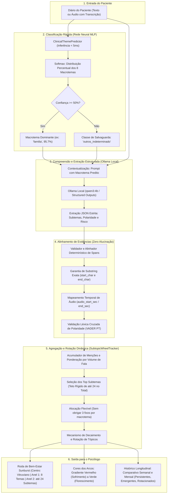
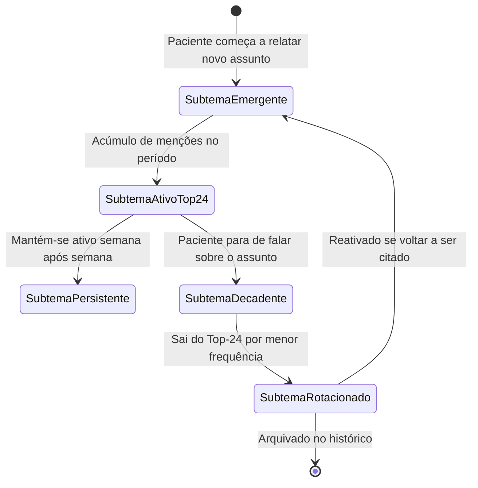

# Fluxo de Processamento do Agente 1 (Decomposição Temática e Roda de Bem-Estar)

Este documento descreve detalhadamente o fluxo de funcionamento do **Agente 1 (Decompositor Temático e Extrator de Evidências)**, sua integração com a **Rede Neural MLP** e o motor da **Roda de Bem-Estar (Sunburst Chart)**, modelado para fornecer ao psicólogo uma plataforma visual hierárquica, dinâmica e longitudinal.

---

## 1. Filosofia e Papel Clínico do Agente 1

O Agente 1 tem como missão exclusiva a **compreensão semântica profunda dos diários íntimos dos pacientes** e a **extração de subtemas granulares estruturados**, descartando a geração de sumários clínicos em texto corrido.

A saída do Agente 1 alimenta diretamente a **Roda de Bem-Estar** (Sunburst Chart concêntrico):
1. **Centro (Núcleo):** O paciente (representado pelo Homem Vitruviano).
2. **Anel Interno (Nível 1):** Os **8 Macrotemas Clínicos Padrão** classificados em milissegundos pela Rede Neural MLP (`familia`, `trabalho`, `relacionamentos`, `estudos`, `saude_sono`, `financas`, `luto`, `autoestima`).
3. **Anel Externo (Nível 2):** Os **Subtemas Específicos** identificados pelo Agente 1 a partir dos relatos (ex.: *Cobrança Paterna*, *Insônia Inicial*, *Sobrecarga de Metas*).
4. **Teto de 24 Subtemas no Total:** A plataforma acomoda no máximo 24 subtemas ativos simultaneamente, distribuídos livremente entre os macrotemas de acordo com o que o paciente mais fala.
5. **Comportamento Rotativo:** Subtemas entram, permanecem ou saem da roda conforme o paciente altera os assuntos de desabafo ao longo dos dias e semanas.
6. **Histórico Longitudinal:** Análise comparativa semanal e mensal permitindo ao psicólogo inspecionar a persistência, o surgimento ou a resolução de tópicos e a evolução da polaridade afetiva (vermelho a verde).

---

## 2. Fluxograma Ponta a Ponta (End-to-End)

O diagrama abaixo detalha o processamento desde o envio do relato até a geração dos dados da Roda Sunburst e do histórico comparativo.



---

## 3. Estrutura da Roda de Bem-Estar (Sunburst Wheel)

Inspirada no modelo concêntrico do **MIT ImpactBench** e na tradição humanista da psicologia, a visualização organiza as informações em três círculos concêntricos:

```
                                ┌─────────────────────────┐
                                │   SUBTEMAS ESPECÍFICOS  │
                                │   (Anel Externo - N2)   │
                                ├─────────────────────────┤
                                │   8 MACROTEMAS CLÍNICOS │
                                │   (Anel Interno - N1)   │
                                ├─────────────────────────┤
                                │  PACIENTE / VITRUVIANO  │
                                │      (Centro - N0)      │
                                └─────────────────────────┘
```

### 3.1. Nível 0: Centro (Homem Vitruviano)
* Representa o paciente em sua integridade bio-psico-social.
* Ponto de ancoragem para a navegação do psicólogo.

### 3.2. Nível 1: Anel Interno (Os 8 Macrotemas Clínicos da Rede Neural)
Os setores fixos do primeiro anel correspondem aos temas treinados e validados na Rede Neural:
1. `familia` (relações domésticas e dinâmicas parentais)
2. `trabalho` (ambiente profissional, metas, chefia e carreira)
3. `relacionamentos` (vida afetiva, parcerias amorosas, amizades)
4. `estudos` (vida acadêmica, provas, pressão formativa)
5. `saude_sono` (qualidade do sono, queixas somáticas, energia física)
6. `financas` (segurança material, gestão de dívidas, orçamento)
7. `luto` (processos de perda, despedida e transição de vida)
8. `autoestima` (autoimagem corporal, autocrítica e senso de valor pessoal)

### 3.3. Nível 2: Anel Externo (Até 24 Subtemas Ativos)
* **Ponderação por Fala:** A largura do arco é diretamente proporcional à quantidade de vezes e à intensidade com que o paciente falou sobre o assunto.
* **Alocação Dinâmica:** Se o paciente desabafar reiteradamente sobre o trabalho e a família nesta semana, o macrotema `trabalho` pode ter **7 subtemas** e `familia` pode ter **6**, enquanto `luto` ou `financas` podem ter **0 subtemas** na borda externa.
* **Gradiente Afetivo (Cores dos Arcos):**
  * **Vermelho Forte (`#E53935`):** Sofrimento agudo, angústia, raiva, desespero (polaridade $\le -0.6$).
  * **Coral / Vermelho Claro (`#E57373`):** Preocupação, frustração moderada (polaridade entre $-0.6$ e $-0.25$).
  * **Âmbar / Amarelo (`#FFD54F`):** Neutro, ambivalência, relato descritivo (polaridade entre $-0.25$ e $+0.25$).
  * **Verde Claro (`#81C784`):** Alívio, bem-estar incipiente, calma (polaridade entre $+0.25$ e $+0.6$).
  * **Verde Escuro (`#388E3C`):** Florescimento, conquista, superação, gratidão (polaridade $\ge +0.6$).

---

## 4. Dinâmica de Rotação e Histórico Longitudinal

Conforme o paciente envia diários ao longo das semanas e dos meses, o motor do Agente 1 rastreia o ciclo de vida de cada subtema:



### 4.1. Quadrantes da Análise Longitudinal para o Psicólogo

| Categoria | Definição Clínica | Implicação para a Consulta |
| :--- | :--- | :--- |
| **Subtemas Persistentes** | Presentes tanto no período anterior quanto no atual. | Indicam **focos crônicos de atenção** ou tópicos nucleares da queixa do paciente (ex.: *Insônia* há 4 semanas). |
| **Subtemas Emergentes (Novos)** | Não existiam no período anterior e entraram no Top-24 atual. | Novos acontecimentos de vida, **gatilhos recentes** ou novas áreas exploradas pelo paciente. |
| **Subtemas Rotacionados (Esquecidos)** | Estavam ativos no período anterior e saíram da roda atual. | Pode representar **resolução do conflito**, alívio de sintomas ou **esquiva cognitiva**. |
| **Variação da Polaridade ($\Delta$ Sentimento)** | O subtema permaneceu ativo, mas mudou de tom afetivo. | Mensuração objetiva de melhora (ex.: *Insônia* mudando de vermelho para verde após higiene do sono). |

---

## 5. Arquitetura de Código e Contratos

A implementação reside no pacote [`agents/extractor/`](file:///C:/Users/BLU8CA/Projects/PUC/challenge-2-base/agents/extractor):

### 5.1. Contratos de Dados ([`agents/extractor/contracts.py`](file:///C:/Users/BLU8CA/Projects/PUC/challenge-2-base/agents/extractor/contracts.py))
* [`MacroTema`](file:///C:/Users/BLU8CA/Projects/PUC/challenge-2-base/agents/extractor/contracts.py#L16): Enum com os 8 macrotemas clínicos + salvaguarda.
* [`EvidenceSpan`](file:///C:/Users/BLU8CA/Projects/PUC/challenge-2-base/agents/extractor/contracts.py#L116): Citação literal, índices de caractere (`start_char`, `end_char`) e carimbos de áudio (`audio_start_sec`, `audio_end_sec`).
* [`SubTemaItem`](file:///C:/Users/BLU8CA/Projects/PUC/challenge-2-base/agents/extractor/contracts.py#L131): Nome do subtema, contextualização e lista de evidências literais.
* [`Agent1Output`](file:///C:/Users/BLU8CA/Projects/PUC/challenge-2-base/agents/extractor/contracts.py#L168): Envelope completo da extração de cada diário.

### 5.2. Motor da Roda Sunburst ([`agents/extractor/wheel.py`](file:///C:/Users/BLU8CA/Projects/PUC/challenge-2-base/agents/extractor/wheel.py))
* [`SubtopicWheelTracker`](file:///C:/Users/BLU8CA/Projects/PUC/challenge-2-base/agents/extractor/wheel.py#L110): Gerenciador que impõe o teto de 24 subtemas no total, pondera frequências e gerencia rotação.
* [`build_wheel(...)`](file:///C:/Users/BLU8CA/Projects/PUC/challenge-2-base/agents/extractor/wheel.py#L125): Constrói a estrutura [`SunburstWheelData`](file:///C:/Users/BLU8CA/Projects/PUC/challenge-2-base/agents/extractor/wheel.py#L77) com vetores de `ids`, `labels`, `parents`, `values` e `colors` pronta para Plotly, ECharts ou Streamlit.
* [`compare_periods(...)`](file:///C:/Users/BLU8CA/Projects/PUC/challenge-2-base/agents/extractor/wheel.py#L248): Gera o comparativo longitudinal [`LongitudinalComparison`](file:///C:/Users/BLU8CA/Projects/PUC/challenge-2-base/agents/extractor/wheel.py#L98) semanal e mensal.

### 5.3. Serviço do Agente 1 ([`agents/extractor/service.py`](file:///C:/Users/BLU8CA/Projects/PUC/challenge-2-base/agents/extractor/service.py))
* [`process(...)`](file:///C:/Users/BLU8CA/Projects/PUC/challenge-2-base/agents/extractor/service.py#L52): Executa a chamada ao Ollama local com Structured Outputs.
* [`process_with_neural_network(...)`](file:///C:/Users/BLU8CA/Projects/PUC/challenge-2-base/agents/extractor/service.py#L127): Orquestração unificada (Rede Neural $\to$ Agente 1).
* [`build_wheel_data(...)`](file:///C:/Users/BLU8CA/Projects/PUC/challenge-2-base/agents/extractor/service.py#L149): Ponto de entrada de alto nível para gerar a roda do paciente.
* [`compare_history(...)`](file:///C:/Users/BLU8CA/Projects/PUC/challenge-2-base/agents/extractor/service.py#L164): Ponto de entrada para comparação longitudinal de períodos.

---

## 6. Exemplo Prático de Execução

Considerando uma semana real de desabafos de um paciente universitário:

```python
from agents.extractor.service import Agent1Service

service = Agent1Service()

# 1. Constrói a Roda de Bem-Estar com os relatos da semana
wheel = service.build_wheel_data(
    entries=diarios_semana_2,
    patient_id="PAC-8419",
    periodo="Semana 2 - Nov/2026",
    max_subtemas=24,
)

print(f"Total de Subtemas Ativos na Roda: {wheel.total_subtemas_ativos} (máx 24)")
for macro in wheel.macrotemas:
    if macro.subtemas:
        sub_nomes = [s.nome for s in macro.subtemas]
        print(f"- {macro.nome_exibicao}: {sub_nomes} | Polaridade: {macro.polaridade_media:+.2f}")
```

**Resultado Produzido:**
```
Total de Subtemas Ativos na Roda: 5 (máx 24)
- Família: ['Cobrança Paterna'] | Polaridade: -0.65 (Vermelho)
- Estudos: ['Pressão de Provas', 'Medo de Reprovação'] | Polaridade: -0.58 (Coral)
- Relacionamentos: ['Solidão e Isolamento'] | Polaridade: -0.40 (Coral)
- Saúde & Sono: ['Caminhada Restaurativa'] | Polaridade: +0.50 (Verde)
```

**Comparativo Longitudinal (Semana 2 vs. Semana 1):**
```
Histórico Longitudinal (Semana 2 vs. Semana 1):
- Subtemas Ativos Atuais: 5 (máx 24)
- Subtemas Persistentes: ['Pressão de Provas'] (continua como queixa central)
- Novos Subtemas Emergentes: ['Caminhada Restaurativa'] (iniciou prática de autocuidado)
- Subtemas Rotacionados: ['Conflito com Irmão'] (deixou de ser mencionado esta semana)
- Índice de Rotatividade Temática: 40.0%
- Evolução de Polaridade em 'Pressão de Provas': +0.15 (ligeira redução da ansiedade)
```
