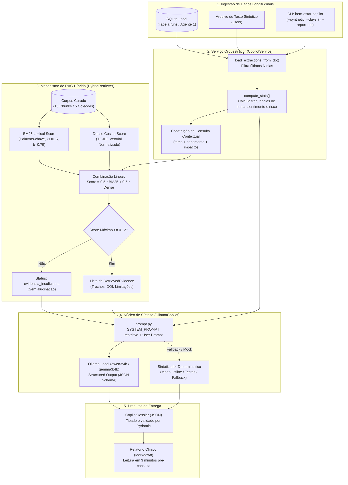

# Arquitetura Técnica e Funcional do Agente 2 (Copiloto com RAG)

> **Status Atual:** 🟢 **Implementado e Totalmente Funcional**  
> **Versão do Esquema:** `1.0.0` | **Versão do Prompt:** `1.0.0`  
> **Suíte de Testes:** 96/96 testes aprovados (18 específicos do Agente 2 + 78 do Agente 1)  
> **Avaliação RAG:** Recall@4: `1.0` (100%) | Taxa de Abstenção: `1.0` (100%) | Acurácia Geral: `1.0` (100%)  
> **Conformidade de Estilo:** 100% verificado via `ruff check`

---

## 1. Visão Geral da Arquitetura

O **Agente 2** opera como um copiloto de inteligência e síntese para terapeutas e psicólogos. Ele consome séries temporais de relatos previamente processados pelo **Agente 1** (localizados no banco SQLite local), agrega os dados comportamentais, consulta uma base de conhecimento científica via **RAG Híbrido** e gera um **Dossiê Longitudinal Estruturado** em JSON e Markdown.



---

## 2. Contratos de Dados Pydantic (`agents/copilot/contracts.py`)

Todos os dados trafegados no Agente 2 são rigorosamente tipados com validação Pydantic v2 e rejeição de campos desconhecidos (`extra="forbid"`):

### 2.1. Níveis Epistêmicos e Dimensões do ImpactBench
```python
class EvidenceTier(str, Enum):
    RESULTADO_EMPIRICO = "resultado_empirico_observado"
    ASSOCIACAO = "associacao_sem_causalidade"
    RECOMENDACAO_NORMATIVA = "recomendacao_normativa"
    MODELO_RISCO_SIMULADO = "modelo_de_risco_simulado"
    LIMITACAO_METODOLOGICA = "limitacao_metodologica"
    FRAMEWORK_CONCEITUAL = "framework_conceitual"

class ImpactBenchDimension(str, Enum):
    BEM_ESTAR_EMOCIONAL = "bem_estar_emocional"
    AUTONOMIA_AGENCIA = "autonomia_agencia"
    CONEXAO_SOCIAL = "conexao_social"
    PENSAMENTO_CRITICO = "pensamento_critico"
    DEPENDENCIA_IA = "dependencia_ia"
```

### 2.2. Modelo de Chunk e Evidência Rastreável
```python
class KnowledgeChunk(BaseModel):
    chunk_id: str
    document_id: str
    collection: str
    title: str
    authors: list[str]
    institution: str
    year: int
    source_type: str
    evidence_tier: EvidenceTier
    target_age_group: str
    dimension_tags: list[str]
    methodology: str
    country_context: str
    section: str
    doi_or_url: str
    text: str
    limitations: str

class RetrievedEvidence(BaseModel):
    chunk_id: str
    title: str
    institution: str
    year: int
    evidence_tier: EvidenceTier
    doi_or_url: str
    claim_ou_trecho: str
    limitacoes: str
```

### 2.3. Estatísticas Longitudinais e Dossiê Final
```python
class LongitudinalStats(BaseModel):
    periodo_dias: int = Field(ge=1)
    total_relatos: int = Field(ge=0)
    temas_frequencia: dict[str, int]
    sentimentos_frequencia: dict[str, int]
    indicios_risco_frequencia: dict[str, int]
    tema_dominante: str
    sentimento_dominante: str
    sinal_risco_detectado: bool

class CopilotDossier(BaseModel):
    dossie_id: str = Field(default_factory=lambda: f"dos_{uuid4().hex[:12]}")
    created_at: datetime = Field(default_factory=lambda: datetime.now(UTC))
    synthetic: Literal[True] = True
    stats: LongitudinalStats
    sintese_narrativa: str
    impactbench_analise: list[ImpactBenchAnalysis]
    evidencias_cientificas: list[RetrievedEvidence]
    questoes_para_o_terapeuta: list[str]
    lacunas_e_abstencoes: list[str]
    status_evidencia: Literal["evidencia_suficiente", "evidencia_parcial", "evidencia_insuficiente"]
    aviso_epistemico: str
```

---

## 3. Módulos e Funções Implementadas

### 3.1. `agents/copilot/retriever.py` (Recuperador Híbrido)
- `_normalize(text: str) -> list[str]`: Remove acentos (NFKD), pontuações e filtra stopwords em português e inglês.
- `_score_bm25(query_tokens, k1=1.5, b=0.75) -> list[float]`: Implementação padrão do algoritmo Okapi BM25 normalizado para $[0, 1]$.
- `_score_dense_cosine(query_tokens) -> list[float]`: Similaridade de cosseno com vetorização TF-IDF em memória dos títulos, textos, tags e instituições.
- `retrieve(query: str, top_k: int = 4, collection_filter: str = None) -> tuple[list[RetrievedEvidence], str]`:
  - Calcula $Score = 0.5 \cdot Score_{bm25} + 0.5 \cdot Score_{cosseno}$.
  - Se $Score_{max} < 0.12$ (limiar de abstenção), retorna lista vazia e status `"evidencia_insuficiente"`.

### 3.2. `agents/copilot/prompt.py` (Engenharia de Prompt)
- Contém o `SYSTEM_PROMPT` estrito que proíbe diagnósticos, obriga citação direta dos chunks e exige abstenção quando a base não cobre a consulta.
- Função `build_copilot_prompt(stats: LongitudinalStats, evidences: list[RetrievedEvidence]) -> str` que injeta o JSON estatístico do paciente e os blocos de evidência formatados com `[CHUNK_ID]`.

### 3.3. `agents/copilot/model.py` (Integração e Fallback)
- Classe `OllamaCopilot`:
  - `generate_dossier(stats, evidences, status_evidencia)`: Realiza a chamada ao Ollama com JSON Schema forçado (`format=CopilotDossier.model_json_schema()`).
  - `_generate_deterministic(...)`: Mecanismo que sintetiza o dossiê clínico via regras epistêmicas determinísticas quando `mock_mode=True` ou caso o servidor Ollama local esteja indisponível, garantindo que testes e pipelines CI rodem sem GPU em milissegundos.

### 3.4. `agents/copilot/service.py` (Orquestração do Copiloto)
- Classe `CopilotService`:
  - `load_extractions_from_db(db_path, days_window=7)`: Conecta ao SQLite gerado pelo Agente 1, verifica a tabela `runs`, decodifica o JSON de extração e filtra por janela temporal.
  - `compute_stats(extractions, days_window=7)`: Agrega dados com `collections.Counter` para extrair tema dominante, sentimento dominante e indício de risco.
  - `analyze(extractions, days_window=7)`: Constrói a query clínica, aciona o RAG e chama o modelo para gerar o dossiê.
  - `export_markdown_report(dossier: CopilotDossier) -> str`: Formata o dossiê em relatório Markdown pronto para impressão ou leitura em tela pelo psicólogo.

### 3.5. `agents/copilot/cli.py` (Interface de Linha de Comando)
- Ponto de entrada registrado no `pyproject.toml` como `bem-estar-copilot`.
- Flags aceitas:
  - `--synthetic`: Obrigatória (salvaguarda de dados sintéticos).
  - `--db <path>`: Caminho do banco SQLite do Agente 1 (padrão: `data/comparacao.sqlite3`).
  - `--days <int>`: Janela de retroação (padrão: 7 dias).
  - `--file <path>`: Alternativa para alimentar extrações via arquivo JSONL direto.
  - `--mock`: Ativa modo determinístico sem Ollama.
  - `--report-md <path>`: Exporta o relatório Markdown formatado.
  - `--output <path>`: Salva o dossiê estruturado em JSON.

---

## 4. O Prompt Restritivo do Agente 2 (`SYSTEM_PROMPT`)

```text
Você é o Agente 2 do Projeto 007, um copiloto de inteligência e síntese de evidências científicas para psicólogos e terapeutas.
A proposta é apoiar a preparação da consulta clínica, analisando relatos semanais estruturados de jovens (12-25 anos).

DIRETRIZES DE SEGURANÇA E EPISTEMOLOGIA CLÍNICA:
1. RASTREABILIDADE TOTAL: Toda correlação teórica DEVE citar explicitamente os chunks recuperados ([chunk_id]).
2. DISTINÇÃO CATEGÓRICA OBRIGATÓRIA:
   - "Fatos Observados": Frequências e menções textuais dos relatos semanais.
   - "Evidência Científica": O que os estudos de referência (MIT, Harvard, USP, CFP) observaram.
   - "Hipóteses Exploratórias": Perguntas para o psicólogo humano investigar na sessão.
3. CAUSALIDADE vs. ASSOCIAÇÃO: Jamais afirme que um evento ou uso de IA causou um sintoma; use 'associação observada'.
4. NÃO DIAGNOSTIQUE: Jamais atribua transtornos psiquiátricos (ex: Depressão Maior, TAG) ou prescreva tratamentos.
5. ABSTENÇÃO: Se as evidências científicas fornecidas não cobrirem o tema, informe explicitamente nas lacunas.
6. ALINHAMENTO COM MIT IMPACTBENCH: Relacione os padrões às dimensões de Bem-Estar Emocional, Autonomia/Agência, Conexão Social e Pensamento Crítico.
```

---

## 5. Base de Conhecimento e Estrutura de Coleções

Os 13 documentos em [`knowledge_base/corpus.jsonl`](file:///C:/Users/BLU8CA/OneDrive%20-%20Bosch%20Group/Desktop/PUC/challenge-2-base/knowledge_base/corpus.jsonl) estão divididos nas seguintes coleções:

| Coleção | Documentos Centrais | Foco Clínico e Regulatório |
| :--- | :--- | :--- |
| `impacto_ia_bem_estar` | MIT ImpactBench (arXiv:2610.20690); MIT Resonance (AHs 2025) | Taxonomia de impacto psicossocial; diários assistidos por IA sem aconselhamento artificial. |
| `evidencias_psicossociais` | MIT Risk Simulation (arXiv:2511.08880); JMIR AI Meta-análise 2026; JAMA Pediatrics | Riscos de bajulação (*sycophancy*), dependência parassocial e quebra de mediação humana em jovens. |
| `digital_psychiatry_harvard` | Harvard Medical School / BIDMC (Dr. John Torous, 2025) | Mitigação do viés de recência inter-sessão; psiquiatria digital baseada em medição (*EMA*). |
| `pesquisa_brasil_usp` | ICMC-USP (Sandra Aluísio / Corpus SetembroBR); Tese USP Inclusão | Processamento de linguagem natural em português; marcadores de linguagem e contexto local. |
| `etica_governanca_cfp` | Resolução CFP nº 09/2024; LGPD (Lei 13.709/2018, Arts. 11 e 14) | Ato privativo do psicólogo; consentimento de responsáveis para menores de idade (12-17 anos). |

---

## 6. Validação e Qualidade (MLOps e RAG)

### 6.1. Suíte de Testes Automatizados (`uv run pytest`)
- **`test_copilot_contracts.py`:** Garante integridade de Enums, modelos e validadores de consistência.
- **`test_copilot_retriever.py`:** Testa normalização, carregamento do corpus, relevância BM25/Cosseno e abstenção ativa.
- **`test_copilot_service.py`:** Testa agregação estatística com `Counter` e geração de relatórios Markdown.
- **`test_copilot_cli.py`:** Testa a interface CLI, exigência da flag `--synthetic` e tratamento de erros de I/O.
- **`test_copilot_integration.py`:** Testa a colaboração multiagente: o Agente 1 grava 3 relatos sintéticos no SQLite e o Agente 2 consome o SQLite para gerar o Dossiê completo.
- **`test_rag_evaluator.py`:** Valida automaticamente as metas de qualidade do RAG.

### 6.2. Resultados do Avaliador de RAG (`evaluation/rag_evaluator.py`)
No arquivo de benchmark [`evaluation/rag_benchmarks.jsonl`](file:///C:/Users/BLU8CA/OneDrive%20-%20Bosch%20Group/Desktop/PUC/challenge-2-base/evaluation/rag_benchmarks.jsonl):
- **Consultas em escopo (7 consultas):**
  - Autonomia/ImpactBench $\rightarrow$ recuperou `mit_impactbench_01_framework`
  - Isolamento social $\rightarrow$ recuperou `mit_impactbench_02_social_connection`
  - Sycophancy e ruminação $\rightarrow$ recuperou `mit_risk_simulation_01_sycophancy`
  - Diário inter-sessão Harvard $\rightarrow$ recuperou `harvard_torous_01_digital_journaling`
  - PLN em português USP $\rightarrow$ recuperou `usp_icmc_01_nlp_mental_health`
  - Normas CFP $\rightarrow$ recuperou `cfp_resolucao_09_2024`
  - LGPD e menores $\rightarrow$ recuperou `brasil_lgpd_saude_menores`
  - **Recall@4:** **100% (`1.0`)**
- **Consultas fora de escopo (3 consultas para teste de abstenção):**
  - Prescrição farmacológica $\rightarrow$ status: `evidencia_insuficiente`
  - Arbitragem de criptomoedas $\rightarrow$ status: `evidencia_insuficiente`
  - Mecânica de motores $\rightarrow$ status: `evidencia_insuficiente`
  - **Taxa de Abstenção Correta:** **100% (`1.0`)**

---

## 7. Como Executar

### 7.1. Execução via Linha de Comando (CLI)
Com dados em um arquivo sintético ou no banco SQLite gerado pelo Agente 1:

```sh
# Usando banco SQLite do Agente 1
uv run bem-estar-copilot --synthetic --db data/comparacao.sqlite3 --days 7 --report-md results/relatorio.md

# Usando arquivo de exemplo sintético em modo offline
uv run bem-estar-copilot --synthetic --mock --days 7 --file data/synthetic/exemplo_semana_paciente.jsonl --output results/dossie.json --report-md results/relatorio.md
```

### 7.2. Executar a Avaliação Automatizada do RAG
```sh
uv run bem-estar-eval-rag --benchmarks evaluation/rag_benchmarks.jsonl --output results/rag_report.json
```

### 7.3. Executar Todos os Testes
```sh
uv run pytest -v
```
