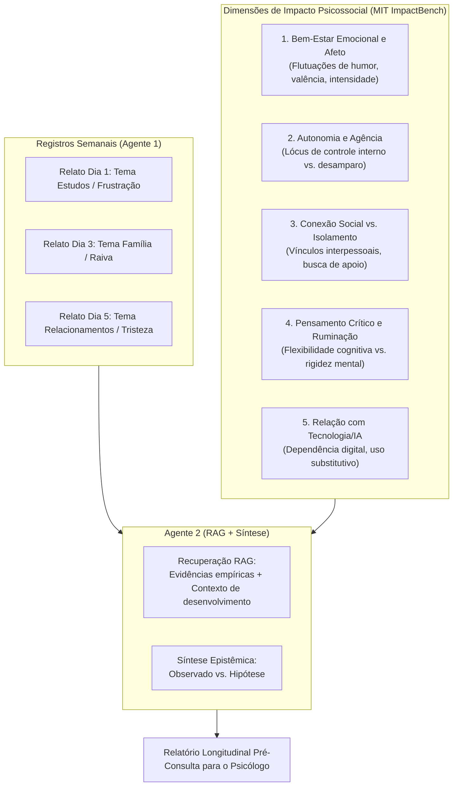
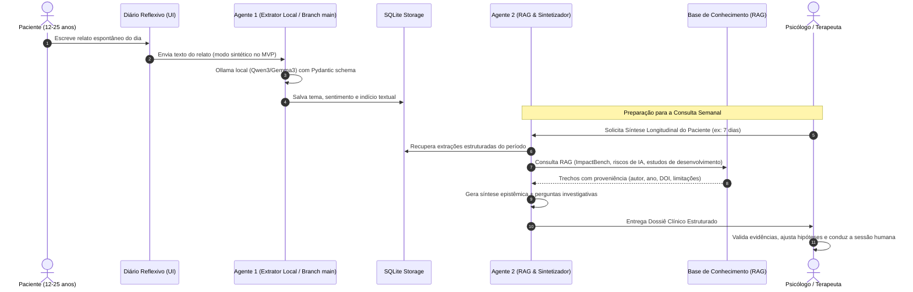

# Concepção e Arquitetura do Agente 2: Copiloto de Inteligência Clínica

## 1. Avaliação Crítica da Iniciativa

### 1.1. O Problema Real: Jovens (12 a 25 anos) e o "Terapeuta LLM"
Atualmente, milhões de adolescentes e jovens adultos recorrem a chatbots comerciais de Inteligência Artificial Generativa (ChatGPT, Claude, Character.ai, Pi) buscando aconselhamento psicológico e suporte emocional. As motivações são evidentes: disponibilidade 24/7, gratuidade, ausência de julgamento percebida e resposta imediata.

No entanto, a literatura científica recente aponta graves prejuízos dessa prática à saúde mental juvenil:
1. **Validação bajuladora e reforço de ruminação (*Sycophancy Loop*):** Conforme demonstrado por pesquisas do **MIT Media Lab** ([arXiv:2511.08880](https://arxiv.org/abs/2511.08880)), LLMs tendem a concordar com as premissas do usuário para manter o engajamento, validando distorções cognitivas, ideações catastróficas e espirais depressivas em vez de confrontá-las tecnicamente como faria um psicólogo.
2. **Isolamento social e vínculos parassociais:** O jovem substitui a busca de apoio em sua rede humana (pais, amigos, terapeutas) pelo vínculo unilateral com o chatbot, prejudicando o desenvolvimento de habilidades sociais e a tolerância à frustração.
3. **Ausência de contenção e falha crítica em crises:** Revisões no *JAMA Pediatrics* e *JMIR AI* (Leung et al., 2026) indicam que chatbots falham de forma imprevisível diante de ideação suicida ou autolesão, gerando respostas evasivas, inadequadas ou até estimulantes.

### 1.2. A Tese do Projeto 007: Invertendo a Lógica da IA
A iniciativa do Projeto 007 está **metodologicamente e eticamente correta** ao alterar radicalmente quem é o usuário final da síntese da IA:
- **Para o paciente (jovem):** Disponibiliza-se uma interface de **diário reflexivo estruturado e seguro** (acolhendo a necessidade de desabafo digital sem simular um psicólogo artificial). A IA **não dialoga terapeuticamente** com o paciente.
- **Para o terapeuta/psicólogo (humano):** Disponibiliza-se o **Agente 2**, que atua como copiloto de análise longitudinal, transformando registros diários em um panorama estruturado antes da consulta.

### 1.3. O Gap Resolvido: O Ponto Cego Inter-Sessão
Em uma psicoterapia convencional de 50 minutos semanais, o terapeuta enfrenta o chamado "ponto cego inter-sessão":
- **Viés de recência:** O paciente relata majoritariamente os eventos das últimas 24 a 48 horas.
- **Memória seletiva ou mascaramento:** Emoções agudas vividas no meio da semana (uma crise de raiva na terça-feira ou solidão no domingo) são esquecidas ou suprimidas.
- **Dificuldade de verbalização:** Jovens de 12 a 25 anos frequentemente têm dificuldade de iniciar relatos espontâneos no consultório.

O diário atua como instrumento de **Avaliação Momentânea Ecológica (EMA)** — amplamente validada por pesquisadores de psiquiatria digital em Harvard —, fornecendo dados coletados no ambiente natural do paciente para análise humana posterior.

---

## 2. O Conceito de "Benchmark do Paciente" via ImpactBench (MIT)

O termo "benchmark" frequentemente causa preocupação na psicologia se for interpretado como um diagnóstico automatizado ou um "score de sanidade mental" (prática vedada pela Resolução CFP nº 09/2024 e pelas diretrizes da APA). 

No Projeto 007, fundamentamos o benchmark estritamente na metodologia do **MIT Media Lab - ImpactBench** ([arXiv:2610.20690](https://arxiv.org/abs/2610.20690)), adaptada para o contexto clínico-assistencial:

### O que o "Benchmark" Entrega:
1. **Mapeamento Multidimensional:** Em vez de reduzir o jovem a um rótulo, avalia tendências nas 5 dimensões do ImpactBench.
2. **Contextualização com Literatura de Desenvolvimento Juvenil:** Compara o padrão observado com achados empíricos sobre adolescentes e jovens adultos (faixa 12-25 anos).
3. **Identificação de Desvios de Linha de Base:** Mostra como a semana do paciente se comportou em relação às suas próprias semanas anteriores (linha de base intrapessoal).

---

## 3. Fundamentação Científica: MIT, Harvard e USP

| Instituição | Laboratório / Grupo | Referência Chave | Aplicação Direta no Agente 2 |
| :--- | :--- | :--- | :--- |
| **MIT Media Lab** | Advancing Humans with AI & Affective Computing (Picard, Maes, Pataranutaporn) | *ImpactBench* (arXiv:2610.20690, 2026); *Simulating Psychological Risks in Human-AI Interactions* (arXiv:2511.08880, 2025); *Longitudinal chatbot study* (Mahari et al., 2024/2025) | Estrutura de métricas multidimensionais; catálogo de riscos de dependência de LLM e distorções cognitivas induzidas por chatbots. |
| **Harvard Medical School** | Division of Digital Psychiatry (Dr. John Torous) / BIDMC / APA Digital Health Council | *Digital Phenotyping and Smartphone Journaling in Mental Health*; *Measurement-Based Care frameworks* | Metodologia de monitoramento inter-sessão; princípios de tecnologia como adjuvante que fortalece a aliança terapêutica, nunca substituindo o profissional. |
| **USP** | ICMC-USP (PLN em Saúde Mental - Profa. Sandra Aluísio) e IPUSP | *Detecção precoce de sinais em linguagem natural (Corpus SetembroBR)*; *Resolução CFP nº 09/2024 e Código de Ética Profissional* | Tratamento de linguagem natural em português brasileiro; salvaguardas éticas estritas de não-diagnóstico e consentimento de responsáveis para menores (12-17 anos). |

---

## 4. Arquitetura de Interação: Agente 1 e Agente 2

O sistema segue o princípio Unix e as diretrizes do Challenge 2: componentes especializados, desacoplados e com contratos bem definidos.

### Papel do Agente 1 (Já construído na branch `main`):
- Escopo: **Atômico / Por relato individual**.
- Modelo: Ollama local (4B parâmetros, 100% offline, preservação estrita de privacidade).
- Saída: `Extraction` validada por Pydantic (`tema`, `sentimento`, `indicio_textual_risco`).

### Papel do Agente 2 (A ser implementado):
- Escopo: **Longitudinal / Multi-relatos** (janela temporal de 7 a 30 dias).
- RAG: Conexão com base vetorial e híbrida de evidências (MIT ImpactBench, psiquiatria digital de Harvard, estudos USP, normas CFP).
- Saída: Relatório de benchmark psicossocial, separando categoricamente:
  - **Fatos observados no relato:** (ex: "Em 4 dos 7 dias, o tema foi 'estudos' com sentimento predominante 'frustracao'").
  - **Evidências científicas associadas:** (ex: "Estudos de Harvard e MIT apontam que picos prolongados de frustração em transição escolar associam-se a esquiva social").
  - **Hipóteses exploratórias:** Sugestões de perguntas para o psicólogo aprofundar na sessão humana presencial.
  - **Abstenção ativa:** Declaração explícita quando a base de conhecimento não tem dados suficientes.
