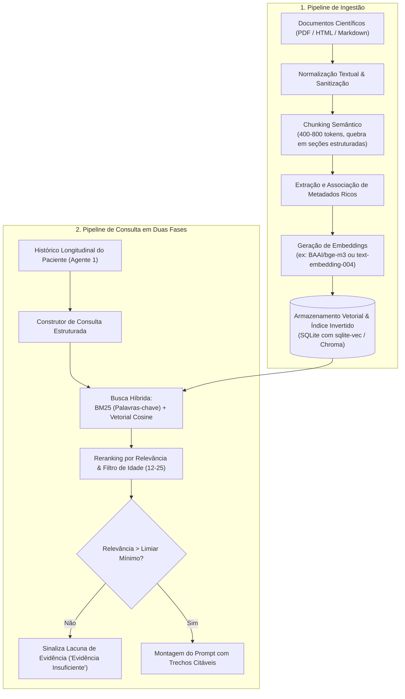

# Estratégia de RAG e Base de Conhecimento para o Agente 2

## 1. Visão Geral da Base de Conhecimento

O RAG (*Retrieval-Augmented Generation*) do Agente 2 não é um repositório genérico de páginas da internet. Ele funciona como uma **biblioteca clínica e psicossocial estritamente curada**, projetada para ancorar as observações do diário em evidências científicas peer-reviewed e normas profissionais vigentes.

O objetivo do RAG é combater ativamente a alucinação, impedir a arrogância diagnóstica do modelo e garantir rastreabilidade total (cada parágrafo gerado deve possuir proveniência explícita).

---

## 2. Organização das Coleções Lógicas

Para evitar contaminação semântica (por exemplo, tratar uma norma legal como resultado empírico ou uma hipótese teórica como fato comprovado), o corpus é particionado em 5 coleções:

| Coleção | Fontes Centrais | Tipos de Documentos | Finalidade na Geração |
| :--- | :--- | :--- | :--- |
| **`impacto_ia_bem_estar`** | MIT Media Lab (ImpactBench, arXiv:2610.20690) | Benchmarks, taxonomias de impacto, métricas psicossociais | Estruturar os relatórios do paciente nas dimensões de Bem-Estar, Agência, Conexão e Cognição. |
| **`evidencias_psicossociais`** | MIT Media Lab (arXiv:2511.08880), JAMA Pediatrics, JMIR AI (Leung et al., 2026), J. Adolescent Health | Ensaios controlados, revisões sistemáticas, estudos longitudinais | Correlacionar padrões de relato e uso de telas/chatbots com riscos documentados (ruminação, isolamento, dependência). |
| **`digital_psychiatry_harvard`** | Harvard Medical School / BIDMC (Dr. John Torous), APA Council on Digital Health | Artigos clínicos, diretrizes de *Measurement-Based Care*, estudos de diários digitais | Fornecer a metodologia de acompanhamento inter-sessão e limites da tecnologia como adjuvante terapêutico. |
| **`pesquisa_brasil_usp`** | ICMC-USP (PLN em saúde mental / SetembroBR), IPUSP, Teses USP | Dissertações, artigos de processamento de linguagem em português | Ajustar a interpretação textual para o contexto sociocultural e expressões idiomáticas de jovens brasileiros. |
| **`etica_governanca_cfp`** | CFP (Resolução nº 09/2024), LGPD (Lei 13.709/2018), APA Ethical Guidance, OMS (WHO) | Normativas, códigos de ética, leis de privacidade | Garantir salvaguardas éticas, aviso de supervisão humana e conformidade legal estrita para dados de menores (12-17 anos). |

---

## 3. Modelo de Dados e Metadados Ricos por Chunk

Cada documento ingerido é indexado com metadados estruturados para permitir **filtros pré-busca** (ex.: filtrar apenas estudos aplicáveis à faixa etária de 12 a 25 anos ou apenas normas vigentes no Brasil).

```json
{
  "chunk_id": "mit_impactbench_2026_sec_autonomy_01",
  "document_id": "mit_impactbench_arxiv_2610_20690",
  "collection": "impacto_ia_bem_estar",
  "title": "Open Benchmark of AI Impact on Humans",
  "authors": ["Pataranutaporn, P.", "Picard, R.", "Maes, P.", "et al."],
  "institution": "MIT Media Lab",
  "year": 2026,
  "source_type": "benchmark_metodologico",
  "evidence_tier": "framework_conceitual",
  "target_age_group": "jovens_e_adultos",
  "dimension_tags": ["autonomia_agencia", "dependencia_cognitiva"],
  "methodology": "painel_especialistas_e_simulacao",
  "country_context": "global",
  "section": "3.2 Metric Definition: Agency and Offloading",
  "doi_or_url": "https://doi.org/10.48550/arXiv.2610.20690",
  "text": "Conteúdo integral do fragmento textual extraído...",
  "limitations": "Taxonomia conceitual sujeita a calibração com dados empíricos locais."
}
```

### Rótulos Epistêmicos (*Evidence Tiers*)
- `resultado_empirico_observado`: Fato estatístico medido em estudo revisado.
- `associacao_sem_causalidade`: Correlação identificada (proibido apresentar como causa).
- `recomendacao_normativa`: Obrigação ética ou regulatória do CFP/OMS/APA.
- `modelo_de_risco_simulado`: Cenários de risco mapeados pelo MIT (ex.: simulação de adulação de chatbots).
- `limitacao_metodologica`: Advertência sobre viés ou amostra não generalizável.

---

## 4. Pipeline Técnico de Ingestão e Recuperação



### 4.1. Chunking Semântico
Em vez de quebrar os textos por contagem arbitrária de caracteres, a divisão respeita a estrutura acadêmica:
- **Resumo / Abstract**
- **Definição de Métricas / Conceitos**
- **Resultados e Estatísticas**
- **Limitações e Conflitos de Interesse**
Isso garante que um resultado nunca seja recuperado desprovido de suas limitações originais.

### 4.2. Busca Híbrida (*Hybrid Search*)
- **Busca Densa (Vetorial):** Capta nuances semânticas (ex.: associa "não tenho ânimo de sair do quarto" com a dimensão *Isolamento Social* do ImpactBench).
- **Busca Esparsa (BM25):** Garante precisão cirúrgica para termos técnicos exatos (ex.: "Resolução CFP 09/2024", "Sycophancy", "PHQ-9", "EMA").

---

## 5. Engenharia de Prompt e Salvaguardas contra Alucinação

O Agente 2 opera sob um contrato de **fundamentação estrita (*Closed-Domain RAG*)**:

```text
Você é o Agente 2 do Projeto 007, um assistente de inteligência e síntese de evidências 
para psicólogos e terapeutas. Você NÃO é terapeuta, NÃO atende pacientes e NÃO fornece diagnósticos.

DADOS DE ENTRADA:
- Resumo longitudinal das extrações do paciente dos últimos 7 a 30 dias (produzidas pelo Agente 1).
- Conjunto de trechos científicos recuperados da Base de Conhecimento [DOC_1, DOC_2, ...].

DIRETRIZES FUNDAMENTAIS:
1. RASTREABILIDADE TOTAL: Toda afirmação correlata deve conter a tag explícita da fonte (ex: [DOC_1, p. 14]).
2. DISTINÇÃO EPISTÊMICA OBRIGATÓRIA:
   - "Padrão Textual do Paciente": O que foi relatado nos diários.
   - "Evidência Científica": O que a literatura demonstrou.
   - "Hipótese de Exploração": Pergunta sugerida para o terapeuta humano explorar na consulta.
3. CAUSALIDADE vs. ASSOCIAÇÃO: Jamais afirme que "o uso do celular causou a ansiedade". Trate apenas como associação observada.
4. ABSTENÇÃO ATIVA: Se os trechos recuperados não oferecerem embasamento suficiente para o padrão analisado, declare categoricamente: "Não há evidências empíricas suficientes na base para este padrão".
5. TOM PROFISSIONAL E COLABORATIVO: Dirija-se sempre ao psicólogo com respeito à sua autonomia de conduta clínica.
```

---

## 6. Métricas de Avaliação do RAG (Framework RAGAS)

Para comprovar que o RAG está apto para suporte à saúde, ele deve ser auditado com métricas quantitativas contínuas:

1. **Context Recall (>= 0.85):** O retriever traz todas as referências fundamentais necessárias para aquele padrão de queixa?
2. **Context Precision (>= 0.90):** Os trechos recuperados são prioritariamente relevantes, sem lixo informacional?
3. **Faithfulness / Groundedness (>= 0.98):** 100% das afirmações científicas do Agente 2 estão apoiadas estritamente nos trechos recuperados? (Alucinação intolerável).
4. **Answer Relevance (>= 0.90):** As hipóteses geradas são úteis para o roteiro de perguntas do psicólogo?
5. **Taxa de Abstenção Correta:** Medida em cenários propositalmente sem resposta na base, onde o modelo deve se abster em 100% dos casos.
