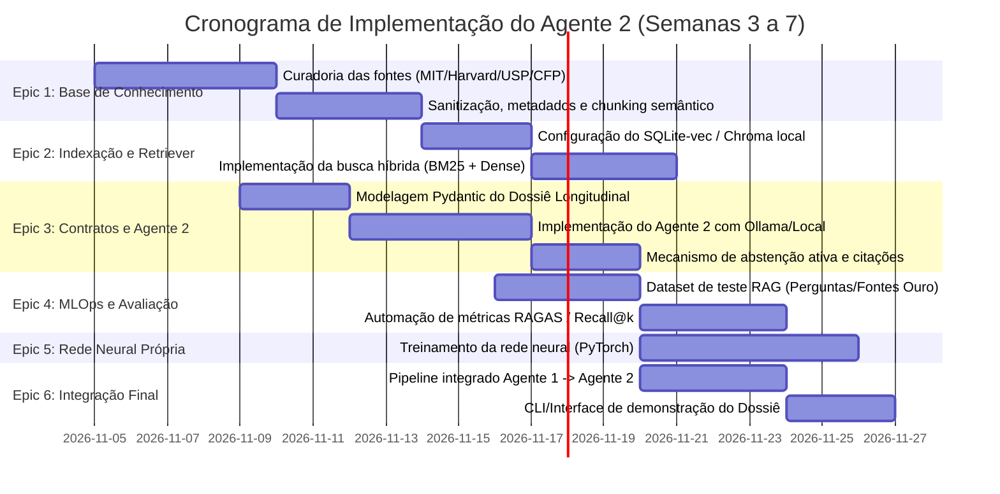

# Plano de Implementação e Backlog de Tarefas: Agente 2

## 1. Alinhamento com os Requisitos do Challenge 2

A implementação do Agente 2 completa os critérios centrais exigidos no Challenge 2:

| Requisito do Challenge | Como o Agente 2 e o RAG Atendem | Evidência Técnica |
| :--- | :--- | :--- |
| **Pelo menos 2 agentes colaborando** | O Agente 1 extrai metadados atômicos; o Agente 2 consome uma janela temporal dessas extrações para gerar síntese longitudinal e contextualização clínica. | Teste de integração end-to-end `tests/test_agent_collaboration.py`. |
| **Base de conhecimento** | RAG estruturado com 5 coleções curadas (MIT ImpactBench, Harvard Digital Psychiatry, USP, normas CFP). | Diretório `knowledge_base/` com metadados versionados e indexação vetorial. |
| **MLOps aplicado** | Rastreamento de versões do corpus, modelos de embedding, prompts e métricas contínuas de fidelidade/recuperação. | Pipeline de avaliação reproduzível em `mlops/` com logs e métricas. |
| **Rede neural construída pelo grupo** | Treinamento de uma rede neural própria (ex.: MLP/PyTorch) para classificação prévia de risco textual ou classificador de relevância/reranker. | Código de treinamento, baseline e avaliação em `models/`. |
| **Uso de API pelos agentes** | Chamadas controladas entre agentes ou integração via API estruturada (REST/FastAPI). | Módulos de clientes de API com tratamento de erros, timeout e schema validation. |
| **Solução ética e explicável** | Separação epistêmica estrita (observado vs. hipótese vs. evidência) e rastreabilidade com DOIs. | Saída estruturada Pydantic com citações diretas e aviso de supervisão humana. |

---

## 2. Backlog Detalhado de Tarefas (Epics e Sprints)

---

### Epic 1: Curadoria e Preparação da Base de Conhecimento
- [ ] **TASK-1.1: Validação das Fontes Primárias**
  - *Descrição:* Obter o texto integral e verificar licença das publicações prioritárias:
    - MIT Media Lab: ImpactBench (arXiv:2610.20690) e Simulação de Riscos Psicológicos (arXiv:2511.08880).
    - Harvard Digital Psychiatry (Torous et al.): Estudos de diários e EMA.
    - USP (ICMC / NILC): Trabalhos de detecção em português (Corpus SetembroBR).
    - CFP: Resolução nº 09/2024 e Código de Ética Profissional.
  - *Critério de Aceite:* Arquivos salvos em `knowledge_base/raw/` com arquivo `manifest.json` contendo DOI, autores, ano e status de licença.
- [ ] **TASK-1.2: Chunking Semântico e Extração de Metadados**
  - *Descrição:* Desenvolver script de pré-processamento que quebre os artigos por seções (Metodologia, Resultados, Limitações) e anexe metadados (faixa etária, tier de evidência).
  - *Critério de Aceite:* Chunks de 400 a 800 tokens armazenados em `knowledge_base/processed/chunks.jsonl`.

---

### Epic 2: Indexação Vetorial e Pipeline de Recuperação
- [ ] **TASK-2.1: Implementação da Vector Store Local**
  - *Descrição:* Integrar armazenamento vetorial reproduzível e sem custos de nuvem (ex.: `sqlite-vec` ou ChromaDB em modo local embutido).
  - *Critério de Aceite:* Banco vetorial inicializado localmente, respeitando a premissa offline-first do projeto.
- [ ] **TASK-2.2: Busca Híbrida (Dense + BM25)**
  - *Descrição:* Criar módulo `agents/rag/retriever.py` com busca combinada (vetorial por cosseno + esparsa por palavras-chave com BM25) e filtros de metadados.
  - *Critério de Aceite:* Função `retrieve(query: str, top_k: int = 5, filters: dict = None) -> list[DocumentChunk]`.

---

### Epic 3: Contratos e Implementação do Agente 2
- [ ] **TASK-3.1: Definição dos Contratos Pydantic do Agente 2**
  - *Descrição:* Criar `agents/copilot/contracts.py` definindo:
    - `LongitudinalInput`: Série temporal de `Extraction` geradas pelo Agente 1 (7 a 30 dias).
    - `GroundedClaim`: Afirmação com citação da fonte, tipo de evidência e limitações.
    - `CopilotDossier`: Síntese longitudinal, dimensões do ImpactBench, achados RAG, perguntas investigativas para o psicólogo e sinalização de abstenção.
  - *Critério de Aceite:* Schemas 100% tipados, com validação estrita de integridade epistêmica (`extra="forbid"`).
- [ ] **TASK-3.2: Orquestração do Agente 2 com LLM Local**
  - *Descrição:* Implementar o núcleo de geração em `agents/copilot/agent.py` utilizando Ollama local e prompt restritivo de fidelidade aos chunks.
  - *Critério de Aceite:* Execução sem alucinação, incluindo tratamento para abstenção quando a relevância dos chunks for inferior a limiar pré-definido.

---

### Epic 4: MLOps e Avaliação do RAG
- [ ] **TASK-4.1: Construção do Dataset de Avaliação (Ground Truth)**
  - *Descrição:* Criar 25 a 30 pares sintéticos de (Padrão Longitudinal -> Fontes Esperadas -> Perguntas Ideais para Terapeuta) para teste de regressão.
  - *Critério de Aceite:* Dataset versionado em `evaluation/rag_benchmarks.jsonl`.
- [ ] **TASK-4.2: Script de Avaliação Automatizada de RAG**
  - *Descrição:* Implementar rotina de cálculo de Recall@5, Faithfulness (fidelidade às fontes) e taxa de abstenção correta.
  - *Critério de Aceite:* Comando executável `uv run bem-estar-evaluate-rag` gerando relatório JSON estruturado.

---

### Epic 5: Rede Neural Construída pelo Grupo (Requisito do Challenge)
- [ ] **TASK-5.1: Modelo Neural Complementar em PyTorch**
  - *Descrição:* Desenvolver e treinar uma rede neural simples (ex.: classificador de embedding feedforward ou LSTM/Transformer leve) para reranking de relevância clínica dos chunks ou como detector inicial de intensidade emocional.
  - *Critério de Aceite:* Scripts de treino, teste, matriz de confusão e baseline comparativo salvos em `models/`.

---

### Epic 6: Integração End-to-End e Interface CLI
- [ ] **TASK-6.1: Pipeline Integrado Agente 1 + Agente 2**
  - *Descrição:* Criar pipeline que recebe uma pasta ou lote de relatos do diário, executa o Agente 1 em lote, persiste no SQLite e dispara o Agente 2 para gerar o Dossiê para o terapeuta.
  - *Critério de Aceite:* Comando `uv run bem-estar-copilot --patient-id <id> --days 7 --output dossie.json`.
- [ ] **TASK-6.2: Testes Automatizados Unitários e de Integração**
  - *Descrição:* Garantir cobertura de testes para todo o fluxo de recuperação, geração e persistência sem dependência de internet.
  - *Critério de Aceite:* `uv run pytest` aprovado com 100% dos testes passando.
