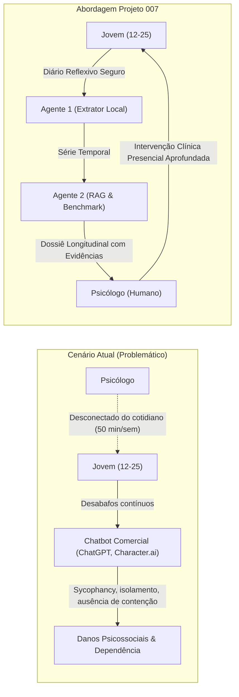

# Valor Agregado, Impacto Clínico e Governança Ética do Agente 2

## 1. Proposta de Valor: Por que o Agente 2 Transforma a Relação Terapêutica?

O Agente 2 atua como uma ponte inteligente entre o comportamento cotidiano do jovem de 12 a 25 anos e a prática clínica do psicólogo. Ele não compete com o profissional; ele amplifica a capacidade diagnóstica e relacional humana.



---

## 2. Benefícios Estruturados por Stakeholder

### 2.1. Para o Psicólogo / Terapeuta
1. **Eliminação do Ponto Cego Inter-Sessão:** Acesso à evolução dos sentimentos e temas ao longo dos dias, identificando gatilhos específicos que ocorreram no meio da semana e seriam esquecidos na consulta.
2. **Eficiência na Preparação Pré-Consulta:** O profissional não precisa ler páginas e páginas de relatos brutos e desestruturados. Em **3 a 5 minutos**, ele analisa o Dossiê Longitudinal do Agente 2 com tendências gráficas e destaques temáticos.
3. **Prática Baseada em Evidências (PBE) em Tempo Real:** Conexão direta dos sintomas e queixas do paciente com achados recentes de centros de excelência (MIT Media Lab, Harvard, USP), com links diretos para leitura dos papers originais.
4. **Formulação de Hipóteses Orientadas:** O Agente 2 sugere eixos de investigação reflexivos (ex.: *"O paciente registrou frustração no tema 'estudos' em dias consecutivos antes de provas; considerar explorar estratégias de enfrentamento e perfeccionismo disfuncional"*).

### 2.2. Para o Paciente Jovem (12 a 25 anos)
1. **Canal Digital Familiar e Seguro:** O jovem mantém o hábito expressivo digital de registrar seus sentimentos no celular, sem o risco de criar vínculos parassociais ou ilusões com uma entidade artificial.
2. **Sensação Real de Ser Escutado e Compreendido:** Ao chegar na sessão semanal, o paciente percebe que o psicólogo está ciente do que aconteceu nos dias difíceis, acelerando o vínculo e a eficácia da psicoterapia.
3. **Desenvolvimento de Autonomia e Consciência Emocional:** A escrita reflexiva diária, desprovida da bajulação algorítmica de chatbots, estimula o autoconhecimento genuíno (*reflective journaling*).

---

## 3. Matriz Comparativa de Mercado

| Critério | Chatbots de "Terapia" (ChatGPT, Character.ai) | Aplicativos Tradicionais de Humor (Daylio, etc.) | **Projeto 007 (Agente 1 + Agente 2)** |
| :--- | :--- | :--- | :--- |
| **Público-Alvo da Saída** | O próprio usuário vulnerável | O usuário (gráficos simples) | **O Psicólogo Profissional** (Copiloto) |
| **Risco de Bajulação / Sycophancy** | **Crítico** (LLM tende a validar delírios e ruminações) | Inexistente (sem LLM) | **Nulo** (o paciente não interage com LLM conversacional) |
| **Integração Clínica** | Nenhuma (atua como substituto clandestino) | Baixa (exportações em PDF genéricas) | **Nativa** (estruturado para a sessão presencial de 50 minutos) |
| **Fundamentação em Evidências** | Genérica, propensa a alucinações | Nenhuma | **RAG Científico** (MIT ImpactBench, Harvard, USP, CFP) |
| **Tratamento de Crises** | Errático e não auditável | Botões estáticos de emergência | **Sinalização estruturada para o profissional humano** |

---

## 4. Governança, Ética e Conformidade Jurídica

### 4.1. Resolução CFP nº 09/2024 e Código de Ética do Psicólogo
- **Ato Privativo e Indelegabilidade:** O diagnóstico psicológico e a intervenção psicoterapêutica são atos privativos de psicólogos habilitados (Lei nº 4.119/1962). O Agente 2 é expressamente categorizado como **instrumento de apoio tecnológico**, sem autonomia decisória.
- **Transparência e Consentimento:** O paciente e seu responsável legal devem ser informados de que os diários são processados por algoritmos locais para estruturação de dados antes da leitura pelo profissional.

### 4.2. LGPD e Proteção Específica para Menores (12 a 17 anos)
- **Art. 11 (Dados Sensíveis de Saúde):** Registros de saúde mental exigem tratamento com salvaguardas reforçadas. O MVP utiliza modelos locais e isolados (Ollama/SQLite criptografado), impedindo vazamento para nuvens de terceiros.
- **Art. 14 (Crianças e Adolescentes):** O tratamento de dados pessoais de menores de 18 anos exige o melhor interesse da criança/adolescente e o consentimento específico e em destaque dado por pelo menos um dos pais ou pelo responsável legal.

---

## 5. Exemplo de Dossiê Gerado pelo Agente 2 para o Terapeuta

```json
{
  "dossie_id": "dos_20261104_puc007_01",
  "periodo_analisado": {
    "inicio": "2026-10-28",
    "fim": "2026-11-03",
    "total_relatos": 6
  },
  "sintese_longitudinal_observada": {
    "temas_frequentes": [
      {"tema": "estudos", "contagem": 4, "percentual": 66.7},
      {"tema": "relacionamentos", "contagem": 2, "percentual": 33.3}
    ],
    "sentimentos_frequentes": [
      {"sentimento": "frustracao", "contagem": 3, "percentual": 50.0},
      {"sentimento": "preocupacao", "contagem": 2, "percentual": 33.3},
      {"sentimento": "calma", "contagem": 1, "percentual": 16.7}
    ],
    "evolucao_temporal": "Pico de frustração e preocupação registrado entre quinta e sexta-feira, coincidindo com menções a avaliações acadêmicas e isolamento social autodeclarado."
  },
  "alinhamento_impactbench_mit": {
    "dimensao_bem_estar_afetivo": "Valência negativa predominante nos dias úteis, com retorno à calma no domingo.",
    "dimensao_conexao_social": "Registros apontam esquiva de contato com colegas de sala após nota baixa.",
    "dimensao_agencia_autonomia": "Indícios de sensação de perda de controle sobre o desempenho acadêmico."
  },
  "evidencias_cientificas_recuperadas": [
    {
      "fonte": "MIT Media Lab (arXiv:2610.20690) - ImpactBench",
      "achado": "A dimensão de agência decresce acentuadamente quando jovens experimentam frustração crônica sem mecanismos de regulação interpessoal.",
      "tipo_evidencia": "framework_conceitual",
      "limitacoes": "Métrica em processo de validação clínica em larga escala."
    },
    {
      "fonte": "Harvard Medical School / Division of Digital Psychiatry (Torous et al., 2025)",
      "achado": "Registros momentâneos entre sessões capturam padrões de esquiva acadêmica com 3x mais precisão do que a memória retrospectiva na consulta semanal.",
      "tipo_evidencia": "resultado_empirico_observado",
      "limitacoes": "Estudo conduzido com universitários norte-americanos."
    }
  ],
  "questoes_exploratorias_para_o_terapeuta": [
    "Como o paciente percebeu o impacto das avaliações acadêmicas da última semana sobre sua disposição física?",
    "Explorar o papel dos amigos: quando sentiu frustração na quinta-feira, o paciente considerou procurar alguém ou preferiu ficar isolado?",
    "Identificar se há crenças disfuncionais de desempenho subjacentes à queixa de estudos."
  ],
  "aviso_epistemico": "Este dossiê é gerado por inteligência artificial para fins de síntese informacional e não constitui diagnóstico clínico, prognóstico ou prescrição. Toda conduta é de responsabilidade exclusiva do psicólogo responsável."
}
```
