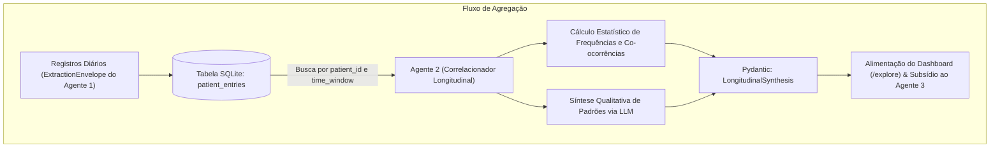

# Guia de Desenvolvimento: Agente 2 (Correlacionador Longitudinal e Analista de Padrões)

## 1. Identificação e Propósito do Agente
* **Arquivo no Código:** `agents/correlator/service.py` e `agents/correlator/prompt.py`
* **Contrato de Dados:** `agents/correlator/contracts.py`
* **Objetivo Primário:** Agregar e analisar múltiplos registros históricos do mesmo paciente produzidos pelo **Agente 1** ao longo de uma janela temporal (7, 14 ou 30 dias). Identificar correlações entre subtemas e valências emocionais (ex: *"Sempre que o subtema 'Irmão' é mencionado, a polaridade cai para -0.7 e surge correlação com insônia no tema 'Saúde & Sono'"*), mapear trajetórias longitudinais e destacar fatores protetivos (recursos positivos) versus fatores de estresse recorrentes.
* **Por que este componente existe?** Atende diretamente à **Constraint 1 (Pelo menos 2 agentes que trabalhem juntos)** e à **Constraint 7 (Explicabilidade)**. O psicólogo não tem tempo de ler dezenas de relatos isolados antes da consulta. O Agente 2 sintetiza as dinâmicas temporais no estilo do MIT ImpactBench, permitindo que a sessão de terapia comece com foco cirúrgico nos padrões da semana.

---

## 2. Diagrama de Integração entre Agentes



---

## 3. Contratos de Dados (Pydantic V2)

Crie o arquivo `agents/correlator/contracts.py`:

```python
from datetime import date
from typing import Dict, List, Optional
from pydantic import BaseModel, ConfigDict, Field

class SubtemaFrequency(BaseModel):
    model_config = ConfigDict(extra="forbid", strict=True)
    nome: str
    macro_tema: str
    total_mencoes: int = Field(ge=1)
    sentimento_mais_comum: str
    polaridade_media: float = Field(ge=-1.0, le=1.0)
    primeira_ocorrencia: date
    ultima_ocorrencia: date

class TemporalCorrelation(BaseModel):
    model_config = ConfigDict(extra="forbid", strict=True)
    origem_subtema: str
    impacto_observado: str
    explicacao: str = Field(description="Exemplo: Conflito com irmão coincidiu com noites de insônia")
    forca_evidencia: float = Field(ge=0.0, le=1.0)

class LongitudinalSynthesis(BaseModel):
    model_config = ConfigDict(extra="forbid", strict=True)
    patient_id: str
    janela_dias: int
    data_inicio: date
    data_fim: date
    total_relatos_processados: int
    distribuicao_polaridade: Dict[str, float] = Field(
        description="Porcentagem de registros: {'positivo': 0.2, 'neutro': 0.3, 'negativo': 0.5}"
    )
    ranking_subtemas: List[SubtemaFrequency]
    correlacoes_identificadas: List[TemporalCorrelation]
    fatores_de_protecao: List[str] = Field(
        description="Momentos de alívio, bem-estar ou estratégias adaptativas relatadas"
    )
    pontos_de_atencao_sessao: List[str] = Field(
        description="Hipóteses e temas prioritários para o terapeuta abordar na consulta"
    )
```

---

## 4. Prompt de Síntese Clínica do Agente 2

Crie o arquivo `agents/correlator/prompt.py`:

```python
AGENT2_SYSTEM_PROMPT = """Você é o Agente de Síntese Longitudinal e Padrões Clínicos.
Sua função é analisar o histórico de registros psicológicos estruturados de um paciente e identificar trajetórias temporais, gatilhos de estresse e fatores de resiliência.

DIRETRIZES FUNDAMENTAIS:
1. FOCO NO TEMPO: Analise como os sentimentos evoluíram do início para o fim do período. Houve estabilização, piora súbita ou alívio?
2. CORRELAÇÕES ENTRE ÁREAS: Identifique como um evento em uma área (ex: família) repercutiu em outra (ex: sono ou trabalho).
3. PERSPECTIVA DE FLORESCIMENTO (IMPACTBENCH): Não aponte apenas problemas. Mapeie expressamente os "Fatores de Proteção" (momentos em que o paciente relatou calma, conexão afetiva ou superação).
4. SUGIRA PONTOS DE PAUTA: Forneça recomendações práticas para a agenda da consulta do psicólogo, sem prescrever diagnósticos médicos.
"""

def build_correlator_user_prompt(entries_summary: str, stats_json: str) -> str:
    return f"""DADOS ESTATÍSTICOS AGREGADOS:
{stats_json}

HISTÓRICO CRONOLÓGICO DOS RELATOS:
{entries_summary}

Gere a síntese longitudinal em conformidade estrita com o esquema especificado."""
```

---

## 5. Implementação do Serviço (`agents/correlator/service.py`)

```python
import json
import httpx
from datetime import date
from collections import defaultdict, Counter
from typing import List
from agents.extractor.contracts import Agent1Output
from agents.correlator.contracts import (
    LongitudinalSynthesis, SubtemaFrequency, TemporalCorrelation
)
from agents.correlator.prompt import AGENT2_SYSTEM_PROMPT, build_correlator_user_prompt

class Agent2CorrelatorService:
    def __init__(self, ollama_url: str = "http://localhost:11434", model_name: str = "qwen2.5:3b"):
        self.ollama_url = ollama_url
        self.model_name = model_name
        self.client = httpx.Client(timeout=25.0)

    def analyze_longitudinal(
        self,
        patient_id: str,
        records: List[Agent1Output],
        data_inicio: date,
        data_fim: date
    ) -> LongitudinalSynthesis:
        if not records:
            raise ValueError("Nenhum registro fornecido para análise longitudinal.")

        # 1. Agregação Estatística Determinística (Sem Alucinação)
        total_records = len(records)
        subtema_counts = defaultdict(int)
        subtema_macro = {}
        subtema_sentimentos = defaultdict(list)
        subtema_polaridades = defaultdict(list)
        subtema_datas = defaultdict(list)
        
        pol_counts = {"positivo": 0, "neutro": 0, "negativo": 0}

        chronological_text = []

        for r in sorted(records, key=lambda x: x.created_at):
            rec_date = r.created_at.date()
            pol_cat = "positivo" if r.score_polaridade > 0.15 else ("negativo" if r.score_polaridade < -0.15 else "neutro")
            pol_counts[pol_cat] += 1
            
            sub_names = []
            for sub in r.subtemas:
                s_name = sub.nome.strip().title()
                sub_names.append(s_name)
                subtema_counts[s_name] += 1
                subtema_macro[s_name] = r.macro_tema_validado.value
                subtema_sentimentos[s_name].append(r.sentimento_predominante.value)
                subtema_polaridades[s_name].append(r.score_polaridade)
                subtema_datas[s_name].append(rec_date)

            chronological_text.append(
                f"- [{rec_date.strftime('%d/%m')}] Tema: {r.macro_tema_validado.value} | "
                f"Subtemas: {', '.join(sub_names)} | Sentimento: {r.sentimento_predominante.value} ({r.score_polaridade:.2f})"
            )

        ranking_subtemas = []
        for s_name, count in sorted(subtema_counts.items(), key=lambda x: x[1], reverse=True):
            s_dates = subtema_datas[s_name]
            most_common_sent = Counter(subtema_sentimentos[s_name]).most_common(1)[0][0]
            avg_pol = sum(subtema_polaridades[s_name]) / len(subtema_polaridades[s_name])
            
            ranking_subtemas.append(SubtemaFrequency(
                nome=s_name,
                macro_tema=subtema_macro[s_name],
                total_mencoes=count,
                sentimento_mais_comum=most_common_sent,
                polaridade_media=round(avg_pol, 2),
                primeira_ocorrencia=min(s_dates),
                ultima_ocorrencia=max(s_dates)
            ))

        stats_summary = {
            "total_registros": total_records,
            "distribuicao_polaridade": {k: round(v / total_records, 2) for k, v in pol_counts.items()},
            "ranking_subtemas": [s.model_dump(mode="json") for s in ranking_subtemas[:5]]
        }

        # 2. Chamada ao LLM para Interpretação de Padrões e Resiliência
        user_prompt = build_correlator_user_prompt(
            "\n".join(chronological_text), json.dumps(stats_summary, indent=2)
        )

        payload = {
            "model": self.model_name,
            "messages": [
                {"role": "system", "content": AGENT2_SYSTEM_PROMPT},
                {"role": "user", "content": user_prompt}
            ],
            "format": LongitudinalSynthesis.model_json_schema(),
            "options": {"temperature": 0.1, "seed": 42},
            "stream": False
        }

        resp = self.client.post(f"{self.ollama_url}/api/chat", json=payload)
        resp.raise_for_status()
        raw_result = resp.json()["message"]["content"]
        
        parsed = json.loads(raw_result)
        # Injeta métricas determinísticas auditáveis
        parsed["patient_id"] = patient_id
        parsed["janela_dias"] = (data_fim - data_inicio).days
        parsed["data_inicio"] = str(data_inicio)
        parsed["data_fim"] = str(data_fim)
        parsed["total_relatos_processados"] = total_records
        parsed["distribuicao_polaridade"] = stats_summary["distribuicao_polaridade"]
        parsed["ranking_subtemas"] = [s.model_dump(mode="json") for s in ranking_subtemas]

        return LongitudinalSynthesis.model_validate(parsed)
```

---

## 6. Como Testar a Colaboração entre Agente 1 e Agente 2 (`tests/test_agents_collaboration.py`)

Este teste satisfaz formalmente o requisito de demonstrar troca de informações entre agentes:

```python
from datetime import UTC, datetime, date
from uuid import uuid4
from agents.extractor.contracts import Agent1Output, SubTemaItem, EvidenceSpan, MacroTema, Sentimento, IndicioRisco
from agents.correlator.service import Agent2CorrelatorService

def test_collaboration_pipeline_agent1_to_agent2(monkeypatch):
    # Cria saídas simuladas do Agente 1
    record1 = Agent1Output(
        entry_id=uuid4(),
        patient_id="PAC-01",
        created_at=datetime(2026, 11, 1, 10, 0, tzinfo=UTC),
        macro_tema_validado=MacroTema.FAMILIA,
        confianca_macro_tema=0.95,
        subtemas=[SubTemaItem(nome="Irmão", descricao="Briga pelo carro", evidencias=[
            EvidenceSpan(quote_text="irmão pegou o carro", start_char=0, end_char=19)
        ])],
        sentimento_predominante=Sentimento.RAIVA,
        score_polaridade=-0.75,
        indicio_textual_risco=IndicioRisco.NAO_IDENTIFICADO,
        modalidade="texto"
    )
    
    record2 = Agent1Output(
        entry_id=uuid4(),
        patient_id="PAC-01",
        created_at=datetime(2026, 11, 3, 22, 0, tzinfo=UTC),
        macro_tema_validado=MacroTema.SAUDE_SONO,
        confianca_macro_tema=0.88,
        subtemas=[SubTemaItem(nome="Insônia", descricao="Dificuldade para dormir", evidencias=[
            EvidenceSpan(quote_text="fiquei acordado a noite toda", start_char=0, end_char=28)
        ])],
        sentimento_predominante=Sentimento.PREOCUPACAO,
        score_polaridade=-0.50,
        indicio_textual_risco=IndicioRisco.NAO_IDENTIFICADO,
        modalidade="texto"
    )

    correlator = Agent2CorrelatorService()
    
    # Mock do LLM para responder no formato esperado
    mock_llm_reply = {
        "correlacoes_identificadas": [
            {
                "origem_subtema": "Irmão",
                "impacto_observado": "Insônia e Ansiedade",
                "explicacao": "Conflito intrafamiliar desencadeou ruminação noturna e quebra do padrão de sono",
                "forca_evidencia": 0.85
            }
        ],
        "fatores_de_protecao": ["Paciente manteve o registro do diário de forma disciplinada"],
        "pontos_de_atencao_sessao": ["Explorar estratégias de estabelecimento de limites com o irmão"]
    }
    
    monkeypatch.setattr(correlator.client, "post", lambda url, json: type("Resp", (), {
        "raise_for_status": lambda self: None,
        "json": lambda self: {"message": {"content": json.dumps(mock_llm_reply)}}
    })())

    synthesis = correlator.analyze_longitudinal(
        patient_id="PAC-01",
        records=[record1, record2],
        data_inicio=date(2026, 11, 1),
        data_fim=date(2026, 11, 7)
    )

    assert synthesis.total_relatos_processados == 2
    assert synthesis.ranking_subtemas[0].nome == "Irmão"
    assert len(synthesis.correlacoes_identificadas) >= 1
```

---

## 7. Referências Técnicas
1. **AgentMental (AAAI 2025/2026):** Framework interativo multiagente com memória estruturada e agregação longitudinal de evidências psiquiátricas.
2. **Resonance (AHs '25 - Picard & Maes):** Metodologia de resgate e sumarização longitudinal de diários pessoais assistidos por IA.
3. **MIT ImpactBench (2025/2026):** Métricas e trajetórias de florescimento emocional e agência.
