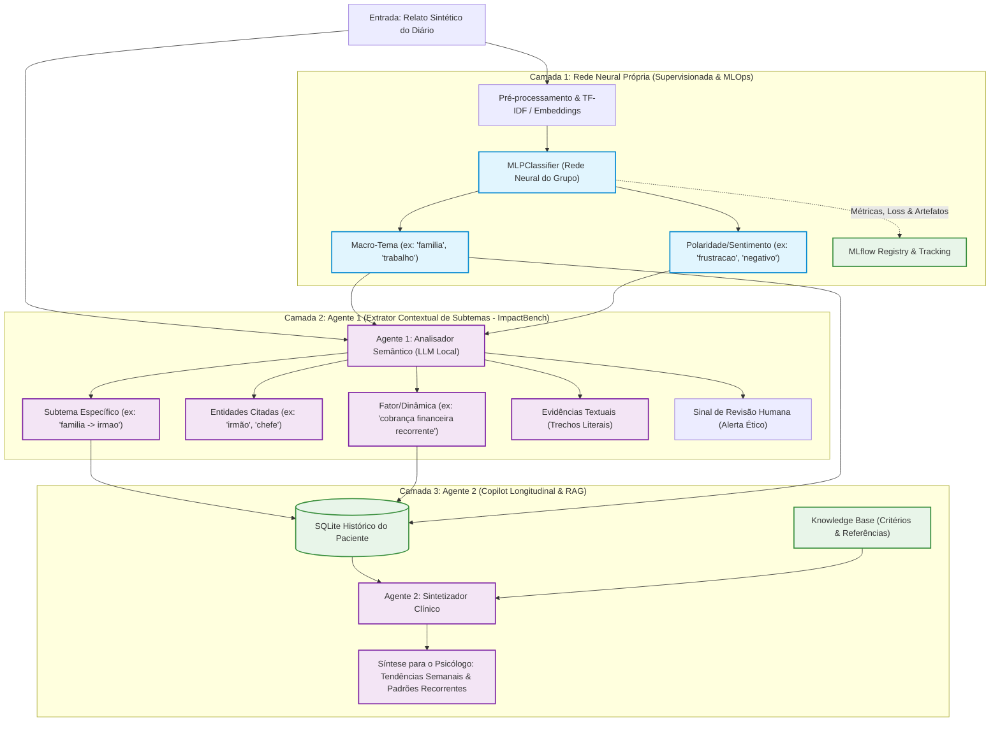

# Arquitetura Proposta: Pipeline Híbrido (Rede Neural + Agentes Semânticos)

Este documento descreve a proposta arquitetural para evolução do **Diário Emocional Inteligente (Challenge 2)**. A proposta substitui a classificação rasa do Agente 1 por um **pipeline híbrido**:
1. Uma **Rede Neural Própria** assume a classificação macro supervisionada (temas e sentimentos fechados);
2. O **Agente 1** é redirecionado para **mapeamento contextual e ontologia dinâmica de subtemas** inspirada no **[ImpactBench do MIT Media Lab](https://impactbench.media.mit.edu/explore)**;
3. O **Agente 2** atua na **síntese longitudinal e correlação com a Base de Conhecimento (RAG)** para suporte ao profissional de saúde mental.

---

## 1. Motivação e Diagnóstico da Arquitetura Atual

No estado atual da branch `main`:
- O **Agente 1** consome um modelo generativo local (Ollama 4B) apenas para selecionar valores em listas fechadas de temas (`trabalho`, `familia`, etc.) e sentimentos (`frustracao`, `tristeza`, etc.).
- **Problema 1 (Subutilização Cognitiva):** Usar um LLM para tarefas rígidas de classificação multiclasse fechada é computacionalmente caro, lento (latência de 2 a 5 segundos) e não aproveita a real força dos Large Language Models (compreensão semântica profunda, síntese e raciocínio contextual).
- **Problema 2 (Requisito Acadêmico da Rede Neural):** O edital do Challenge 2 exige explicitamente:
  > *"Construir e testar pelo menos uma rede neural simples (código de treino, divisão dos dados, baseline e avaliação reproduzível). O simples uso de um LLM pronto não deve ser tratado como evidência de que o grupo construiu e testou a rede neural exigida."*
- **Problema 3 (Colaboração Multiagente Frágil):** Se o primeiro agente apenas gera um JSON simples de 3 campos, a colaboração com um segundo agente torna-se artificial ou rasa.

---

## 2. Inspiração Teórica: ImpactBench (MIT Media Lab)

O **[ImpactBench](https://impactbench.media.mit.edu/explore)** (desenvolvido pelo MIT Media Lab AHA, UC Berkeley Haas e USC Marshall, 2024–2025) estabelece uma taxonomia para analisar os impactos de interações em quatro níveis:

```
Nível 1: Domínios Fundamentais (Psicológico, Social, Material/Físico)
   │
   └── Nível 2: Subáreas (ex: Relações Sociais, Saúde Mental, Finanças, Agência)
         │
         └── Nível 3: Métricas & Dinâmicas (Comportamentos/Indícios com Polaridade Benéfica vs. Nociva)
               │
               └── Nível 4: Cenários & Evidências Textuais (Grounding literal)
```

### Aplicação ao Diário Emocional
Transpomos essa estrutura para os relatos dos diários, criando uma hierarquia semântica rica:
- **Macro-Domínio (Nível 1 & 2):** Identificado de forma determinística e veloz pela **Rede Neural**.
- **Sub-temas e Dinâmicas Interpessoais (Nível 3):** Descobertos pelo **Agente 1**.
  - *Exemplo:* Se a pessoa frequentemente menciona o irmão, o Agente 1 não apenas marca `familia`, mas mapeia `familia -> irmao -> sobrecarga_financeira`.
- **Fundamentação Textual (Nível 4):** Citação exata de trechos do relato (*Grounding*), garantindo auditabilidade e eliminando alucinações.

---

## 3. Evidências Científicas: Por que o Sistema Híbrido (Rede Neural + Agentes) Supera a Abordagem Apenas com Agentes?

A decisão de compor uma **Rede Neural especializada** com **Agentes LLM** fundamenta-se nas mais recentes pesquisas de engenharia de IA e ciência cognitiva. Diversos estudos comprovam que confiar cegamente em modelos generativos monolíticos para todas as etapas de um pipeline introduz ineficiências graves:

### 3.1. Sistemas Compostos de IA vs. Modelos Monolíticos (Compound AI Systems)
- **Referência:** Zaharia, M., Khattab, O., Stoica, I., Zou, J., et al. (2024). *"The Shift from Models to Compound AI Systems"*. **Berkeley AI Research (BAIR)** / Databricks / Stanford.
- **Fundamento Científico:** O estudo pioneiro da UC Berkeley demonstra que as aplicações de IA de maior desempenho e robustez não derivam de enviar tudo a um único LLM gigante via prompt, mas sim de **Sistemas Compostos de IA (Compound AI Systems)**. Esses sistemas dividem a tarefa entre múltiplos componentes especializados (redes neurais clássicas, guardrails determinísticos e modelos generativos), obtendo controle superior, rastreabilidade e menor variabilidade.

### 3.2. Eficiência de Roteamento e Cascatas de Modelos (FrugalGPT)
- **Referência:** Chen, L., Zaharia, M., & Zou, J. (2023). *"FrugalGPT: How to Use Large Language Models While Reducing Cost and Improving Performance"*. **Stanford University**, arXiv:2305.05176.
- **Fundamento Científico:** O trabalho de Stanford formalizou o conceito de *Model Cascades*. Executar uma tarefa de classificação fechada usando um LLM de 4 a 7 bilhões de parâmetros gera um consumo computacional desproporcional. Classificadores neurais leves dedicados resolvem o reconhecimento de padrões em milissegundos e a uma fração de custo energético, reservando o poder gerativo do LLM apenas para a extração não estruturada de subtemas contextuais.

### 3.3. Teoria do Processamento Dual (Sistema 1 vs. Sistema 2 na IA)
- **Referência:** Booch, G., Fabiano, F., Horesh, L., et al. (2021). *"Thinking Fast and Slow in AI"*. **AAAI / IBM Research**; Bengio, Y. (2019). *"From System 1 Deep Learning to System 2 Deep Learning"*. **NeurIPS Keynote**.
- **Fundamento Científico:** Inspirando-se na psicologia cognitiva de Daniel Kahneman (*Rápido e Devagar*):
  - **Sistema 1 (Rede Neural Discriminativa):** Rápido, intuitivo, probabilístico e reativo. Especializado em mapeamento imediato de padrões conhecidos (Macro-temas: `familia`, `trabalho`; Sentimento: `tristeza`, `alegria`).
  - **Sistema 2 (Agente LLM Deliberativo):** Mais lento, analítico e contextual. Responsável por desconstruir relações causais, inferir nuances semânticas e mapear a ontologia hierárquica do relato.
  - *Vantagem Híbrida:* Delegar tarefas do Sistema 1 a agentes Sistema 2 gera lentidão desnecessária e instabilidade.

### 3.4. Calibração Estatística vs. Fragilidade de Prompt (Prompt Brittleness)
- **Referência:** Guo, C., Pleiss, G., Sun, Y., & Weinberger, K. Q. (2017). *"On Calibration of Modern Neural Networks"*. **ICML**; Kadavath, S., et al. (2022). *"Language Models (Mostly) Know What They Know"*. **Anthropic**.
- **Fundamento Científico:** Redes neurais dedicadas treinadas com perda de entropia cruzada (*Cross-Entropy Loss*) produzem distribuições de probabilidade bem calibradas (via *Softmax*). Isso permite calcular incerteza estatística real e rejeitar predições ambíguas. LLMs generativos, por sua vez, são autoregressivos (preveem o próximo token), sendo suscetíveis a *overconfidence*, distorções causadas por pequenas mudanças no prompt (*prompt brittleness*) e deriva de schema (*schema drift*).

### 3.5. Eficiência Energética e Green AI
- **Referência:** Luccioni, A. S., et al. (2023). *"Power Hungry Processing: Watts Driving the Cost of AI Deployment?"*. **ACM FAccT**.
- **Fundamento Científico:** Enquanto uma inferência de um modelo generativo local (Ollama 4B) consome dezenas de Joules por requisição e bloqueia a memória VRAM da máquina, a inferência de uma rede neural densa (MLP) consome frações de milijoules e executa em CPU em $<8\text{ ms}$, viabilizando execução contínua com pegada ecológica significativamente menor (*Green AI*).

---

### Comparativo: Apenas Agentes vs. Sistema Híbrido (Rede Neural + Agentes)

| Critério Técnico | Abordagem Apenas Agentes (Main) | Arquitetura Híbrida Proposta |
| :--- | :--- | :--- |
| **Latência na Classificação Básica** | 2.000 ms a 5.000 ms por relato | **3 ms a 8 ms** (inferência in-process via CPU) |
| **Calibração de Probabilidade** | Não calibrada (números alucinados ou ausentes) | **Calibrada matematicamente** via *Softmax* |
| **Risco de Alucinação / Schema Drift** | Médio (o LLM pode inventar temas fora da lista) | **Zero no nível macro** (espaço de estados matematicamente fechado) |
| **Ancoragem Semântica (Grounding)** | Genérica sobre o texto bruto | **Focada:** o LLM recebe o prior da rede e busca apenas subtemas e citações |
| **Rastreabilidade e MLOps** | Depende de pipelines lentos de LLM-as-a-judge | **MLflow nativo:** curvas de perda, matriz de confusão e métricas clássicas |
| **Cumprimento do Edital Challenge 2** | Falha no requisito de rede neural construída | **100% de conformidade** com o requisito formal |

---

## 4. Topologia e Fluxo de Dados da Arquitetura Híbrida



---

## 5. Detalhamento dos Componentes

### 5.1. Camada 1: Rede Neural de Classificação Macro (MLOps)
- **Implementação:** MLP (Multi-Layer Perceptron) treinado com `scikit-learn` / `PyTorch`, utilizando vetorização TF-IDF ou embeddings compactos em português.
- **Entrada:** Texto limpo do relato.
- **Saídas:**
  - `macro_tema`: [`trabalho`, `familia`, `relacionamentos`, `estudos`, `saude`, `financas`, `luto`, `outros`].
  - `sentimento_base`: [`alegria`, `tristeza`, `raiva`, `medo`, `preocupacao`, `frustracao`, `calma`].
  - `probabilidades`: Scores de confiança calibrados para cada classe.
- **Latência média:** $\approx 3\text{ a }8\text{ ms}$ (inferência local síncrona sem overhead de geração de tokens).
- **Rastreabilidade (MLOps):** Parâmetros (`alpha`, `hidden_layer_sizes`), métricas (`accuracy`, `f1_macro`, matriz de confusão) e curvas de perda registradas no MLflow.

### 5.2. Camada 2: Agente 1 (Descoberta Semântica e Subtemas)
- **Papel:** Recebe o texto e a classificação prévia da Rede Neural como *prior* contextual.
- **Responsabilidades:**
  1. **Hierarquização:** Refinar o tema macro em um caminho contextual (`familia` $\rightarrow$ `irmao` $\rightarrow$ `apoio_financeiro`).
  2. **Identificação de Entidades e Relações:** Mapear os atores do relato e o tipo de atrito ou suporte emocional relatado.
  3. **Verificação de Fundamentação (*Grounding*):** Exigir que cada subtema tenha como evidência uma citação literal do texto, prevenindo alucinações.
  4. **Triagem de Risco Textual:** Sinalizar menções explícitas de crise para triagem ética imediata.

### 5.3. Camada 3: Agente 2 (Copilot / Síntese Longitudinal)
- **Papel:** Conectar o histórico de múltiplos relatos de um mesmo usuário/sessão.
- **Responsabilidades:**
  1. Identificar padrões recorrentes: *"Nos últimos 14 dias, o subtema 'irmão' esteve presente em 80% dos relatos marcados como frustração/família."*
  2. Consultar a Base de Conhecimento (`knowledge_base`) para formatar uma visão sintética e neutra para apoiar a próxima consulta do psicólogo.
  3. Comprovar a exigência de **dois agentes colaborando em prol de um objetivo comum**.

---

## 6. Contratos de Dados Propostos (Modelos Pydantic)

```python
from typing import Literal
from pydantic import BaseModel, Field


class MacroClassification(BaseModel):
    """Saída gerada pela Rede Neural própria do grupo."""

    macro_tema: Literal[
        "trabalho",
        "familia",
        "relacionamentos",
        "estudos",
        "saude",
        "financas",
        "luto",
        "outros",
    ]
    sentimento_base: Literal[
        "alegria",
        "tristeza",
        "raiva",
        "medo",
        "preocupacao",
        "frustracao",
        "calma",
    ]
    confianca: float = Field(ge=0.0, le=1.0)
    modelo_origem: str = "mlp_v1"


class SubtopicExtraction(BaseModel):
    """Saída gerada pelo Agente 1 inspirada na taxonomia ImpactBench."""

    subtema: str = Field(
        ...,
        description="Sub-tópico granular descoberto (ex: conflito_fraternal, sobrecarga_de_prazos)",
    )
    caminho_hierarquico: str = Field(
        ...,
        description="Caminho ontológico: Macro -> Subárea -> Dinâmica (ex: familia -> irmao -> dinheiro)",
    )
    entidades_mencionadas: list[str] = Field(
        default_factory=list,
        description="Pessoas, grupos ou elementos centrais (ex: ['irmão', 'chefe'])",
    )
    fatores_recorrentes: list[str] = Field(
        default_factory=list,
        description="Fatores específicos descritos (ex: ['empréstimo não pago', 'discussão ríspida'])",
    )
    evidencias_textuais: list[str] = Field(
        ...,
        min_length=1,
        description="Citações literais do texto que fundamentam essa relação",
    )


class ProcessedJournalEntry(BaseModel):
    """Resultado consolidado do pipeline híbrido."""

    id: str
    relato_anonimizado: str
    classificacao_macro: MacroClassification
    detalhamento_semantico: SubtopicExtraction
    sinal_revisao_humana: Literal["presente", "nao_identificado", "indeterminado"]
    requires_human_review: bool
```

---

## 7. Alinhamento com os Requisitos do Challenge 2

| Requisito do Edital | Como a Arquitetura Híbrida Atende |
| :--- | :--- |
| **Construir e testar pelo menos uma rede neural simples** | O grupo constrói, treina e avalia o modelo MLP próprio para macro-classificação, com baseline comparativo (ex: Naive Bayes ou Regressão Logística). |
| **Aplicar MLOps** | Pipeline de treino automatizado, versionamento de datasets (`train/val/holdout`), logging de hiperparâmetros e artefatos de modelo no MLflow. |
| **Pelo menos dois agentes que trabalhem juntos** | **Agente 1** extrai a semântica fina de cada relato $\rightarrow$ envia para **Agente 2**, que consolida o histórico semanal do paciente com apoio da Base de Conhecimento. |
| **Uma base de conhecimento** | Usada pelo Agente 2 para contextualizar tópicos clínicos e diretrizes de acolhimento. |
| **Solução ética e explicável** | Grounding compulsório (o Agente 1 só pode apontar subtemas respaldados por trechos explícitos). A IA nunca formula diagnóstico. |
| **Resource de até dois anos** | **ImpactBench (MIT Media Lab, 2024–2025)** citado e referenciado formalmente como embasamento da taxonomia hierárquica de bem-estar. |

---

## 8. Próximos Passos para Execução

1. **Aproveitar o classificador da branch `feat/mlops`:**
   - O classificador MLP já implementado em `models/neural_net.py` é o ponto de partida ideal.
2. **Atualizar o Prompt e Esquema do Agente 1:**
   - Adaptar `agents/extractor/prompt.py` e `contracts.py` para receber a dica da rede neural e devolver o objeto `SubtopicExtraction`.
3. **Encadear no Grafo (LangGraph):**
   - O nó 1 executa a inferência da Rede Neural local ($\approx 5\text{ ms}$).
   - O nó 2 invoca o Agente 1 com o relato e o contexto macro já preenchido.
4. **Alimentar o Agente 2:**
   - Submeter o histórico acumulado (`data/synthetic/exemplo_semana_paciente.jsonl`) ao Agente 2 para demonstrar a geração de relatórios longitudinais.
