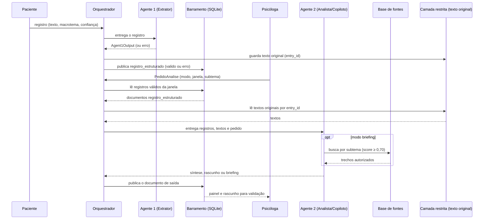
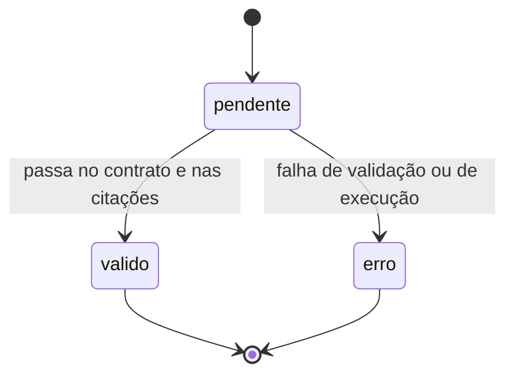
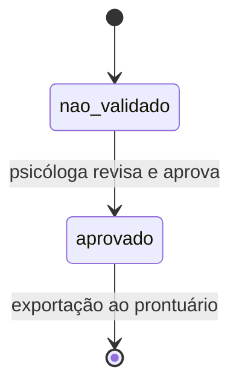

# Guia de Desenvolvimento: Comunicação entre Agentes

O [contrato da demonstração integrada](contrato-integracao-agentes.md) descreve o fluxo executável de diário, roda e chat, com os passos para rodá-lo localmente.

## 1. Identificação e Propósito
* **Arquivos no Código:** `agents/bus/documentos.py` (contratos e barramento), `agents/pipeline.py` (orquestrador), `agents/llm.py` (cliente do modelo local)
* **Objetivo Primário:** definir como os agentes trocam informação. Toda comunicação passa por **documentos** gravados no barramento, nunca por chamadas diretas entre agentes.
* **Por que este componente existe?** Porque a arquitetura é de **caixa preta**: cada agente recebe documentos, executa sua lógica interna e entrega um documento. Quem consome não sabe como o documento foi produzido, só se ele cumpre o contrato.

### Regras de comunicação
1. Agentes não se chamam. O orquestrador chama cada um e publica o que ele devolve.
2. O único canal de resultado entre agentes é o documento publicado no barramento. O texto original do paciente não é um documento: fica na camada restrita e o Agente 2 o lê pelo `entry_id`.
3. Todo documento é validado contra o contrato do seu tipo **antes** de ser gravado.
4. Consumidores leem apenas documentos com status que os autoriza (ex.: o Agente 2 só lê registros `valido`).
5. Nenhum conteúdo migra automaticamente para o prontuário ou para terceiros. Essa passagem é sempre manual e aprovada pela psicóloga.
6. Documentos de erro não contêm texto do paciente, só o código do erro.

### Decisões já tomadas
* Comunicação em caixa preta, por documentos.
* Agente 2 fundido, com três modos de saída (síntese, rascunho, briefing).
* RAG só existe no modo briefing, sobre a base de fontes autorizadas. A leitura dos registros do paciente é consulta estruturada, não RAG.
* O Agente 2 lê os textos originais do paciente, além dos registros estruturados. Os textos ficam na camada restrita, nunca no barramento de documentos.

---

## 2. Diagrama de Integração



---

## 3. Contratos de Dados (Pydantic V2)

Crie `agents/bus/documentos.py` com a parte de contratos:

```python
from datetime import UTC, datetime
from enum import Enum
from typing import Any, Dict, List, Literal
from uuid import UUID, uuid4
from pydantic import BaseModel, ConfigDict, Field

from agents.extractor.contracts import Agent1Output
from agents.correlator.contracts import BriefingCopiloto, LongitudinalSynthesis, RascunhoEvolucao

class TipoDocumento(str, Enum):
    REGISTRO = "registro_estruturado"
    SINTESE = "sintese"
    RASCUNHO = "rascunho"
    BRIEFING = "briefing"

# Cada tipo tem exatamente um contrato. O barramento usa este mapa para validar.
CONTRATOS = {
    TipoDocumento.REGISTRO: Agent1Output,
    TipoDocumento.SINTESE: LongitudinalSynthesis,
    TipoDocumento.RASCUNHO: RascunhoEvolucao,
    TipoDocumento.BRIEFING: BriefingCopiloto,
}

class MetadadosExecucao(BaseModel):
    model_config = ConfigDict(extra="forbid")
    modelo: str
    modelo_digest: str
    prompt_version: str
    seed: int
    temperatura: float
    latencia_ms: int = Field(ge=0)

class Documento(BaseModel):
    """Envelope comum a todos os documentos trocados entre agentes."""
    model_config = ConfigDict(extra="forbid")
    documento_id: UUID = Field(default_factory=uuid4)
    tipo: TipoDocumento
    versao_contrato: str = "1.0.0"
    produzido_por: Literal["codigo", "agente1", "agente2"]
    patient_id: str
    created_at: datetime = Field(default_factory=lambda: datetime.now(UTC))
    status: Literal["pendente", "valido", "erro", "nao_validado", "aprovado"]
    origem_ids: List[UUID] = Field(default_factory=list, description="Documentos de entrada usados")
    metadados: MetadadosExecucao | None = None
    payload: Dict[str, Any] = Field(default_factory=dict)
```

---

## 4. Documentos Trocados

| Documento | Produtor | Consumidor | Gatilho | Status inicial |
|---|---|---|---|---|
| `registro_estruturado` | Agente 1 | Agente 2 | Novo registro do paciente | `valido` ou `erro` |
| `sintese` | Agente 2 (modo síntese) | Painel da psicóloga | Pedido com modo síntese | `valido` |
| `rascunho` | Agente 2 (modo rascunho) | Psicóloga, para edição | Pedido com modo rascunho | `nao_validado` |
| `briefing` | Agente 2 (modo briefing) | Painel da psicóloga | Pedido com modo briefing e subtema | `valido` (ou abstenção, também válida) |

O `PedidoAnalise` (definido no contrato do Agente 2) não é publicado no barramento. Ele é a entrada do orquestrador.

---

## 5. Estados dos Documentos





Um documento `sintese` ou `briefing` nunca é sobrescrito. Uma nova análise gera nova linha com novo `documento_id`.

---

## 6. Barramento (`agents/bus/documentos.py`, parte de persistência)

```python
import json
import sqlite3
from typing import List
from uuid import UUID
from agents.extractor.contracts import Agent1Output

SCHEMA = """
CREATE TABLE IF NOT EXISTS documentos (
    documento_id    TEXT PRIMARY KEY,
    tipo            TEXT NOT NULL,
    patient_id      TEXT NOT NULL,
    status          TEXT NOT NULL,
    created_at      TEXT NOT NULL,
    versao_contrato TEXT NOT NULL,
    produzido_por   TEXT NOT NULL,
    origem_ids      TEXT NOT NULL,
    metadados       TEXT,
    payload         TEXT NOT NULL
);
CREATE INDEX IF NOT EXISTS idx_documentos_busca
    ON documentos (patient_id, tipo, status, created_at);

-- Camada restrita: texto original. Não é documento do barramento.
-- Em produção, a coluna texto é criptografada (AES-256).
CREATE TABLE IF NOT EXISTS textos_originais (
    entry_id   TEXT PRIMARY KEY,
    patient_id TEXT NOT NULL,
    texto      TEXT NOT NULL
);
"""

class Barramento:
    def __init__(self, caminho: str = "barramento.db"):
        self.con = sqlite3.connect(caminho)
        self.con.executescript(SCHEMA)

    def publicar(self, doc: Documento) -> None:
        if doc.status == "erro":
            # Erro não carrega conteúdo do paciente. Só o código do erro.
            if set(doc.payload) != {"codigo_erro"}:
                raise ValueError("Documento de erro só pode conter o código do erro.")
        else:
            # Valida antes de gravar. Payload inválido nunca entra no barramento.
            CONTRATOS[doc.tipo].model_validate(doc.payload, strict=False)

        self.con.execute(
            "INSERT INTO documentos VALUES (?,?,?,?,?,?,?,?,?,?)",
            (
                str(doc.documento_id),
                doc.tipo.value,
                doc.patient_id,
                doc.status,
                doc.created_at.isoformat(),
                doc.versao_contrato,
                doc.produzido_por,
                json.dumps([str(i) for i in doc.origem_ids]),
                doc.metadados.model_dump_json() if doc.metadados else None,
                json.dumps(doc.payload, ensure_ascii=False, default=str),
            ),
        )
        self.con.commit()

    def ler(self, tipo: TipoDocumento, patient_id: str, inicio: datetime, fim: datetime,
            status: str = "valido") -> List[Documento]:
        linhas = self.con.execute(
            "SELECT documento_id, tipo, patient_id, status, created_at, versao_contrato, "
            "produzido_por, origem_ids, metadados, payload FROM documentos "
            "WHERE tipo=? AND patient_id=? AND status=? AND created_at BETWEEN ? AND ? "
            "ORDER BY created_at",
            (tipo.value, patient_id, status, inicio.isoformat(), fim.isoformat()),
        ).fetchall()
        return [self._linha_para_documento(l) for l in linhas]

    def guardar_texto(self, entry_id: UUID, patient_id: str, texto: str) -> None:
        # Camada restrita: o texto não passa pelo barramento de documentos.
        self.con.execute(
            "INSERT INTO textos_originais VALUES (?,?,?)",
            (str(entry_id), patient_id, texto),
        )
        self.con.commit()

    def texto_original(self, entry_id: UUID) -> str:
        linha = self.con.execute(
            "SELECT texto FROM textos_originais WHERE entry_id=?", (str(entry_id),)
        ).fetchone()
        if linha is None:
            raise KeyError("Texto original não encontrado para o registro.")
        return linha[0]

    @staticmethod
    def _linha_para_documento(l) -> Documento:
        did, tipo, pid, status, criado, versao, por, origens, meta, payload = l
        return Documento(
            documento_id=UUID(did),
            tipo=TipoDocumento(tipo),
            patient_id=pid,
            status=status,
            created_at=datetime.fromisoformat(criado),
            versao_contrato=versao,
            produzido_por=por,
            origem_ids=[UUID(o) for o in json.loads(origens)],
            metadados=MetadadosExecucao.model_validate_json(meta) if meta else None,
            payload=json.loads(payload),
        )
```

> **Importante:** `payload` deve ser preenchido com `modelo.model_dump(mode="json")`. Assim datas e UUIDs viram texto e o contrato valida na leitura.

---

## 7. Orquestrador (`agents/pipeline.py`)

O orquestrador não interpreta conteúdo. Ele chama os agentes e publica o que devolvem.

```python
from datetime import UTC, datetime, time
from agents.bus.documentos import Barramento, Documento, TipoDocumento
from agents.correlator.contracts import ModoSaida, PedidoAnalise
from agents.correlator.service import Agent2Service
from agents.extractor.contracts import Agent1Output
from agents.extractor.service import Agent1Service

MODO_PARA_TIPO = {
    ModoSaida.SINTESE: TipoDocumento.SINTESE,
    ModoSaida.RASCUNHO: TipoDocumento.RASCUNHO,
    ModoSaida.BRIEFING: TipoDocumento.BRIEFING,
}
STATUS_SAIDA = {
    TipoDocumento.SINTESE: "valido",
    TipoDocumento.RASCUNHO: "nao_validado",
    TipoDocumento.BRIEFING: "valido",
}

class Orquestrador:
    def __init__(self, bus: Barramento, agente1: Agent1Service, agente2: Agent2Service):
        self.bus = bus
        self.agente1 = agente1
        self.agente2 = agente2

    def processar_registro(self, patient_id: str, texto: str, macro_tema: str,
                           confianca: float, modalidade: str = "texto"):
        try:
            saida = self.agente1.process(patient_id, texto, macro_tema, confianca, modalidade)
        except Exception as exc:
            self.bus.publicar(Documento(
                tipo=TipoDocumento.REGISTRO, produzido_por="agente1",
                patient_id=patient_id, status="erro",
                payload={"codigo_erro": type(exc).__name__},
            ))
            return None

        # O texto original vai para a camada restrita antes do registro ficar disponível.
        self.bus.guardar_texto(saida.entry_id, patient_id, texto)
        self.bus.publicar(Documento(
            tipo=TipoDocumento.REGISTRO, produzido_por="agente1",
            patient_id=patient_id, status="valido",
            payload=saida.model_dump(mode="json"),
        ))
        return saida

    def gerar_analise(self, pedido: PedidoAnalise):
        registros: list[Agent1Output] = []
        docs_origem = []

        # O briefing não lê registros do paciente. Só consulta a base de fontes.
        if pedido.modo is not ModoSaida.BRIEFING:
            inicio, fim = pedido.intervalo()
            docs_origem = self.bus.ler(
                TipoDocumento.REGISTRO, pedido.patient_id,
                datetime.combine(inicio, time.min, tzinfo=UTC),
                datetime.combine(fim, time.max, tzinfo=UTC),
            )
            registros = [Agent1Output.model_validate(d.payload, strict=False) for d in docs_origem]

        textos = {r.entry_id: self.bus.texto_original(r.entry_id) for r in registros}
        resultado = self.agente2.run(pedido, registros, textos)

        tipo = MODO_PARA_TIPO[pedido.modo]
        self.bus.publicar(Documento(
            tipo=tipo,
            produzido_por="agente2",
            patient_id=pedido.patient_id,
            status=STATUS_SAIDA[tipo],
            origem_ids=[d.documento_id for d in docs_origem],
            payload=resultado.model_dump(mode="json"),
        ))
        return resultado
```

---

## 8. Tecnologias

| Necessidade | Ferramenta | Papel na comunicação |
|---|---|---|
| Barramento de documentos | SQLite | Armazena os documentos com índice por paciente, tipo e status. Roda local, sem servidor |
| Contrato dos documentos | Pydantic V2 | Valida na publicação e na leitura |
| Formato do payload | JSON | Legível e auditável |
| Modelo de linguagem local | Ollama (Qwen 2.5 ou Qwen3 4B, Gemma 3 4B) | Executa os agentes sem enviar dados para fora |
| Reprodutibilidade | Temperatura 0, seed fixa, digest do modelo em `metadados` | Permite auditar qual modelo produziu cada documento |
| Classificação temática | PyTorch (MLP) sobre embeddings SBERT | Roda antes do Agente 1 e entrega o macrotema |
| Recuperação do briefing | BM25 + e5-small, fundidos por RRF | Busca híbrida na base de fontes |
| Testes | pytest | Testes de contrato e do fluxo caixa preta |
| Rastreio de experimentos | MLflow | Compara versões de prompt e modelo |

Como os agentes rodam em sequência, não é necessária fila de mensagens. A persistência com status basta para coordenar o fluxo.

---

## 9. Testes (`tests/test_comunicacao.py`)

Os testes mostram a caixa preta: o Agente 2 é testado sem saber que o Agente 1 existe, e só enxerga o que foi publicado.

```python
import json
from datetime import date, datetime, UTC
import pytest
from pydantic import ValidationError

from agents.bus.documentos import Barramento, Documento, TipoDocumento
from agents.correlator.contracts import ModoSaida, PedidoAnalise
from agents.correlator.service import Agent2Service
from agents.extractor.service import Agent1Service
from agents.pipeline import Orquestrador

TEXTO = "Ontem meu irmão pegou meu carro sem pedir de novo e ainda riu de mim. Fiquei com uma raiva insuportável."

RESP_A1 = {
    "subtemas": [{
        "nome": "Irmão",
        "descricao": "Conflito por uso indevido do carro e deboche",
        "evidencias": [{"quote_text": "meu irmão pegou meu carro sem pedir de novo e ainda riu de mim", "start_char": 0, "end_char": 10}],
    }],
    "sentimento_predominante": "raiva",
    "score_polaridade": -0.82,
    "indicio_textual_risco": "nao_identificado",
}

RESP_A2 = {
    "correlacoes_identificadas": [],
    "fatores_de_protecao": ["Manteve o registro diário"],
    "pontos_de_atencao_sessao": ["Limites com o irmão"],
}

class FakeLLM:
    def __init__(self, resposta):
        self.resposta = resposta

    def chat(self, system, user, schema, seed=42):
        return json.dumps(self.resposta)

@pytest.fixture
def orq():
    return Orquestrador(
        bus=Barramento(":memory:"),
        agente1=Agent1Service(FakeLLM(RESP_A1)),
        agente2=Agent2Service(FakeLLM(RESP_A2)),
    )

def test_agente2_le_apenas_registros_validos_publicados(orq):
    orq.processar_registro("PAC-01", TEXTO, "familia", 0.92)
    # Texto acima do limite: gera registro de erro, que o Agente 2 não deve ler
    orq.processar_registro("PAC-01", "x" * 3000, "familia", 0.9)

    hoje = datetime.now(UTC).date()
    pedido = PedidoAnalise(patient_id="PAC-01", modo=ModoSaida.SINTESE, janela_dias=7, data_fim=hoje)
    resultado = orq.gerar_analise(pedido)

    assert resultado.total_relatos_processados == 1
    publicados = orq.bus.ler(TipoDocumento.SINTESE, "PAC-01",
                             datetime.combine(hoje, datetime.min.time(), UTC),
                             datetime.combine(hoje, datetime.max.time(), UTC))
    assert len(publicados) == 1
    assert len(publicados[0].origem_ids) == 1  # rastreável ao registro de origem

def test_erro_do_agente1_grava_so_o_codigo(orq):
    orq.processar_registro("PAC-01", "x" * 3000, "familia", 0.9)
    erros = orq.bus.con.execute(
        "SELECT payload FROM documentos WHERE status='erro'"
    ).fetchall()
    assert len(erros) == 1
    assert json.loads(erros[0][0]) == {"codigo_erro": "ValueError"}

def test_payload_invalido_nao_entra_no_barramento():
    bus = Barramento(":memory:")
    with pytest.raises(ValidationError):
        bus.publicar(Documento(
            tipo=TipoDocumento.REGISTRO, produzido_por="agente1",
            patient_id="PAC-01", status="valido", payload={},
        ))

def test_erro_com_conteudo_do_paciente_e_recusado():
    bus = Barramento(":memory:")
    with pytest.raises(ValueError):
        bus.publicar(Documento(
            tipo=TipoDocumento.REGISTRO, produzido_por="agente1",
            patient_id="PAC-01", status="erro",
            payload={"codigo_erro": "ValueError", "texto": "conteúdo do paciente"},
        ))
```

---

## 10. Pontos em Aberto

1. **Taxonomia de macrotemas:** o enum atual tem 8 temas mais `outros` e `nao_identificado`. A equipe vai definir 6. Isso muda o `MacroTema`, o treino do MLP e a versão do contrato do registro. Enquanto não houver lista final, o enum permanece como está.
2. **Versionamento do contrato:** qual regra usar para mudar um esquema sem perder registros antigos? Proposta: `versao_contrato` no envelope e leitura compatível apenas com a versão atual.
3. **Reprocessamento:** quando o prompt do Agente 1 mudar, os registros antigos são reprocessados ou mantêm `prompt_version` de origem?
4. **Briefing e texto original:** a consulta à base de fontes continua usando só o nome do subtema, e o briefing não recebe os relatos do paciente. Confirmar se o briefing também deve usar os textos da janela.
8. **Limite de contexto:** a síntese recusa janelas com mais de 24.000 caracteres de relatos. Uma janela de 30 dias pode chegar a esse limite. Definir se ela será resumida em etapas.
9. **Controle de acesso ao texto original:** definir se cada leitura do Agente 2 é registrada em log de auditoria e quem pode disparar a análise.
5. **Gatilho da análise:** o Agente 2 roda só sob pedido da psicóloga, ou também quando chegam novos registros?
6. **Auditoria:** a psicóloga deve ver quais registros originaram cada síntese, ou isso fica só no log técnico?
7. **Formato do armazenamento:** payload em JSON dentro do SQLite (versão inicial) ou tabelas normalizadas por subtema (consultas mais rápidas, mais migrações).

---

## 11. Referências Técnicas
1. **SQLite, linguagem SQL:** [https://www.sqlite.org/lang.html](https://www.sqlite.org/lang.html)
2. **Pydantic V2, documentação:** [https://docs.pydantic.dev/latest/](https://docs.pydantic.dev/latest/)
3. **Ollama, API de chat e structured outputs:** [https://ollama.com/blog/structured-outputs](https://ollama.com/blog/structured-outputs)
4. **Mermaid, diagramas de sequência e de estado:** [https://mermaid.js.org/syntax/sequenceDiagram.html](https://mermaid.js.org/syntax/sequenceDiagram.html)
