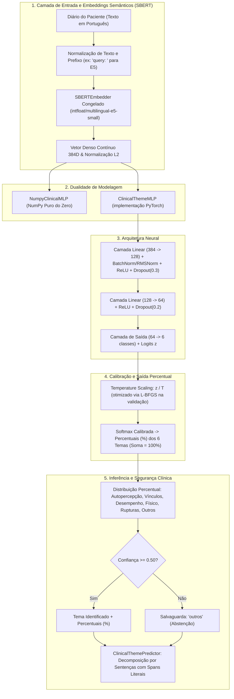

# Dossiê Técnico e Teórico: Deep Learning & Rede Neural com SBERT

> **Documento Oficial de Domínio Técnico e Fundamentação Científica**  
> **Componente:** Classificador Neural dos 6 Temas Clínicos (`models/`)  
> **Público-Alvo:** Engenheiros de ML, Pesquisadores e Banca Avaliadora de Pós-Graduação/Mestrado

---

## Sumário Executivo e Mapa do Domínio

Este documento formaliza e detalha o ecossistema de Deep Learning desenvolvido no projeto. O subsistema foi projetado para atender com rigor científico à **Constraint 4 (Construir e testar pelo menos uma rede neural própria)** e à **Constraint 3 (Práticas consolidadas de MLOps)**.

Ao receber o diário de um paciente, o pipeline converte o relato em embeddings densos via **SBERT** (`models/sbert_embedder.py`, substituindo a abordagem anterior baseada em TF-IDF/LSA) e utiliza a Rede Neural MLP (`ClinicalThemeMLP`) para **identificar o tema predominante e atribuir percentuais (`%`) para cada um dos 6 temas clínicos**: **`autopercepcao`**, **`vinculos`**, **`desempenho`**, **`fisico`**, **`rupturas`** e **`outros`**.



---

## 1. Fundamentos Matemáticos e Formulação Teórica

A rede neural desenvolvida é um **Perceptron Multicamadas (MLP - Multi-Layer Perceptron)** operando como um mapeador não linear $f: \mathbb{R}^d \to \mathbb{R}^K$, onde $d = 384$ é a dimensionalidade padrão dos embeddings de sentença **SBERT** e $K = 6$ representa a taxonomia única definida em [`data/taxonomy.py`](../data/taxonomy.py):

1. `autopercepcao` (**Autopercepção**)
2. `vinculos` (**Vínculos**)
3. `desempenho` (**Desempenho**)
4. `fisico` (**Físico**)
5. `rupturas` (**Rupturas**)
6. `outros` (**Outros** — ausência de tema clínico claro, relato neutro ou abstenção)

### 1.1. Inicialização de Pesos: He (Kaiming)
Para evitar que os gradientes desapareçam (*vanishing gradients*) ou explodam (*exploding gradients*) nas camadas ativadas por ReLU, os pesos são inicializados segundo a teoria de He et al. (2015):

$$\mathbf{W}^{(l)} \sim \mathcal{N}\left(0, \, \sigma^2\right), \quad \text{onde } \sigma = \sqrt{\frac{2}{n_{\text{in}}}}$$

Essa formulação é aplicada explicitamente na camada oculta inicial ($n_{\text{in}} = 384$) no [`models/numpy_mlp.py`](file:///C:/Users/BLU8CA/Projects/PUC/challenge-2-base/models/numpy_mlp.py).

---

### 1.2. Propagação Direta (Forward Pass)

Dado um lote de relatos clínicos codificados pelo `SBERTEmbedder` como matriz $\mathbf{X} \in \mathbb{R}^{B \times 384}$:

1. **Primeira Projeção Oculta:**
   $$\mathbf{z}^{(1)} = \mathbf{X} \mathbf{W}^{(1)} + \mathbf{b}^{(1)}, \quad \mathbf{W}^{(1)} \in \mathbb{R}^{384 \times 128}, \; \mathbf{b}^{(1)} \in \mathbb{R}^{1 \times 128}$$

2. **Normalização (BatchNorm / LayerNorm / RMSNorm):**
   No caso da [`RMSNorm`](file:///C:/Users/BLU8CA/Projects/PUC/challenge-2-base/models/torch_mlp.py):
   $$\text{RMS}(\mathbf{z}) = \sqrt{\frac{1}{h_1} \sum_{j=1}^{h_1} (z_j)^2 + \epsilon}, \quad \bar{\mathbf{z}}^{(1)} = \frac{\mathbf{z}^{(1)}}{\text{RMS}(\mathbf{z}^{(1)})} \odot \boldsymbol{\gamma}$$

3. **Ativação Não-Linear e Dropout:**
   $$\mathbf{a}^{(1)} = \text{ReLU}\left(\bar{\mathbf{z}}^{(1)}\right) = \max\left(0, \bar{\mathbf{z}}^{(1)}\right)$$
   $$\tilde{\mathbf{a}}^{(1)} = \frac{\mathbf{a}^{(1)} \odot \mathbf{m}^{(1)}}{1 - p_{\text{drop}}}, \quad m_j \sim \text{Bernoulli}(1 - p_{\text{drop}})$$

4. **Segunda Projeção Oculta:**
   $$\mathbf{z}^{(2)} = \tilde{\mathbf{a}}^{(1)} \mathbf{W}^{(2)} + \mathbf{b}^{(2)}, \quad \mathbf{a}^{(2)} = \text{ReLU}\left(\mathbf{z}^{(2)}\right), \quad \mathbf{W}^{(2)} \in \mathbb{R}^{128 \times 64}$$

5. **Camada de Saída (Logits para as 6 Classes):**
   $$\mathbf{z}^{(3)} = \mathbf{a}^{(2)} \mathbf{W}^{(3)} + \mathbf{b}^{(3)}, \quad \mathbf{z}^{(3)} \in \mathbb{R}^{B \times 6}$$

6. **Probabilidades Softmax e Percentuais (`%`) (Estabilidade Numérica com Log-Sum-Exp):**
   Para evitar estouro aritmético (*overflow*) com valores exponenciais elevados, subtrai-se o valor máximo $z_{\max} = \max_j (z_j)$:
   $$\hat{y}_{k} = \frac{e^{z_k - z_{\max}}}{\sum_{j=1}^6 e^{z_j - z_{\max}}}, \quad \%_k = \hat{y}_k \times 100$$

---

### 1.3. Dedução Analítica do Gradiente e Retropropagação (Backward Pass)

No módulo didático [`models/numpy_mlp.py`](file:///C:/Users/BLU8CA/Projects/PUC/challenge-2-base/models/numpy_mlp.py), o cálculo diferencial foi escrito **sem qualquer biblioteca de autograd**, aplicando analiticamente a Regra da Cadeia.

#### Teorema: O Gradiente da Softmax com Entropia Cruzada
Dada a função de perda de Entropia Cruzada Categórica para uma amostra com rótulo *one-hot* $\mathbf{y}$:
$$\mathcal{L} = -\sum_{k=1}^6 y_k \ln(\hat{y}_k)$$

Sabendo que $\hat{y}_k = \frac{e^{z_k}}{\sum_{j} e^{z_j}}$, calculamos a derivada parcial em relação a cada logit $z_i$:

$$\frac{\partial \hat{y}_k}{\partial z_i} = 
\begin{cases} 
\hat{y}_i (1 - \hat{y}_i), & \text{se } k = i \\
-\hat{y}_k \hat{y}_i, & \text{se } k \neq i 
\end{cases}$$

Aplicando a Regra da Cadeia:
$$\frac{\partial \mathcal{L}}{\partial z_i} = -\sum_{k=1}^6 \frac{y_k}{\hat{y}_k} \frac{\partial \hat{y}_k}{\partial z_i} = -\frac{y_i}{\hat{y}_i} \left[ \hat{y}_i (1 - \hat{y}_i) \right] - \sum_{k \neq i} \frac{y_k}{\hat{y}_k} \left[ -\hat{y}_k \hat{y}_i \right]$$

$$= -y_i (1 - \hat{y}_i) + \hat{y}_i \sum_{k \neq i} y_k = -y_i + y_i \hat{y}_i + \hat{y}_i \sum_{k \neq i} y_k = -y_i + \hat{y}_i \underbrace{\sum_{k=1}^6 y_k}_{= 1}$$

$$\boxed{\frac{\partial \mathcal{L}}{\partial \mathbf{z}^{(3)}} = \hat{\mathbf{y}} - \mathbf{y} = \boldsymbol{\delta}^{(3)}}$$

#### Propagação para as Camadas Ocultas:
1. **Gradiente dos Pesos e Bias da Camada de Saída:**
   $$\frac{\partial \mathcal{L}}{\partial \mathbf{W}_{\text{out}}} = (\mathbf{a}^{(1)})^T \boldsymbol{\delta}_{\text{out}}, \quad \frac{\partial \mathcal{L}}{\partial \mathbf{b}_{\text{out}}} = \sum_{\text{batch}} \boldsymbol{\delta}_{\text{out}}$$

2. **Propagação para a Camada Oculta (NumPy MLP):**
   $$\boldsymbol{\delta}^{(1)} = \left( \boldsymbol{\delta}_{\text{out}} (\mathbf{W}_{\text{out}})^T \right) \odot \mathbb{I}(\mathbf{z}^{(1)} > 0)$$
   $$\frac{\partial \mathcal{L}}{\partial \mathbf{W}^{(1)}} = \mathbf{X}^T \boldsymbol{\delta}^{(1)}, \quad \frac{\partial \mathcal{L}}{\partial \mathbf{b}^{(1)}} = \sum_{\text{batch}} \boldsymbol{\delta}^{(1)}$$

Isso está expressamente transcrito em código no [`models/numpy_mlp.py`](file:///C:/Users/BLU8CA/Projects/PUC/challenge-2-base/models/numpy_mlp.py), servindo como evidência de rigor matemático fundamental.

---

## 2. Engenharia de Embeddings Semânticos: Migração para SBERT

### 2.1. Por que substituímos o TF-IDF pelo SBERT (`SBERTEmbedder`)

Abordagens esparsas baseadas em **TF-IDF** dependem de sobreposição lexical exata: se o paciente escreve *"não me sinto suficiente no estágio"* e o conjunto de treino continha *"tenho vergonha da minha incapacidade"*, o vetor TF-IDF trata as expressões como dimensões ortogonais sem proximidade semântica.

Com a adoção do **SBERT (`SBERTEmbedder` em `models/sbert_embedder.py`)** usando `sentence-transformers`:
1. **Codificação Contextual Multilíngue:** O modelo padrão `intfloat/multilingual-e5-small` (com prefixo `"query: "` e janela de 512 tokens; também suportando `paraphrase-multilingual-MiniLM-L12-v2`) projeta o diário inteiro em um vetor denso contínuo de **384 dimensões** que captura sinônimos, contexto frasal e nuances emocionais em português.
2. **Encoder Congelado (Zero Data Leakage):** O SBERT é utilizado estritamente com pesos pré-treinados e congelados (`fit()` é *no-op*). Ele apenas transforma o texto em vetor; quem aprende as fronteiras de decisão entre os **6 temas** (`autopercepcao`, `vinculos`, `desempenho`, `fisico`, `rupturas`, `outros`) é o MLP treinado pelo grupo.
3. **Normalização na Hiperesfera Unitária:** Os embeddings são normalizados pela norma $\ell_2$:
   $$\mathbf{v}_{\text{doc}} = \frac{\text{SBERT}(d)}{\|\text{SBERT}(d)\|_2}$$
   estabilizando a escala das entradas na primeira camada linear do MLP.
4. **Serialização Leve:** Os métodos `__getstate__` e `__setstate__` salvam apenas a configuração do modelo em `dist/theme_embedder.joblib` sem duplicar os pesos do encoder (~470 MB).

> O vetorizador local `ClinicalTextEmbedder` (`models/embedder.py`) permanece no código apenas como alternativa experimental (`--embedder clinical`), enquanto o fluxo padrão de treino utiliza `--embedder sbert`.

---

## 3. Regularização, Otimização e Estabilidade Numérica

Para prevenir overfitting e assegurar convergência estável sobre os vetores SBERT de 384 dimensões:

| Técnica | Justificativa Teórica | Implementação no Projeto |
| :--- | :--- | :--- |
| **AdamW Optimizer** | Desacopla o decaimento de peso ($L_2$ regularization) da atualização do gradiente móvel, evitando penalização inadequada em parâmetros com gradientes frequentes. | `torch.optim.AdamW(lr=0.005, weight_decay=1e-3)` |
| **Gradient Clipping** | Limita a norma $\ell_2$ do gradiente a um limiar máximo ($||\mathbf{g}||_2 \le 1.0$). Previne explosões de gradiente causadas por batches ruidosos. | `torch.nn.utils.clip_grad_norm_(model.parameters(), max_norm=1.0)` |
| **Dropout Invertido** | Simula um comitê de sub-redes ativas, impedindo a co-adaptação espúria de neurônios. | Taxas de 0.30 na Camada 1 e 0.20 na Camada 2 |
| **RMSNorm / BatchNorm** | Normalização de ativações que reduz o *Internal Covariate Shift*, acelerando a convergência. | Modular em [`models/torch_mlp.py`](file:///C:/Users/BLU8CA/Projects/PUC/challenge-2-base/models/torch_mlp.py) |

---

## 4. Prevenção de Data Leakage e Rigor MLOps

### 4.1. Vazamento de Dados por Família de Templates
A divisão aleatória ingênua (*naive random split*) sobre registros correlacionados levaria à memorização espúria e falsos scores elevados.

#### Solução Arquitetada ([`data/split.py`](file:///C:/Users/BLU8CA/Projects/PUC/challenge-2-base/data/split.py) e [`models/train.py`](file:///C:/Users/BLU8CA/Projects/PUC/challenge-2-base/models/train.py)):
- **Group Stratified Splitting** consciente das **6 classes** e das famílias de origem (`group_id`, via *Union-Find*).
- Garante que nenhuma família ou template presente no conjunto de treino apareça nos conjuntos de validação ou teste.
- Proporção alvo aproximada de partição: **70% Treino / 15% Validação / 15% Teste**.

### 4.2. Rastreabilidade com MLflow ([`mlops/tracker.py`](file:///C:/Users/BLU8CA/Projects/PUC/challenge-2-base/mlops/tracker.py))
Cada experimento registra automaticamente:
- Assinatura SHA-256 do arquivo de dados e de todo o código-fonte executado (`embedder`, `sbert_model`, `sbert_embedder.py`, `torch_mlp.py`, `numpy_mlp.py`).
- Curvas completas de época: `train_loss`, `val_loss`, `val_macro_f1`.
- Matriz de confusão em imagem e relatórios de classificação por classe em JSON (`classification_report.json` para argmax e `threshold_classification_report.json` para a política de abstenção).
- Baseline ingênuo (`DummyClassifier(strategy="most_frequent")`) para comparação de superação estatística.

---

## 5. Explicabilidade Clínica, Percentuais, Abstenção e Calibração

### 5.1. A 6ª Classe (`outros`) e a Política de Abstenção ($\tau = 0.50$)
Modelos Softmax tradicionais sofrem de **hiperconfiança (*overconfidence*)**: mesmo diante de relatos ambíguos ou neutros, a rede pode atribuir confiança alta indevida. O sistema adota a **Política de Abstenção por Limiar**:

$$\text{Classe Final} = 
\begin{cases} 
\arg\max_k \hat{p}_k, & \text{se } \max_k \hat{p}_k \ge 0.50 \\
\text{"outros"}, & \text{caso contrário}
\end{cases}$$

### 5.2. Calibração de Probabilidades via Temperature Scaling (Guo et al., 2017)
Para tornar os percentuais exibidos pela rede (`predict_percentages`) mais bem calibrados em validação, aplicamos **Temperature Scaling**:

$$\hat{p}_k = \frac{\exp(z_k / T)}{\sum_{j=1}^6 \exp(z_j / T)}$$

O hiperparâmetro escalar $T > 0$ é ajustado sobre os logits do conjunto de validação minimizando a Entropia Cruzada via L-BFGS sem alterar a acurácia das predições ($T$ é monotônico com relação à ordem dos logits). Essa calibração não substitui validação clínica em uso real.

### 5.3. Identificação Temática, Percentuais (`%`) e Segmentação Literal ([`models/predictor.py`](file:///C:/Users/BLU8CA/Projects/PUC/challenge-2-base/models/predictor.py))
Ao receber o diário:
- `predict_text()` retorna o tema principal identificado e o dicionário `percentages` com a porcentagem (`%`) de cada um dos **6 temas** (`autopercepcao`, `vinculos`, `desempenho`, `fisico`, `rupturas`, `outros`).
- `destrinchar_diario()` segmenta o texto em sentenças mantendo índices literais de caracteres (`start_char`, `end_char`, `quote`) e calcula `topic_weights` (participação percentual dos caracteres analisados por tema), permitindo auditoria humana por psicólogos.

---

## 6. Avaliação e Reprodução na Nova Taxonomia (6 Temas + SBERT)

> [!NOTE]
> Os números registrados anteriormente nesta seção (`Macro-F1 = 0,8094` e `ECE = 0,0777`) correspondiam ao **benchmark histórico da taxonomia antiga de 9 classes** com `ClinicalTextEmbedder` antes da consolidação para as **6 classes** (`data/taxonomy.py`) e da adoção do **SBERT** (`models/sbert_embedder.py`).
>
> Para gerar o relatório atualizado na nova taxonomia com SBERT, execute o treinamento e consulte `dist/comparison_report.json`, `dist/classification_report.json` e `dist/threshold_classification_report.json`:
> ```bash
> uv run python -m models.train --embedder sbert
> ```

---

## 7. Tabela Comparativa de Trade-offs Arquiteturais

| Dimensão | TF-IDF + Regressão Logística (Abordagem Anterior) | SBERT Congelado + MLP Próprio (Solução Atual) | BERTimbau Fine-Tuned | LLM Zero-Shot (Ollama / Gemini) |
| :--- | :--- | :--- | :--- | :--- |
| **Captura Semântica / Sinônimos** | Baixa (apenas correspondência lexical) | **Alta (embeddings contextuais 384D multilíngues)** | Muito Alta | Muito Alta |
| **Latência de Inferência** | $< 1 \text{ ms}$ | **$\approx 10 \text{ a } 30 \text{ ms}$ (CPU após carregar modelo)** | $40 \text{ a } 150 \text{ ms}$ | $800 \text{ a } 3.000 \text{ ms}$ |
| **Auditabilidade / Controle** | Alta (pesos lineares) | **Alta (camadas MLP e gradientes próprios sobre vetores fixos)** | Baixa (atenções em 12 camadas) | Baixa (caixa-preta generativa) |
| **Capacidade de Abstenção Calibrada** | Mediana | **Alta (Temperature Scaling + Thresholding em `outros`)** | Alta | Baixa (depende de prompt) |
| **Conformidade com a Restrição Acadêmica** | Não atende (modelo linear raso) | **Atende (Deep Learning MLP próprio treinado sobre features SBERT)** | Atende parcialmente (fine-tuning) | Viola a restrição (não treina rede própria) |

---

## 8. Referências e Fundamentação Bibliográfica

1. **Reimers, N., & Gurevych, I. (2019).** *Sentence-BERT: Sentence Embeddings using Siamese BERT-Networks.* EMNLP-IJCNLP.
2. **Guo, C., Pleiss, G., Sun, Y., & Weinberger, K. Q. (2017).** *On Calibration of Modern Neural Networks.* ICML.
3. **He, K., Zhang, X., Ren, S., & Sun, J. (2015).** *Delving Deep into Rectifiers: Surpassing Human-Level Performance on ImageNet Classification.* arXiv:1502.01852.
4. **Loshchilov, I., & Hutter, F. (2019).** *Decoupled Weight Decay Regularization (AdamW).* ICLR.
5. **Srivastava, N., et al. (2014).** *Dropout: A Simple Way to Prevent Neural Networks from Overfitting.* JMLR, 15(1), 1929-1958.
6. **Zhang, B., & Sennrich, R. (2019).** *Root Mean Square Layer Normalization (RMSNorm).* NeurIPS.
7. **Conselho Federal de Psicologia (CFP).** *Código de Ética Profissional do Psicólogo (Resolução CFP nº 010/05).*
