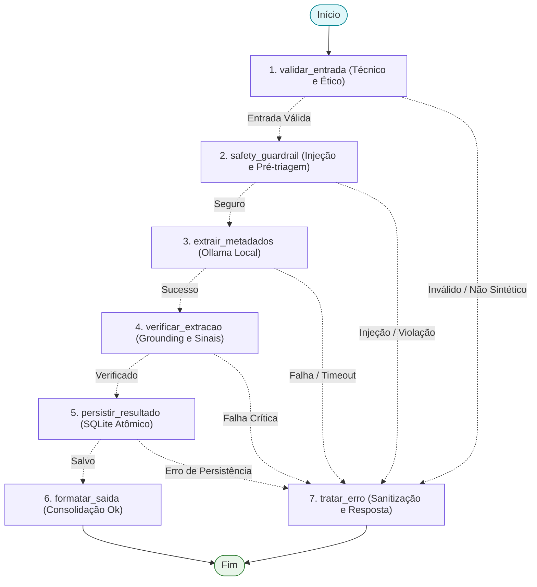

# Arquitetura do LangGraph no Projeto Bem-Estar

Este documento descreve como o **LangGraph** atua funcionalmente no projeto **Challenge 2: Bem-Estar - Diário Emocional Inteligente**, seguindo as melhores práticas de engenharia de sistemas baseados em agentes (*Agentic AI*).

---

## 1. Contexto e Motivação

O projeto realiza a análise e estruturação de relatos sintéticos de diário emocional, identificando temas, sentimentos e indícios que requerem revisão humana por profissionais autorizados.

Em vez de uma cadeia linear rígida (*pipeline* síncrono frágil), o fluxo foi modelado como um **StateGraph** do LangGraph. Isso proporciona:

1. **Separação estrita de responsabilidades:** Validação técnica, guardrails determinísticos de segurança, inferência cognitiva do modelo local, checagem pós-extração de fundamentação (*grounding*) e persistência atômica.
2. **Resiliência e recuperação:** Se qualquer nó falhar (ex.: estouro de contexto, injeção de prompt, indisponibilidade do Ollama, erro de disco), o fluxo é roteado deterministicamente para o nó central de tratamento de erros (`tratar_erro`), garantindo que o contrato de resposta (`ProcessingResult`) seja sempre respeitado sem vazar dados brutos nos diagnósticos.
3. **Observabilidade e rastreabilidade:** Suporte a *checkpointing* em memória (`MemorySaver`), permitindo inspecionar cada transição de estado, historiar execuções por `thread_id` e conectar telemetria (*LangSmith* / *MLflow*).
4. **Testabilidade desacoplada:** Injeção de dependências via `RunnableConfig['configurable']`, permitindo simulações completas em milissegundos sem depender de servidor Ollama ativo.

---

## 2. Topologia do Grafo (StateGraph)

O fluxo operacional do extrator no LangGraph é ilustrado no diagrama Mermaid abaixo:



---

## 3. Estado Tipado (`ExtractionState`)

Definido em [`agents.extractor.graph.ExtractionState`](file:///C:/Users/BLU8CA/OneDrive - Bosch Group/Desktop/PUC/challenge-2-base/agents/extractor/graph.py):

```python
class ExtractionState(TypedDict, total=False):
    # Entradas
    relato: str
    synthetic: bool
    db_path: str | Path | None

    # Validação estrutural e guardrails de segurança
    is_valid: bool
    is_safe: bool
    safety_flags: list[str]

    # Saídas cognitivas
    extraction: Extraction | None
    requires_human_review: bool
    review_reasons: list[str]

    # Metadados operacionais e persistência
    metadata: RunMetadata | None
    saved_id: str | None

    # Status e resultado consolidado
    status: Literal["ok", "error"]
    error: ErrorInfo | None
    result: ProcessingResult | None
```

---

## 4. Descrição dos Nós e Melhores Práticas Aplicadas

### 4.1. `validar_entrada`
- **Responsabilidade:** Validação determinística de contratos e restrições antes de gastar recursos de inferência.
- **Checagens:**
  - Obrigatoriedade de confirmação sintética (`synthetic=True`).
  - Não vazio e tipo string válido.
  - Limite de caracteres (`MAX_INPUT_CHARS = 2400`).
  - Limite de bytes UTF-8 (`MAX_INPUT_BYTES = 2400`).

### 4.2. `safety_guardrail`
- **Responsabilidade:** Proteção contra manipulação adversarial e pré-triagem de segurança.
- **Checagens:**
  - Padrões de *prompt injection* ("ignore instructions", "developer mode", "você agora é um psicólogo").
  - Pré-triagem determinística de menções críticas diretas.

### 4.3. `extrair_metadados`
- **Responsabilidade:** Execução da inferência estruturada via SDK oficial Ollama local (`OllamaExtractor`).
- **Recursos:**
  - `Extraction.model_json_schema()` para garantir saída aderente ao Pydantic.
  - Medição de latência real em milissegundos (`latency_ms`).
  - Serialização concorrente com trava de processo (`_MODEL_LOCK`).
  - Captura sanitizada de timeouts, recusas e erros de conexão.

### 4.4. `verificar_extracao`
- **Responsabilidade:** Guardrail pós-inferência (combate à alucinação e conformidade clínica).
- **Recursos:**
  - **Grounding Check:** Valida se as frases citadas como evidência (`evidencias`) realmente existem no texto original do relato.
  - **Gatilho de Revisão Humana:** Se `sinal_para_revisao == SINAL_IDENTIFICADO`, marca `requires_human_review=True` e adiciona justificativas aos `review_reasons`.
  - Garante o princípio ético fundamental: a IA **nunca** diagnostica nem substitui avaliação profissional.

### 4.5. `persistir_resultado`
- **Responsabilidade:** Persistência atômica no banco SQLite local.
- **Recursos:**
  - Permissão restrita no arquivo (`0600`).
  - Registro de integridade (`PRAGMA user_version`).
  - Tratamento de `StorageError` sem quebra da aplicação.

### 4.6. `formatar_saida` e `tratar_erro`
- **Responsabilidade:** Padronização final do objeto `ProcessingResult`.
- Garante conformidade com o contrato público da aplicação tanto em caso de sucesso quanto de falha.

---

## 5. Como Executar

### Via CLI com a Flag `--graph`:
```bash
printf '%s\n' 'Fiquei frustrado com o cancelamento da reunião.' | uv run bem-estar-extract --synthetic --graph
```

### Via Código Python:
```python
from agents.extractor.graph import run_extraction_graph

relato = "Tenho me sentido sobrecarregado com os prazos no trabalho."
result = run_extraction_graph(relato, synthetic=True)

print(result.status)
print(result.extraction.tema)
print(result.extraction.sentimento)
```

### Visualizar o Diagrama Mermaid:
```python
from agents.extractor.graph import get_graph_mermaid

print(get_graph_mermaid())
```

---

## 6. Testes Automatizados

A suíte em [`tests/test_graph.py`](file:///C:/Users/BLU8CA/OneDrive - Bosch Group/Desktop/PUC/challenge-2-base/tests/test_graph.py) valida:
- Fluxo completo com persistência em SQLite.
- Rejeição de entradas não-sintéticas, vazias ou muito longas.
- Bloqueio determinístico de *prompt injection*.
- Recuperação e fallback em falhas de modelo e de armazenamento.
- Verificação de evidências alucinadas (*grounding check*).
- Rastreamento com *checkpointing* (`MemorySaver`).
- Integração da CLI (`--graph`).
