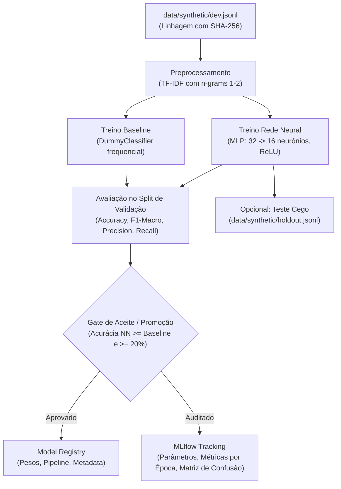

# MLOps e Rede Neural: Arquitetura e Rastreamento

Este documento descreve a implementação de MLOps e a rede neural desenvolvida para o **Challenge 2 - Bem-Estar**, atendendo aos critérios `infra: mlops` e `feature: neural-network`.

---

## 1. Visão Geral da Arquitetura

O pipeline conecta dados sintéticos, extração de features, treinamento de modelos e governança em um fluxo automatizado e auditável.



---

## 2. Componentes Implementados

### `models/`
- **[`models/baseline.py`](file:///C:/Users/BLU8CA/OneDrive%20-%20Bosch%20Group/Desktop/PUC/challenge-2-base/models/baseline.py)**: Classificador de referência estocástico/frequencial (`SentimentBaselineClassifier`) para cálculo de baseline reprodutível.
- **[`models/neural_net.py`](file:///C:/Users/BLU8CA/OneDrive%20-%20Bosch%20Group/Desktop/PUC/challenge-2-base/models/neural_net.py)**: Rede neural multicamadas (`SentimentNeuralNetClassifier`) composta por vetorização TF-IDF sublinear e classificador MLP (`hidden_layer_sizes=(32, 16)`, otimizador Adam, regularização L2).

### `mlops/`
- **[`mlops/config.py`](file:///C:/Users/BLU8CA/OneDrive%20-%20Bosch%20Group/Desktop/PUC/challenge-2-base/mlops/config.py)**: Modelo de configuração tipado com validação Pydantic para hiperparâmetros, sementes e limiares.
- **[`mlops/tracker.py`](file:///C:/Users/BLU8CA/OneDrive%20-%20Bosch%20Group/Desktop/PUC/challenge-2-base/mlops/tracker.py)**: Gerenciador de contexto para rastreamento de experimentos com MLflow (registro de parâmetros, métricas por época, artefatos gráficos e modelos).
- **[`mlops/pipeline.py`](file:///C:/Users/BLU8CA/OneDrive%20-%20Bosch%20Group/Desktop/PUC/challenge-2-base/mlops/pipeline.py)**: Orquestrador executável que realiza:
  1. Leitura e cálculo do hash SHA-256 do dataset (garantia de linhagem de dados).
  2. Divisão estratificada treino/validação.
  3. Treinamento e avaliação do baseline.
  4. Treinamento da rede neural e log da curva de perda (*loss curve*) a cada época.
  5. Avaliação métrica completa e geração gráfica da matriz de confusão (`confusion_matrix.png`).
  6. Gate de aceitação e registro do artefato do modelo.
  7. Avaliação final opcional no conjunto holdout.

---

## 3. Como Executar

### 3.1. Execução do Pipeline CLI
Para rodar o pipeline completo com semente fixa:
```sh
uv run bem-estar-mlops --holdout
```

Parâmetros disponíveis:
- `--split`: conjunto de treino (`dev`, padrão).
- `--holdout`: executa teste cego no conjunto holdout.
- `--seed`: semente de números pseudoaleatórios (padrão: 42).
- `--max-iter`: épocas de treino (padrão: 200).
- `--tracking-uri`: URI do backend de dados (padrão: `sqlite:///mlflow.db`).
- `--output`: exporta o sumário final em arquivo JSON.

### 3.2. Interface Visual do MLflow
Para visualizar experimentos, comparar runs, analisar hiperparâmetros e gráficos de loss:
```sh
uv run mlflow ui --backend-store-uri sqlite:///mlflow.db
```
Em seguida, abra o navegador em `http://127.0.0.1:5000`.

---

## 4. Integração Contínua (CI/CD)

O workflow [`.github/workflows/ci.yml`](file:///C:/Users/BLU8CA/OneDrive%20-%20Bosch%20Group/Desktop/PUC/challenge-2-base/.github/workflows/ci.yml) inclui a execução do pipeline de MLOps em modo smoke (`--max-iter 20`) em ambientes Ubuntu, macOS e Windows, garantindo que nenhum PR quebre o ciclo de treino ou avaliação.
