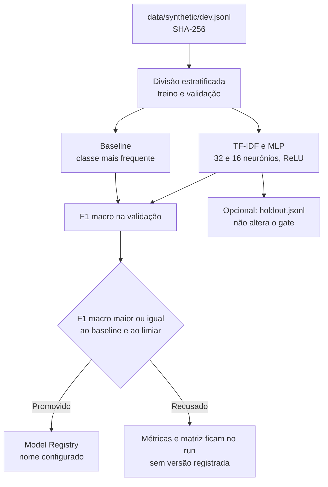

# MLOps e rede neural: arquitetura e rastreamento

Este documento descreve o pipeline implementado para o **Challenge 2 - Bem-Estar**. Ele cobre o rastreamento reproduzível (`infra: mlops`) e a rede neural treinada pelo grupo (`feature: neural-network`).

Os rótulos de `data/synthetic/` estão com `annotation_status: unreviewed`. O gate abaixo é um critério de engenharia para publicar um artefato. Ele não valida uso clínico nem qualidade da anotação.

---

## 1. Visão geral

O comando `bem-estar-mlops` lê o split `dev`, treina um baseline e uma rede, registra a rodada no MLflow e só publica o modelo quando o F1 macro da validação passa no gate. O holdout entra apenas na avaliação cega.



---

## 2. Componentes

### `models/`

- [`models/baseline.py`](../models/baseline.py): `SentimentBaselineClassifier`, um `DummyClassifier` da classe mais frequente.
- [`models/neural_net.py`](../models/neural_net.py): `SentimentNeuralNetClassifier`, TF-IDF com n-gramas 1-2 e `MLPClassifier`.
- [`models/metrics.py`](../models/metrics.py): acurácia, F1 macro, precisão, recall e relatório, usados pelos dois modelos.

A rede classifica o campo `expected.sentimento` dos relatos sintéticos. Ela não substitui o extrator em `agents/extractor/`, que continua usando o modelo de linguagem e o VADER.

### `mlops/`

- [`mlops/config.py`](../mlops/config.py): configuração tipada. O limiar padrão de promoção é `min_f1_macro = 0.25`.
- [`mlops/data.py`](../mlops/data.py): leitura do JSONL e SHA-256 do arquivo.
- [`mlops/gate.py`](../mlops/gate.py): promove quando o F1 macro da validação é maior ou igual ao do baseline e ao limiar.
- [`mlops/store.py`](../mlops/store.py): para um tracking `sqlite:///...`, cria o diretório irmão `<banco>-artifacts`.
- [`mlops/tracker.py`](../mlops/tracker.py): abre o run, registra parâmetros, métricas, figura e, só na promoção, o modelo. Uma exceção encerra o run como `FAILED`.
- [`mlops/pipeline.py`](../mlops/pipeline.py): orquestra a rodada.
- [`mlops/cli.py`](../mlops/cli.py): comando `bem-estar-mlops`.
- [`mlops/plots.py`](../mlops/plots.py): matriz de confusão.

O resultado da promoção fica na tag `promoted` e na métrica `promoted`. Ele não entra como hiperparâmetro.

---

## 3. Como executar

```sh
uv run bem-estar-mlops --holdout
```

Parâmetros:

- `--split`: split de treino. Só `dev` é aceito, para o holdout permanecer cego.
- `--holdout`: avalia `data/synthetic/holdout.jsonl` sem usá-lo no gate.
- `--seed`: semente, padrão 42.
- `--max-iter`: iterações do MLP, padrão 200.
- `--min-f1`: F1 macro mínimo na validação, padrão 0.25.
- `--tracking-uri`: padrão `sqlite:///mlflow.db`. Os arquivos da rodada ficam em `mlflow-artifacts/`, ao lado do banco.
- `--output`: grava o sumário JSON.

Para inspecionar a rodada:

```sh
uv run mlflow ui --backend-store-uri sqlite:///mlflow.db
```

Abra `http://127.0.0.1:5000`. O banco e o diretório de artefatos são locais e estão no `.gitignore`.

---

## 4. Integração contínua

[`.github/workflows/ci.yml`](../.github/workflows/ci.yml) roda `uv sync --locked`, Ruff e `uv run pytest -q` em Ubuntu, macOS e Windows. `tests/test_mlops.py` cobre o ciclo, o gate, o registry, o diretório de artefatos, a reprodutibilidade da semente e o status `FAILED`.
