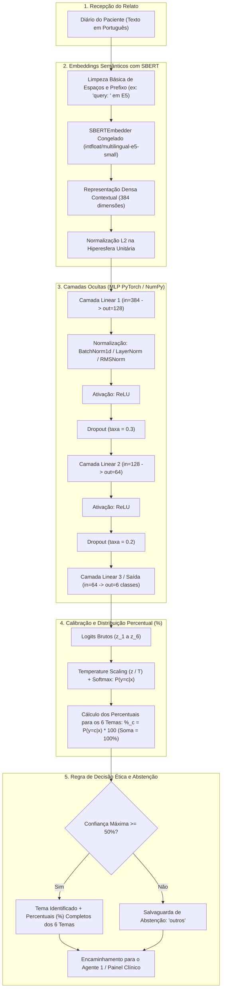
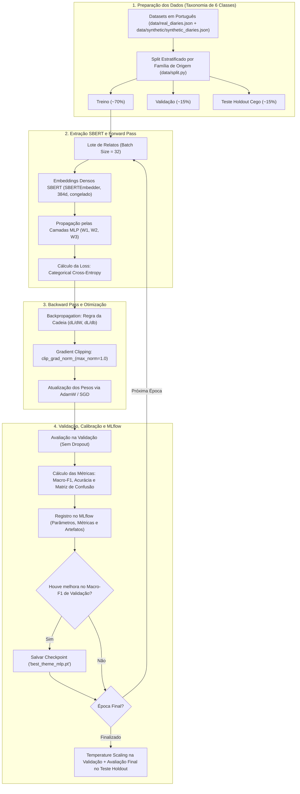
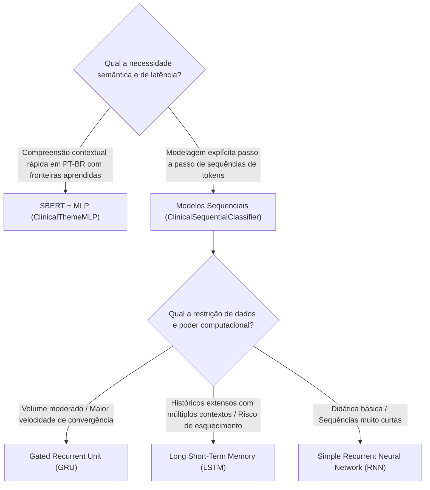

# Fluxograma e Funcionamento da Rede Neural

Este documento detalha o fluxo de processamento, arquitetura e ciclo de treinamento da **Rede Neural Perceptron Multicamadas (MLP)** equipada com embeddings **SBERT** (`models/sbert_embedder.py`), dedicada a receber o diário do paciente, **identificar os 6 temas clínicos** (`autopercepcao`, `vinculos`, `desempenho`, `fisico`, `rupturas`, `outros`) e **gerar suas distribuições percentuais (`%`)**. Comparações conceituais com modelos sequenciais (RNN, LSTM e GRU) em seções posteriores são apenas teóricas e não integram o código ativo.

---

## 1. Fluxograma de Inferência Ponta a Ponta (End-to-End)

O diagrama abaixo ilustra o ciclo completo desde a recepção do diário clínico em português até a geração das distribuições percentuais (`0%` a `100%`) para os 6 temas e a regra de salvaguarda em `outros`.



---

## 2. Fluxograma do Ciclo de Treinamento e Otimização (MLOps)

O diagrama a seguir descreve como a rede é treinada usando **SBERT congelado**, **Backpropagation**, **Categorical Cross-Entropy** e rastreamento no **MLflow**.



---

## 3. Detalhamento Matemático dos Blocos

### 3.1. Embeddings Densos com SBERT (`models/sbert_embedder.py`)
1. **Encoder Pré-Treinado Congelado:** Utiliza `SentenceTransformer("intfloat/multilingual-e5-small")` por padrão com prefixo `"query: "` (ou `paraphrase-multilingual-MiniLM-L12-v2`), substituindo completamente o modelo esparso TF-IDF.
2. **Sem Vazamento de Dados:** Como o encoder não tem pesos ajustados no dataset do projeto, `fit()` é *no-op* e não vaza informações entre treino, validação e teste.
3. **Normalização $L_2$:** Cada diário é convertido em um vetor denso contínuo de $d = 384$ dimensões normalizado na hiperesfera unitária:
   $$e = \frac{\text{SBERT}(\text{texto})}{\|\text{SBERT}(\text{texto})\|_2 + \epsilon}$$

### 3.2. Propagação Direta (MLP em `models/torch_mlp.py`)
A rede processa o vetor SBERT em três estágios lineares com não linearidades e normalização:
1. **Primeira Camada Oculta:**
   $$z_1 = W_1 e + b_1 \quad (W_1 \in \mathbb{R}^{128 \times 384})$$
   $$h_1 = \text{ReLU}(\text{Norm}(z_1))$$
   $$\tilde{h}_1 = \text{Dropout}(h_1, p=0.3)$$
2. **Segunda Camada Oculta:**
   $$z_2 = W_2 \tilde{h}_1 + b_2 \quad (W_2 \in \mathbb{R}^{64 \times 128})$$
   $$h_2 = \text{ReLU}(z_2)$$
   $$\tilde{h}_2 = \text{Dropout}(h_2, p=0.2)$$
3. **Camada de Saída (Logits para os 6 Temas):**
   $$z_{\text{out}} = W_3 \tilde{h}_2 + b_3 \quad (W_3 \in \mathbb{R}^{6 \times 64})$$

### 3.3. Função de Perda (Categorical Cross-Entropy)
Para classificação multiclasse onde cada relato possui um rótulo verdadeiro $y \in \{0, \dots, 5\}$ entre os 6 temas, a perda é dada por:
$$\mathcal{L} = - \sum_{c=1}^{6} y_c \log\left(\frac{e^{z_c}}{\sum_{j=1}^{6} e^{z_j}}\right)$$

### 3.4. Retropropagação Analítica (Backpropagation em `models/numpy_mlp.py`)
No baseline didático em NumPy puro, a derivada analítica combinada da Softmax com a Entropia Cruzada é computada exatamente como:
$$\frac{\partial \mathcal{L}}{\partial z_{\text{out}}} = \frac{\hat{p} - y_{\text{one-hot}}}{N}$$
$$\frac{\partial \mathcal{L}}{\partial W_{\text{out}}} = a_1^T \left(\frac{\partial \mathcal{L}}{\partial z_{\text{out}}}\right), \quad \frac{\partial \mathcal{L}}{\partial b_{\text{out}}} = \sum_{\text{batch}} \frac{\partial \mathcal{L}}{\partial z_{\text{out}}}$$
Propagando o gradiente de volta para a camada oculta através da derivada da ReLU:
$$\frac{\partial \mathcal{L}}{\partial z_1} = \left(\frac{\partial \mathcal{L}}{\partial a_1}\right) \odot \mathbb{I}(z_1 > 0)$$

---

## 4. Guia de Escolhas Arquiteturais e Diagnósticos

### 4.1. SBERT + MLP vs. Modelos Sequenciais (RNN, LSTM, GRU)

As alternativas seguintes são conceituais. O repositório implementado não contém
um `ClinicalSequentialClassifier` ou modelos RNN, LSTM e GRU ativos.



### 4.2. Técnicas de Normalização

* **Batch Normalization (`BatchNorm1d`):** Normaliza na dimensão do mini-batch. Excelente para MLPs com lotes maiores ($N \ge 16$).
* **Layer Normalization (`LayerNorm`):** Normaliza na dimensão das características individuais de cada amostra. Padrão para processamento de texto e modelos recorrentes por não oscilar com batch sizes variáveis.
* **RMSNorm (`RMSNorm`):** Normaliza pela raiz quadrada média dos elementos sem subtrair a média:
  $$\text{RMS}(x) = \sqrt{\frac{1}{d}\sum_{i=1}^{d} x_i^2 + \epsilon}, \quad \text{RMSNorm}(x) = \frac{x}{\text{RMS}(x)} \odot \gamma$$
  Reduz custo computacional mantendo estabilidade comparável à LayerNorm.

### 4.3. Diagnóstico e Resolução de Problemas de Gradiente

| Fenômeno | Sintoma / Diagnóstico | Causa Raiz | Solução Adotada no Projeto |
| :--- | :--- | :--- | :--- |
| **Vanishing Gradients** | Perda estagnada no início; norma do gradiente $\|\nabla W_1\| < 10^{-6}$. | Saturação de ativações clássicas (Sigmoid/Tanh) e camadas sem normalização. | Ativação **ReLU**, inicialização **He/Kaiming**, camadas de **Normalização** e conexões de portão aditivo (**LSTM/GRU**). |
| **Exploding Gradients** | Perda salta para `NaN` ou `Inf`; oscilações bruscas nos pesos. | Taxa de aprendizado excessiva ou multiplicação cumulativa de matrizes com autovalores $> 1$. | **Gradient Clipping** (`torch.nn.utils.clip_grad_norm_(max_norm=1.0)`) ativo em todas as iterações de treino. |

### 4.4. Critérios para Seleção da Função de Perda

| Função de Perda | Fórmula Matemática | Cenário Clínico Apropriado | Adotado na Rede? |
| :--- | :--- | :--- | :---: |
| **Categorical Cross-Entropy (CCE)** | $-\sum y_c \log(\hat{y}_c)$ | Classificação multiclasse mutuamente exclusiva ($\sum P_i = 100\%$). | **Sim (Principal nos 6 temas)** |
| **Binary Cross-Entropy (BCE)** | $-\sum [y \log \hat{y} + (1-y)\log(1-\hat{y})]$ | Classificação multirrótulo independente ou triagem binária de risco. | Alternativa |
| **Mean Squared Error (MSE)** | $\frac{1}{N}\sum (y - \hat{y})^2$ | Regressão contínua de escalas clínicas (ex: escore PHQ-9 de 0 a 27). | Opcional |
| **Mean Absolute Error (MAE)** | $\frac{1}{N}\sum \|y - \hat{y}\|$ | Regressão clínica robusta a pacientes discrepantes (*outliers*). | Opcional |

---

## 5. Exemplo Ilustrativo do Formato de Saída após Receber o Diário

O trecho abaixo é ilustrativo. Os números não representam uma inferência
confirmada ou uma taxonomia clínica validada.

**Entrada Textual:**
> *"Meu pai ligou só pra cobrar as notas da faculdade e comparar com o filho do vizinho. Desliguei o telefone com vontade de sumir do mapa, eles nunca perguntam como eu tô me sentindo por dentro."*

**Vetorização e Classificação:**
1. `SBERTEmbedder` gera o vetor unitário denso ($d=384$).
2. Passagem pelo `ClinicalThemeMLP` (`384 -> 128 -> 64 -> 6` logits).
3. Softmax calibrada (Temperature Scaling) gera os percentuais (`%`) para cada um dos **6 temas** (soma = `100.00%`):

```
┌────────────────────────┬─────────────┐
│ Tema                   │ Percentual  │
├────────────────────────┼─────────────┤
│ vinculos               │      84.50% │  <-- Tema Identificado (Confiança >= 50%)
│ desempenho             │       8.20% │
│ autopercepcao          │       5.10% │
│ fisico                 │       1.10% │
│ rupturas               │       0.60% │
│ outros                 │       0.50% │
├────────────────────────┼─────────────┤
│ Soma Total             │     100.00% │
└────────────────────────┴─────────────┘
```

*(Valores acima ilustrativos do formato de saída gerado por `ClinicalThemePredictor.predict_text()`; na decomposição por sentenças via `--destrinchar`, o preditor também calcula a fração de caracteres analisados por tema com citações literais.)*

**Resultado:**
A rede neural identifica o tema predominante (`vinculos`) e disponibiliza a distribuição percentual (`%`) completa dos 6 temas para os consumidores do pipeline (como o Agente 1 e a camada de visualização).
