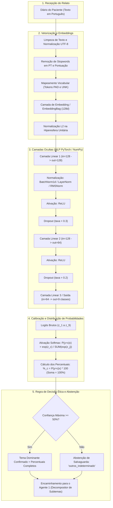
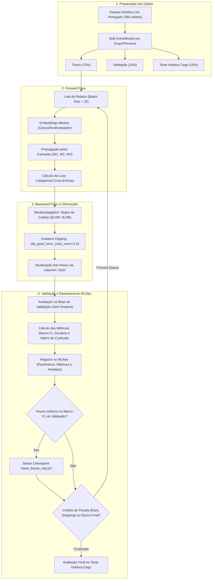
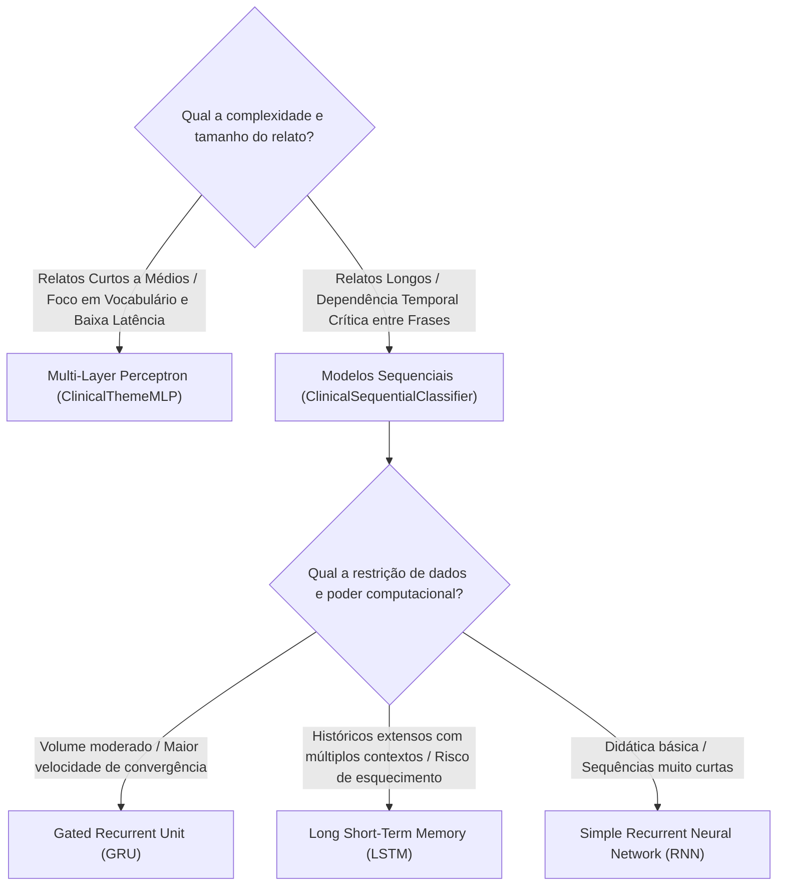

# Fluxograma e Funcionamento da Rede Neural

Este documento detalha o fluxo de processamento, arquitetura e ciclo de treinamento da **Rede Neural Perceptron Multicamadas (MLP)** e dos **Modelos Sequenciais (RNN, LSTM e GRU)** dedicados à identificação dos 8 temas psicológicos a partir dos relatos dos diários dos pacientes.

---

## 1. Fluxograma de Inferência Ponta a Ponta (End-to-End)

O diagrama abaixo ilustra o ciclo completo desde a recepção do diário clínico em português até a geração das distribuições percentuais (0 a 100%) e salvaguarda ética de abstenção.



---

## 2. Fluxograma do Ciclo de Treinamento e Otimização (MLOps)

O diagrama a seguir descreve como a rede é ajustada matematicamente usando **Backpropagation**, **Categorical Cross-Entropy** e boas práticas de mitigação de gradientes explosivos/evanescentes.



---

## 3. Detalhamento Matemático dos Blocos

### 3.1. Embeddings Densos (`models/embedder.py`)
1. **Tokenização:** Limpeza textual com preservação de marcadores diagnósticos e remoção de *stopwords* da língua portuguesa (`PORTUGUESE_STOPWORDS`).
2. **Tokens Reservados:**
   - `<PAD>` (índice `0`): preenchimento para empacotamento em lotes (*batches*).
   - `<UNK>` (índice `1`): palavras fora do vocabulário de treino (*Out-Of-Vocabulary / OOV*).
3. **Agregação e Normalização:** O texto do relato é convertido para um vetor contínuo de $d = 128$ dimensões via média dos vetores de palavras (*Mean Pooling*), seguido de normalização $L_2$:
   $$e = \frac{\bar{v}}{\|\bar{v}\|_2 + \epsilon}$$

### 3.2. Propagação Direta (MLP em `models/torch_mlp.py`)
A rede processa a entrada em três estágios lineares com não linearidades e normalização:
1. **Primeira Camada Oculta:**
   $$z_1 = W_1 e + b_1 \quad (W_1 \in \mathbb{R}^{128 \times 128})$$
   $$h_1 = \text{ReLU}(\text{Norm}(z_1))$$
   $$\tilde{h}_1 = \text{Dropout}(h_1, p=0.3)$$
2. **Segunda Camada Oculta:**
   $$z_2 = W_2 \tilde{h}_1 + b_2 \quad (W_2 \in \mathbb{R}^{64 \times 128})$$
   $$h_2 = \text{ReLU}(z_2)$$
   $$\tilde{h}_2 = \text{Dropout}(h_2, p=0.2)$$
3. **Camada de Saída (Logits):**
   $$z_{\text{out}} = W_3 \tilde{h}_2 + b_3 \quad (W_3 \in \mathbb{R}^{9 \times 64})$$

### 3.3. Função de Perda (Categorical Cross-Entropy)
Para classificação multiclasse onde cada relato possui um rótulo verdadeiro $y \in \{0, \dots, C-1\}$, a perda é dada por:
$$\mathcal{L} = - \sum_{c=1}^{C} y_c \log\left(\frac{e^{z_c}}{\sum_{j=1}^{C} e^{z_j}}\right)$$

### 3.4. Retropropagação Analítica (Backpropagation em `models/numpy_mlp.py`)
No baseline didático em NumPy puro, a derivada analítica combinada da Softmax com a Entropia Cruzada é computada exatamente como:
$$\frac{\partial \mathcal{L}}{\partial z_{\text{out}}} = \frac{\hat{p} - y_{\text{one-hot}}}{N}$$
$$\frac{\partial \mathcal{L}}{\partial W_3} = h_2^T \left(\frac{\partial \mathcal{L}}{\partial z_{\text{out}}}\right), \quad \frac{\partial \mathcal{L}}{\partial b_3} = \sum_{\text{batch}} \frac{\partial \mathcal{L}}{\partial z_{\text{out}}}$$
Propagando o gradiente de volta para as camadas ocultas através da derivada da ReLU:
$$\frac{\partial \mathcal{L}}{\partial z_1} = \left(\frac{\partial \mathcal{L}}{\partial h_1}\right) \odot \mathbb{I}(z_1 > 0)$$

---

## 4. Guia de Escolhas Arquiteturais e Diagnósticos

### 4.1. MLP vs. Modelos Sequenciais (RNN, LSTM, GRU)



### 4.2. Técnicas de Normalização

* **Batch Normalization (`BatchNorm1d`):** Normaliza na dimensão do mini-batch. Excelente para MLPs com lotes maiores ($N \ge 16$).
* **Layer Normalization (`LayerNorm`):** Normaliza na dimensão das características individuais de cada amostra. Padrão para processamento de texto e modelos recorrentes por não oscilar com batch sizes variáveis.
* **RMSNorm (`RMSNorm`):** Normaliza pela raiz quadrada média dos elementos sem subtrair a média:
  $$\text{RMS}(x) = \sqrt{\frac{1}{d}\sum_{i=1}^{d} x_i^2 + \epsilon}, \quad \text{RMSNorm}(x) = \frac{x}{\text{RMS}(x)} \odot \gamma$$
  Reduz custo computacional em 10% a 15% mantendo estabilidade idêntica à LayerNorm.

### 4.3. Diagnóstico e Resolução de Problemas de Gradiente

| Fenômeno | Sintoma / Diagnóstico | Causa Raiz | Solução Adotada no Projeto |
| :--- | :--- | :--- | :--- |
| **Vanishing Gradients** | Perda estagnada no início; norma do gradiente $\|\nabla W_1\| < 10^{-6}$. | Saturação de ativações clássicas (Sigmoid/Tanh) e camadas profundas sem normalização. | Ativação **ReLU**, inicialização **He/Kaiming**, camadas de **Normalização** e conexões de portão aditivo (**LSTM/GRU**). |
| **Exploding Gradients** | Perda salta para `NaN` ou `Inf`; oscilações bruscas nos pesos. | Taxa de aprendizado excessiva ou multiplicação cumulativa de matrizes com autovalores $> 1$. | **Gradient Clipping** (`torch.nn.utils.clip_grad_norm_(max_norm=1.0)`) ativo em todas as iterações de treino. |

### 4.4. Critérios para Seleção da Função de Perda

| Função de Perda | Fórmula Matemática | Cenário Clínico Apropriado | Adotado na Rede? |
| :--- | :--- | :--- | :---: |
| **Categorical Cross-Entropy (CCE)** | $-\sum y_c \log(\hat{y}_c)$ | Classificação multiclasse mutuamente exclusiva ($\sum P_i = 100\%$). | **Sim (Principal)** |
| **Binary Cross-Entropy (BCE)** | $-\sum [y \log \hat{y} + (1-y)\log(1-\hat{y})]$ | Classificação multirrótulo independente ou triagem binária de risco. | Alternativa |
| **Mean Squared Error (MSE)** | $\frac{1}{N}\sum (y - \hat{y})^2$ | Regressão contínua de escalas clínicas (ex: escore PHQ-9 de 0 a 27). | Opcional |
| **Mean Absolute Error (MAE)** | $\frac{1}{N}\sum \|y - \hat{y}\|$ | Regressão clínica robusta a pacientes discrepantes (*outliers*). | Opcional |

---

## 5. Exemplo de Execução Real

**Entrada Textual:**
> *"Meu pai ligou só pra cobrar as notas da faculdade e comparar com o filho do vizinho. Desliguei o telefone com vontade de sumir do mapa, eles nunca perguntam como eu tô me sentindo por dentro."*

**Vetorização e Classificação:**
1. TextEmbedder gera vetor unitário denso ($d=128$).
2. Passagem pelo `ClinicalThemeMLP` (Camada 1 $\to$ BatchNorm $\to$ ReLU $\to$ Camada 2 $\to$ Logits).
3. Softmax gera o vetor de probabilidades normalizado.
4. Percentuais resultantes:

```
┌────────────────────────┬─────────────┐
│ Tema                   │ Percentual  │
├────────────────────────┼─────────────┤
│ familia                │      95.74% │  <-- Tema Dominante (Confiança >= 50%)
│ estudos                │       1.63% │
│ relacionamentos        │       1.04% │
│ saude_sono             │       0.42% │
│ financas               │       0.41% │
│ trabalho               │       0.34% │
│ luto                   │       0.22% │
│ outros_indeterminado   │       0.10% │
│ autoestima             │       0.09% │
├────────────────────────┼─────────────┤
│ Soma Total             │     100.00% │
└────────────────────────┴─────────────┘
```

**Resultado:**
O tema `familia` é confirmado e encaminhado junto à distribuição percentual completa para o **Agente 1**, que iniciará a extração dos subtemas (`Cobrança Paterna`, `Comparação Fraterna/Social`) e das citações literais correspondentes.
