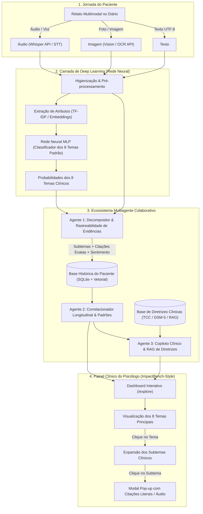

# 01 - Visão Geral, Arquitetura e Fronteiras Clínicas

## 1. Visão do Projeto e Proposta de Valor

O **Diário Clínico Assistido & Copiloto Psicológico** é um ecossistema agentico e de inteligência artificial desenhado para atuar como ponte entre os sentimentos vivenciados pelo paciente no seu cotidiano e a prática psicoterapêutica profissional realizada em consultório.

### O Problema Clínico e Social
Estudos recentes de grande escala (como McBain et al., *JAMA Network Open*, 2025 e *JAMA Pediatrics*, 2026; Li et al., *arXiv:2512.07797*, 2025) demonstram que adolescentes e adultos recorrem crescentemente a modelos de linguagem (LLMs conversacionais e chatbots comerciais) para "desabafar" e buscar aconselhamento em momentos de angústia. No entanto, essa interação desregulada apresenta sérios riscos:
- **Ausência de Continuidade Terapêutica:** Respostas pontuais que não constroem um plano de tratamento ou desenvolvimento de resiliência.
- **Sicofania e Validação Tóxica:** Tendência dos LLMs de concordar excessivamente com o usuário, validando ruminações ou pensamentos distorcidos.
- **Risco de Dependência e Alucinações:** Falsa ilusão de vínculo terapêutico sem supervisão humana capacitada e incapacidade de condução clínica de risco à vida.

### A Solução Proposta
Ao invés de desabafar com um bot conversacional que tenta agir como terapeuta substituto, o paciente utiliza um **Diário Multimodal Pessoal** (suportando texto escrito, fotos/imagens de apoio e mensagens de voz gravadas). 
1. **O paciente desabafa de forma autêntica e privada**, sabendo que o material não será julgado por um chatbot, mas servirá de subsídio para o seu psicólogo real.
2. **O sistema inteligente processa esses registros em segundo plano**, através de uma Rede Neural de Deep Learning para categorização macrotemática e de uma rede colaborativa de agentes de IA para decomposição em subtemas, correlação longitudinal e busca em diretrizes clínicas (RAG).
3. **O psicólogo acessa um Painel Interativo inspirado no MIT ImpactBench**, onde visualiza a evolução longitudinal do paciente, os 8 temas clínicos fundamentais, os subtemas emergentes e, ao clicar, abre *pop-ups* com as citações e trechos literais exatos (áudio ou texto) gravados pelo paciente fora da sessão.

---

## 2. Fronteiras Clínicas e Princípios Éticos Fundamentais

O sistema foi rigorosamente desenhado com base no princípio de **Inteligência Aumentada (Human-in-the-Loop)**, respeitando as resoluções do Conselho Federal de Psicologia (CFP) e diretrizes internacionais de IA na saúde (NIST AI RMF, 2026):

* **Ampliação, Nunca Substituição:** O software não fornece diagnósticos clínicos (ex: não rotula o paciente como tendo "Transtorno Depressivo Maior"), não prescreve intervenções diretas ao paciente e não emite conselhos terapêuticos autônomos. A interpretação clínica pertence 100% ao psicólogo humano.
* **Separação Rígida entre Tema, Sentimento e Polaridade:** Contextos de vida (ex: "Família" ou "Trabalho") não possuem valência emocional intrínseca pré-definida. O sistema dissocia a temática abordada das emoções reportadas (ex: Família pode estar associada tanto a Acolhimento e Alegria quanto a Frustração e Raiva).
* **Detecção de Indício Textual de Risco vs. Gestão de Crise:** O sistema identifica estritamente padrões lexicais/semânticos indicativos de sofrimento agudo ou risco (ex: expressões de desesperança profunda ou ideação passiva vs. ativa). Ele sinaliza ao psicólogo para priorização na pauta da sessão. Contudo, o sistema **não atua como pronto-socorro psicológico** e explicita que a ausência de indício textual não equivale a atestado de segurança clínica.
* **Rastreabilidade e Explicabilidade Absoluta:** Nenhuma métrica ou subtema aparece no painel do psicólogo como uma "caixa-preta". Todo indicador deve ser fundamentado em evidências textuais/auditivas diretas, permitindo ao terapeuta inspecionar a palavra exata proferida pelo paciente.

---

## 3. Macrofluxo Arquitetural Ponta a Ponta

---

## 4. O Ciclo de Interação: Da Expressão ao Consultório

1. **Expressão Assíncrona do Paciente:** O paciente vivencia um atrito no trabalho ou uma discussão familiar às 22h. Em vez de recorrer a um bot generativo que pode gerar respostas descontextualizadas, abre o aplicativo e grava um áudio de 2 minutos ou redige um texto.
2. **Processamento Neural Híbrido:**
   - A **Rede Neural** (construída e treinada pelo grupo) avalia o texto e detecta que a temática preponderante é **Família** (com 91% de probabilidade).
   - O **Agente 1 (Decompositor)** analisa o conteúdo em profundidade e descobre os subtemas específicos: *"Discussão sobre finanças do pai"* e *"Relação com irmão mais novo"*. Mapeia os trechos literais exatos com carimbos de tempo e posições de caracteres.
   - O **Agente 2 (Correlacionador Longitudinal)** verifica os últimos 30 dias e nota que o subtema *"irmão"* é reincidente às quintas-feiras e correlaciona-se com picos do sentimento *"frustração"*.
   - O **Agente 3 (RAG de Diretrizes)** consulta protocolos clínicos autorizados (ex: TCC para resolução de conflitos e comunicação assertiva) e gera sugestões de perguntas investigativas para o psicólogo abordar em sessão.
3. **Consulta Clínica Enriquecida:**
   - Minutos antes da sessão, o psicólogo abre a tela do paciente no sistema (com interface visual limpa no estilo ImpactBench).
   - O psicólogo nota o alerta visual no tema **Família**, clica e vê o nó **Irmão**.
   - Ao clicar em **Irmão**, um modal pop-up exibe a transcrição literal e o trecho de áudio exato gravado pelo paciente.
   - A consulta inicia-se com foco cirúrgico nas dores reais do paciente, maximizando a eficácia terapêutica humana.

---

## 5. Alinhamento com as Restrições (Constraints) do Desafio

| Restrição | Como o Projeto Atende |
| :--- | :--- |
| **1. Pelo menos 2 agentes que trabalhem juntos** | **Três agentes integrados:** Agente 1 (Decompositor/Extrator de Subtemas) alimenta o Agente 2 (Correlacionador Longitudinal), que por sua vez aciona o Agente 3 (Consultor RAG de Diretrizes Clínicas). |
| **2. Ter uma base de conhecimento** | Base tripartite: Acervo de Diretrizes Clínicas autorizadas (TCC/Beck, protocolos de regulação emocional), Base Histórica de Relatos do Paciente e Regras Imutáveis de Sistema. |
| **3. Aplicar MLOps** | Pipeline estruturado com `uv`, GitHub Actions (CI para pytest e ruff), rastreamento de experimentos com MLflow (hiperparâmetros, loss, F1-macro e matrizes de confusão) e versionamento de modelos. |
| **4. Construir e testar pelo menos uma rede neural simples** | Rede Neural MLP construída e treinada especificamente para classificar os 8 temas padrão a partir de vetores de texto, com divisão treino/validação/teste e métricas reproduzíveis. |
| **5. Utilizar API por meio dos agentes** | Agentes utilizam APIs para transcrição de áudio (STT), inferência de LLM (API local Ollama / OpenAI-compatible via `httpx`/`pydantic-ai`) e recuperação vetorial. |
| **6. Ferramenta de versionamento de código** | Repositório Git com histórico atômico, branches temáticas (`feat/*`), convenção de Conventional Commits e Pull Requests documentados. |
| **7. Solução ética e explicável** | Governança alinhada ao CFP e NIST AI RMF: privacidade local, abstenção estrita de diagnósticos/prescrições e rastreabilidade total (pop-up de evidências literais). |
| **8. Pelo menos 1 resource de até 2 anos** | Embasado em artigos de alto impacto de 2024–2026: Li et al. (*arXiv:2512.07797*, 2025), McBain et al. (*JAMA Network Open*, 2025; *JAMA Pediatrics*, 2026), Breslau et al. (*ScienceDirect*, 2025), *PsychAdapter* (Nature/arXiv 2024/2025) e *ImpactBench* (MIT Media Lab, 2025/2026). |
| **9. MVP funcional** | Aplicação executável de ponta a ponta: ingestão do diário, classificação neural, extração de subtemas por agentes, persistência em SQLite/Vector Store e visualização no painel interativo. |
