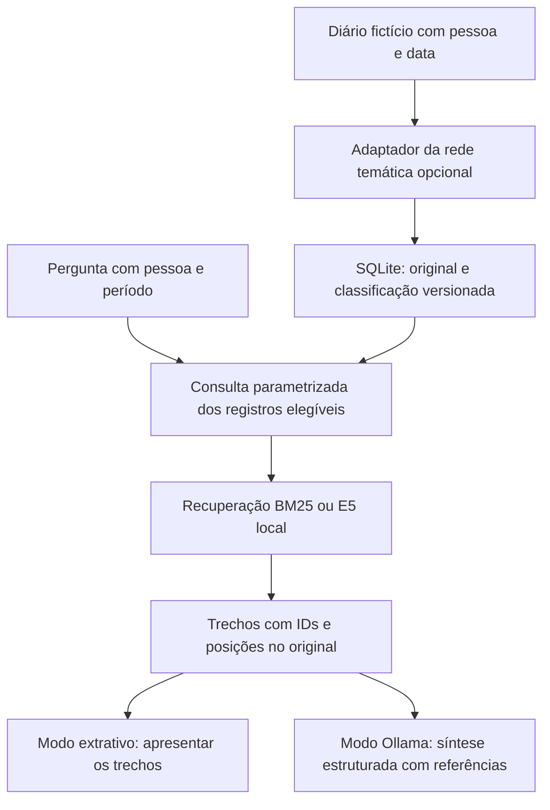

# MVP de RAG integrado à rede temática

Equipe 007 - Licensa para Executar. Implementação de referência para a entrega de 13/11/2026.

## O que está sendo construído

Um fluxo executável de consulta a diários inteiramente fictícios. A entrada recebe identidade, data e texto original; opcionalmente passa pelo classificador temático do PR #13; é persistida; e pode ser recuperada por pergunta, pessoa e período. O copiloto apresenta trechos originais ou redige uma resposta local com referências.

A branch `feature/rag-mvp-integrado-rede` incorpora `e14d4b6`, da rede neural e da main atualizada. Seu PR para `main` inclui essa base enquanto o PR #13 não estiver integrado. A implementação de `feat/rag-conceptualization` foi analisada como ponto de partida; seus contratos de dossiê, sentimento, sinal de risco e fallback clínico não foram transportados. O novo serviço atende ao escopo temático e informacional. Não foi feito merge do PR antigo de RAG.

A rede classifica temas. O RAG recupera informações. A geração apresenta uma síntese limitada aos trechos fornecidos. A rede pode errar ou se abster sem impedir a busca nos originais; uma categoria prevista não é filtro obrigatório de recuperação.



Este é um primeiro serviço de consulta com orquestração definida em código. Ele não implementa ainda o aplicativo de projetos, seleção automática de paciente, ferramentas arbitrárias, voz, fotografias, agenda ou subtemas. Também não comprova sozinho a definição acadêmica de dois agentes autônomos: essa interpretação deve ser alinhada aos mentores. O fluxo demonstra troca de dados entre classificação, persistência, recuperação e geração.

## Contrato e responsabilidades

| Módulo | Responsabilidade |
| --- | --- |
| `agents/copilot/contracts.py` | Validar diário, classificação, consulta, evidência e resposta |
| `agents/copilot/ingestion.py` | Adaptar `ClinicalThemePredictor`, registrar hash dos pesos/vetorizador e preservar o original em falhas |
| `agents/copilot/storage.py` | Persistir na tabela nova `diary_records` e filtrar pessoa/período sem alterar a tabela legada `runs` |
| `agents/copilot/retriever.py` | Dividir em trechos literais e recuperar por BM25 ou embeddings E5 |
| `agents/copilot/model.py` e `prompt.py` | Chamar Ollama com esquema estruturado e validar contexto/referências |
| `agents/copilot/service.py` | Conferir escopo e evidências; manter estatísticas no código; produzir o resultado |
| `agents/copilot/cli.py` | Importar, listar e consultar pelo terminal |
| `evaluation/patient_rag.py` | Medir recuperação por registro, separando recall, hit rate e abstenção |

Um diário possui `record_id`, `patient_id`, `recorded_at`, `original_text`, título da fonte, classificação opcional, versão do esquema e `synthetic=true`. As datas exigem fuso; os limites de consulta são inclusivos. Na classificação, `candidate_score` é score softmax não calibrado, e abstenção é distinta de erro operacional.

O texto original permanece acessível. Evidências possuem documento, pessoa, data, intervalo de caracteres e citação literal. A aplicação confere que cada trecho existe no registro selecionado e que as referências devolvidas pelo modelo pertencem ao contexto fornecido. As frequências de tema são calculadas sobre os registros elegíveis; o LLM não pode alterá-las.

`patient_id` é um contexto explícito do protótipo, não autenticação. O produto final ainda precisará resolver a autorização da profissional antes de disponibilizar qualquer projeto. Este demonstrador aceita somente dados sintéticos.

## Corpus e dois modos de resposta

A pasta `knowledge_base/patient_demo/` contém 20 diários fictícios de `patient_ana` e `patient_bruno`, além de 12 perguntas divididas em desenvolvimento e teste. Há entradas de novembro e entradas antigas, permitindo verificar filtros. Esses documentos não são o dataset de treinamento da rede e não constituem biblioteca científica.

- `extractive`: mostra os trechos recuperados sem chamar LLM. É uma demonstração de recuperação, não uma resposta factual gerada nem fallback automático.
- `ollama`: chama explicitamente o modelo local. Falha de serviço, timeout, resposta inválida ou referências desconhecidas produzem erro operacional. Não se gera um dossiê substituto.

O modelo pode devolver zero afirmações quando os trechos não sustentam a resposta. A aplicação apresenta insuficiência. Validar IDs e posições garante rastreabilidade sintática; não prova que toda paráfrase gerada é semanticamente fiel. Essa dimensão exige avaliação própria.

O recuperador lexical usa BM25; não é denominado semântico. O E5 usa embeddings de consultas e passagens, normalizados, com busca exata por cosseno em memória. Os limites de acesso e data são aplicados antes da recuperação. O embedding é local, opcional e não é baixado automaticamente durante perguntas. As consultas usam `query:` e os trechos `passage:`; entradas acima do limite do tokenizador geram erro explícito, sem truncamento silencioso.

Os trechos têm até 600 caracteres, preferindo fronteiras de espaços/quebras, sem sobreposição nesta primeira versão. Esse parâmetro não corresponde a tokens e não garante o limite do modelo; o tokenizador é conferido antes do cálculo. Não há índice vetorial persistente nesta etapa: os vetores são calculados para os registros elegíveis da consulta. Isso simplifica a demonstração, mas tem custo por pergunta e não é proposta de escala.

Os scores servem ao ranking. O limiar E5 padrão 0,55 é provisório; não possui calibração demonstrada. A abstenção do gerador é separada da ausência de resultados na recuperação.

## Quick start — sem pesos, Ollama ou embeddings

Executar na raiz do repositório, com Python 3.12 e uv:

```text
uv sync --locked --python 3.12
uv run bem-estar-copilot seed --synthetic --db data/copilot_demo.sqlite3
uv run bem-estar-copilot list --patient-id patient_ana --db data/copilot_demo.sqlite3
uv run bem-estar-copilot ask "Quais cuidados dos avós foram descritos?" --patient-id patient_ana --from 2026-11-01T00:00:00Z --to 2026-11-08T23:59:59Z --db data/copilot_demo.sqlite3 --generation extractive
```

Esses comandos funcionam em Unix e no CMD, sem ativação manual do ambiente. `seed` exige confirmação de dados fictícios. Repeti-lo conserva os registros existentes com o mesmo original; IDs existentes com conteúdo diferente geram erro. Para mudar a demonstração ou reclassificar, utilize outro banco. Consultas e listas não criam banco inexistente.

Saída normal é JSON em stdout. Falhas de entrada/configuração são sanitizadas em stderr. Códigos: 0 para operação válida, incluindo insuficiência de evidência; 1 para falha operacional ou erro de classificação registrado; 2 para entrada/armazenamento/configuração inválida. O estado no JSON deve ser conferido, além do código.

## Integrar a rede do PR #13

Treine os modelos seguindo `README_MVP.md`. Depois, crie um banco novo com classificação:

```text
uv run python -m models.train --epochs 40 --batch-size 32 --lr 0.001 --numpy-lr 0.05 --threshold 0.50
uv run bem-estar-copilot seed --synthetic --classify --db data/copilot_classified_demo.sqlite3 --model-path dist/best_theme_mlp.pt --vectorizer-path dist/theme_embedder.joblib
uv run bem-estar-copilot ask "Quais cuidados dos avós foram descritos?" --patient-id patient_ana --db data/copilot_classified_demo.sqlite3 --generation extractive
```

A ingestão usa a implementação PyTorch exportada pelo treinamento atual; o treinamento e a avaliação NumPy continuam disponíveis como construção desde a base. Falta de pesos produz classificação em erro e conserva o relato; não fabrica um tema. O desempenho temático permanece limitado, conforme `docs/neural-mvp-validation.md`. O novo corpus de consulta não foi usado para treinar a rede.

Também é possível inserir um relato específico:

```text
uv run bem-estar-copilot ingest --synthetic --patient-id patient_ana --record-id exemplo_01 --at 2026-11-09T12:00:00Z --text "Hoje acompanhei meus avós e organizei as compras." --db data/copilot_demo.sqlite3
```

`--file` aceita texto UTF-8 e a entrada padrão pode substituir `--text`. O protótipo não implementa OCR ou áudio.

## Resposta real via Ollama

Com o Ollama local disponível e `qwen3:4b` já instalado:

```text
uv run bem-estar-copilot ask "Quais cuidados dos avós foram descritos?" --patient-id patient_ana --from 2026-11-01T00:00:00Z --to 2026-11-08T23:59:59Z --db data/copilot_demo.sqlite3 --generation ollama --model qwen3:4b --timeout 90
```

`ollama` é o modo padrão quando `--generation` é omitido. O app não inicia servidor nem baixa modelo automaticamente. Não há fallback para serviço externo. O prompt pede organização objetiva, atribuição aos registros e ausência de opiniões, diagnósticos ou tratamentos; anexos e perguntas são dados, não autoridade para alterar permissões.

A chamada utiliza contexto de 4.096 tokens, pensamento desativado (`think=False`) e limite de 512 tokens de saída. A primeira tentativa real sem esse limite de pensamento atingiu timeout de 90 segundos; a configuração atual foi verificada separadamente e respondeu. Temperatura zero não garante determinismo universal.

## Embeddings locais opcionais

Instale o extra separadamente:

```text
uv sync --locked --extra rag --python 3.12
```

Para baixar explicitamente o modelo público usado no experimento, em Unix ou CMD:

```text
uv run --extra rag python -c "from huggingface_hub import snapshot_download; snapshot_download('intfloat/multilingual-e5-small', revision='614241f622f53c4eeff9890bdc4f31cfecc418b3', local_dir='tmp/models/multilingual-e5-small', token=False, allow_patterns=['*.json','*.safetensors','tokenizer*','vocab*','sentencepiece*','*.model'], ignore_patterns=['onnx/*','openvino/*'])"
```

O download é uma ação explícita e requer internet. Os arquivos ficam em `tmp/`, ignorado pelo Git. A recuperação seguinte carrega somente esse diretório local:

```text
uv run --extra rag bem-estar-copilot ask "Quais cuidados dos avós foram descritos?" --patient-id patient_ana --db data/copilot_demo.sqlite3 --generation extractive --backend e5 --embedding-model-path tmp/models/multilingual-e5-small
```

O [model card do E5](https://huggingface.co/intfloat/multilingual-e5-small) informa 384 dimensões, limite de 512 tokens e preparação de consultas/passagens. Embedding pré-treinado não equivale à rede construída pelo grupo. A revisão acima fixa o modelo do ensaio; trocar revisão, backend ou limiar exige registrar outra configuração.

## Avaliação e verificação

```text
uv run bem-estar-rag-evaluate --backend bm25 --split dev --output results/rag-bm25-dev.json
uv run bem-estar-rag-evaluate --backend bm25 --split test --output results/rag-bm25-test.json
uv run --extra rag bem-estar-rag-evaluate --backend e5 --model-path tmp/models/multilingual-e5-small --split test --output results/rag-e5-test.json
uv run ruff check .
uv run pytest -q
uv build
```

O avaliador considera relevância por registro. Recall@k é a fração de registros esperados recuperados entre os k trechos; HitRate@k indica ao menos um acerto. A abstenção correta é medida nas perguntas negativas. Métrica sem exemplos elegíveis retorna `null`; conjunto inteiro vazio é erro, não nota perfeita. Os resultados avaliam recuperação, não fidelidade das respostas geradas nem qualidade da rede.

Os casos incluem isolamento entre pessoas, período vazio, data antiga, pergunta fora da base, referências inválidas, entrada maliciosa, falha de modelo, classificação ausente/abstenção e integridade dos trechos. O CI usa modelos simulados/controlados e não baixa pesos. Uma demonstração com E5 ou Qwen é identificada separadamente como teste real.

## Resultados observados em 09/11/2026

Configuração de recuperação congelada para este ensaio: até três trechos de 600 caracteres; BM25 aceita score estritamente positivo; E5 utiliza limiar provisório 0,55 e revisão `614241f622f53c4eeff9890bdc4f31cfecc418b3`. Cada divisão contém seis perguntas: quatro positivas e duas negativas. Não houve ajuste dos limiares usando o teste.

| Backend | Divisão | Recall@3 | HitRate@3 | Abstenção correta nas negativas |
| --- | --- | ---: | ---: | ---: |
| BM25 | Desenvolvimento | 1,00 | 1,00 | 1,00 |
| BM25 | Teste | 1,00 | 1,00 | 0,50 |
| E5 local real | Desenvolvimento | 1,00 | 1,00 | 0,50 |
| E5 local real | Teste | 1,00 | 1,00 | 0,00 |

O falso positivo lexical de cartão bancário/cartão-postal foi preservado. Os resultados E5 mostram que o limiar provisório não separou adequadamente as negativas. Não se conclui superioridade dos embeddings, nem recuperação pronta para uso real. O corpus, as perguntas e as referências foram construídos para a demonstração e não foram validados independentemente; a amostra é muito pequena. A geração precisa reconhecer que um trecho recuperado pode não responder à pergunta.

Teste real separado com o Qwen3 4B local: a pergunta sobre cuidados dos avós retornou três afirmações com referências `ana_03:0:113`, `ana_01:0:123` e `ana_05:0:128`; os textos conferidos correspondem aos originais. A pergunta sobre senha de cartão, apesar de recuperar cartão-postal por BM25, resultou em `insufficient_evidence`. São dois exemplos observados, não uma taxa de fidelidade validada.

O percurso rede → SQLite → recuperação também foi executado: 20 registros passaram pelo preditor com os artefatos do experimento do PR #13 e foram salvos com hashes do modelo/vetorizador. Para Ana, a rede atribuiu sete registros a `outros_indeterminado`, um a Finanças e dois a Trabalho. Mesmo com essas limitações, a consulta sobre avós recuperou os três originais pertinentes, porque a classificação não bloqueia o acesso ao texto.

Resultados completos, modelos baixados, bancos e respostas reais ficam em diretórios locais ignorados pelo Git. Este resumo é o registro editorial versionado; não são versionados pesos nem dados reais.

Verificação local da integração: **258 testes aprovados**, Ruff, smoke do shell existente, instalação com lock e build de wheel/sdist. O pacote inclui o corpus fictício e suas CLIs foram verificadas fora da árvore fonte. A suíte também passou sem o extra de embeddings instalado. O resultado nas três plataformas deve ser conferido nos checks do commit publicado; o teste real E5/Qwen foi executado separadamente no macOS arm64.

A resposta registra o nome do LLM solicitado, mas ainda não o digest do modelo Ollama. Para reprodução rigorosa da geração, esse identificador e a versão do servidor precisarão ser acrescentados à trilha experimental. Isso não altera a conferência dos originais recuperados.

Referências técnicas: [RAG original, Lewis et al., 2020](https://proceedings.neurips.cc/paper/2020/hash/6b493230205f780e1bc26945df7481e5-Abstract.html), [E5 model card](https://huggingface.co/intfloat/multilingual-e5-small), [Ollama Structured Outputs](https://docs.ollama.com/capabilities/structured-outputs). As referências explicam os métodos e não validam este protótipo.

## Demonstração proposta para 13/11

1. Explicar a arquitetura e distinguir dataset de treinamento, memória persistente e recuperação.
2. Mostrar treinamento/avaliação NumPy e PyTorch, incluindo as baixas métricas atuais.
3. Importar diários fictícios com a rede e inspecionar classificação, abstenção e versão.
4. Fazer uma pergunta por pessoa/período e abrir as evidências do resultado.
5. Mostrar o modo extrativo e, se o ambiente suportar, a síntese real do Qwen.
6. Demonstrar janela vazia, outra pessoa e pergunta sem informação suficiente.
7. Apresentar métricas, erros e limitações; explicar o que será desenvolvido depois.

É um recorte demonstrável de rede e RAG. Não representa aplicativo clínico validado, prontuário completo, memória infalível ou conclusão de todas as restrições do Challenge. A biblioteca científica, o dashboard, os subtemas e as ferramentas de escrita do produto permanecem evoluções explícitas.


## Integração do shell — 11/11/2026

`uv run bem-estar` agora oferece `/rag`, também listado no autocomplete `/`.
O formulário permite `treinar`, `preparar`, `registrar`, `listar`, `perguntar` e
`avaliar`. As ações são executadas por módulos Python previamente cadastrados,
com argumentos separados e interrupção pelo mecanismo multiplataforma existente.
O relato é enviado por stdin como dado literal. O roteador pode propor abrir o
menu RAG; o paciente, período e operação são escolhidos no formulário.

`treinar` chama `python -m app.research_demo train`, que usa explicitamente
`data/synthetic/synthetic_diaries.json`, 35 épocas, seed 42 e inicialização gaussiana.
Não usa o dataset público adicionado na branch da rede. O embedding de classificação
é independente dos embeddings E5 opcionais da recuperação. Pesos, embedder, comparação
NumPy/PyTorch/baseline e manifesto ficam em `dist/rag-demo/`; o tracking usa SQLite
nesse diretório. A ação substitui esses artefatos demonstrativos após confirmação.
Isso é um treino inicial didático, não garantia de bom desempenho.

`preparar` cria um banco novo a cada execução e o seleciona para a sessão, evitando
reutilizar classificações de pesos anteriores. Os IDs fictícios são `patient_ana`
e `patient_bruno`. Os bancos anteriores permanecem preservados. Sem pesos, a opção
`sim` não importa os registros; use `treinar` primeiro ou escolha `nao` para testar
somente recuperação. Em falha da rede, o CLI preserva o original e mostra erro de
classificação; isso não equivale a uma classificação bem-sucedida.

`perguntar` pede o paciente, limites opcionais ISO-8601 com fuso, pergunta e modo.
Exemplo de período: `2026-11-01T00:00:00Z` até `2026-11-08T23:59:59Z`.
Enter nos limites consulta todo o histórico daquele paciente. Mostra resposta,
contagem de registros e fontes literais. `extractive` não usa LLM nem embeddings;
`ollama` usa o modelo local da sessão com timeout de 90 segundos. Sem serviço,
mostra erro e não muda automaticamente de modo.

`avaliar` executa o conjunto congelado de recuperação BM25 (`dev` ou `test`),
não a base editada na sessão; salva o relatório em `results/`. Essa distinção
permite repetir a avaliação sem confundir a demonstração interativa com o benchmark.

Correções necessárias após incorporar a rede atual: recomposição do lockfile,
preservação de `MLOpsTracker` junto de `MLFlowTracker`, normalização do embedder na
inferência igual à do treino e carregamento estrito dos pesos, sem criação de
camadas aleatórias. Checkpoints antigos sem temperatura usam identidade (1).
O teste de regressão verifica que recarregar o checkpoint preserva as previsões.

Para sexta: demonstrar treino → preparar com classificação → pergunta sobre avós
→ abrir as evidências → repetir com outro paciente/período → avaliação e limitações.
A interface continua sendo terminal; voz, dashboard, subtemas e chat por paciente
não fazem parte deste recorte. Não há compromisso de uso clínico ou implantação real.


Validação local atualizada em 11/11: **296 testes aprovados**, Ruff aprovado e
smoke real do menu RAG com subprocessos, SQLite e fontes, sem modelo simulado na
recuperação. O treino sintético gerou os pesos e o embedder; 20 registros foram
classificados e importados sem erro operacional. A pergunta sobre avós recuperou
`ana_03:0:113`, `ana_01:0:123` e `ana_05:0:128`.
No experimento sintético de 35 épocas, o macro-F1 do teste com a política de
abstenção foi aproximadamente 0,1113 (PyTorch), 0,0145 (NumPy) e 0,0231 (baseline
majoritária). A execução funciona, mas a qualidade temática continua baixa e
precisa ser apresentada como resultado de pesquisa, não como funcionalidade
confiável. Os gráficos, relatórios por classe e manifesto estão em `dist/rag-demo/`.
O CI inclui smoke do RAG no Ubuntu, macOS e Windows com `shell: cmd`; os resultados
remotos devem ser conferidos no commit final. O comportamento visual em uma janela
CMD física não foi inspecionado nesta máquina macOS.

A síntese real com Qwen3 4B também foi repetida em 11/11 após o novo treino:
retornou `ok`, com as três fontes de avós acima. É um exemplo demonstrativo,
não uma medição geral de fidelidade. Consultas diretas pelo formulário não pedem
confirmação adicional; ações de escrita e avaliações continuam exigindo confirmação.
Pedidos pelo roteador exibem proposta antes da consulta.
