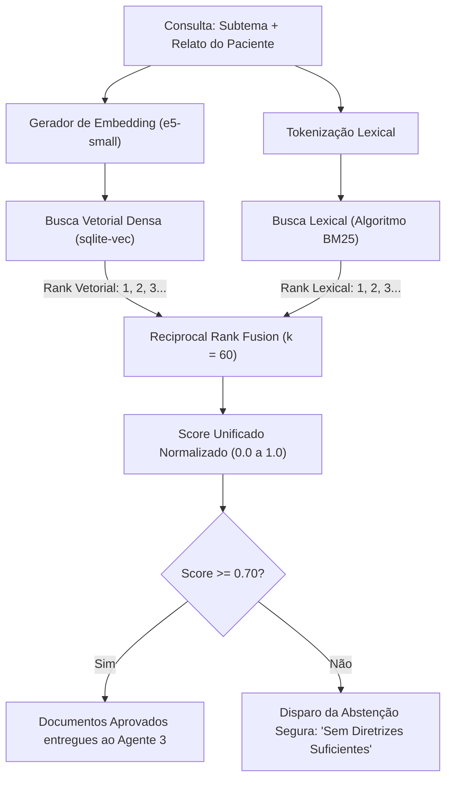

# Guia de Desenvolvimento: Pipeline de RAG e Busca Híbrida (BM25 + Vetorial com RRF)

## 1. Identificação e Propósito do Pipeline
* **Arquivo no Código:** `knowledge_base/hybrid_retriever.py`
* **Objetivo Primário:** Executar a recuperação precisa de trechos da literatura clínica autorizada (TCC de Beck, manuais de psicoeducação) combinando dois paradigmas complementares:
  1. **Busca Lexical (BM25):** Para correspondência exata de termos técnicos clínicos e palavras-chave específicas.
  2. **Busca Densa Vetorial (`multilingual-e5-small`):** Para capturar similaridade semântica entre linguagem coloquial de desabafo e terminologia médica.
  3. **Fusão de Ranks (RRF - Reciprocal Rank Fusion):** Para ponderar e unificar os dois rankings de forma não paramétrica e sem viés de escala.
* **Por que este componente existe?** Elimina os dois maiores riscos de IA em saúde mental: a perda de contexto clínico por vocabulário coloquial e a alucinação de condutas terapêuticas. Apenas documentos com alta relevância comprovada são passados ao Agente 3.

---

## 2. Diagrama da Recuperação Híbrida com Fusão RRF



---

## 3. Formulação Matemática do RRF

Para evitar que a escala de similaridade do cosseno seja incompatível com as pontuações do BM25, o método **Reciprocal Rank Fusion (RRF)** utiliza exclusivamente as posições ordinais dos itens:

$$RRF\_Score(d) = \frac{1}{60 + \text{rank}_{\text{BM25}}(d)} + \frac{1}{60 + \text{rank}_{\text{vetorial}}(d)}$$

Se um documento estiver no topo de ambos os rankings ($\text{rank} = 1$), sua pontuação combinada será máxima:
$$RRF = \frac{1}{61} + \frac{1}{61} \approx 0.0328$$

---

## 4. Implementação Completa do Recuperador Híbrido (`knowledge_base/hybrid_retriever.py`)

```python
import math
from collections import Counter
from typing import List, Dict, Any
from sentence_transformers import SentenceTransformer
from knowledge_base.vector_store import LocalVectorStore

class BM25Index:
    """Implementação limpa do algoritmo BM25 Okapi em Python puro."""
    def __init__(self, corpus: List[Dict[str, Any]], k1: float = 1.5, b: float = 0.75):
        self.corpus = corpus
        self.k1 = k1
        self.b = b
        self.doc_len = [len(self._tokenize(d["texto"])) for d in corpus]
        self.avg_doc_len = sum(self.doc_len) / len(self.doc_len) if self.doc_len else 0
        self.doc_freqs = []
        self.idf = {}
        self._initialize()

    def _tokenize(self, text: str) -> List[str]:
        return text.lower().replace(".", " ").replace(",", " ").split()

    def _initialize(self):
        df = Counter()
        for d in self.corpus:
            tokens = set(self._tokenize(d["texto"]))
            self.doc_freqs.append(Counter(self._tokenize(d["texto"])))
            for t in tokens:
                df[t] += 1

        total_docs = len(self.corpus)
        for term, freq in df.items():
            self.idf[term] = math.log(1.0 + (total_docs - freq + 0.5) / (freq + 0.5))

    def get_scores(self, query: str) -> List[float]:
        q_tokens = self._tokenize(query)
        scores = [0.0] * len(self.corpus)
        for i, doc_freq in enumerate(self.doc_freqs):
            d_len = self.doc_len[i]
            for t in q_tokens:
                if t in doc_freq:
                    freq = doc_freq[t]
                    numerator = self.idf.get(t, 0.0) * freq * (self.k1 + 1.0)
                    denominator = freq + self.k1 * (1.0 - self.b + self.b * (d_len / self.avg_doc_len))
                    scores[i] += numerator / denominator
        return scores


class HybridRetriever:
    def __init__(
        self,
        vector_store: LocalVectorStore,
        embedding_model_name: str = "intfloat/multilingual-e5-small",
        similarity_threshold: float = 0.70
    ):
        self.vector_store = vector_store
        self.embedder = SentenceTransformer(embedding_model_name)
        self.similarity_threshold = similarity_threshold
        self._refresh_bm25_index()

    def _refresh_bm25_index(self):
        """Carrega todos os documentos para manter o índice BM25 sincronizado em memória."""
        cursor = self.vector_store.conn.cursor()
        rows = cursor.execute("SELECT doc_id, titulo, autor, ano, secao, conteudo_chunk FROM clinical_documents").fetchall()
        self.docs_cache = [
            {
                "doc_id": r["doc_id"],
                "titulo": r["titulo"],
                "autor": r["autor"],
                "ano": r["ano"],
                "secao": r["secao"],
                "texto": r["conteudo_chunk"]
            }
            for r in rows
        ]
        if self.docs_cache:
            self.bm25 = BM25Index(self.docs_cache)
        else:
            self.bm25 = None

    def retrieve(self, query: str, top_k: int = 3) -> List[Dict[str, Any]]:
        if not self.docs_cache or not self.bm25:
            return []

        # 1. Busca Lexical com BM25
        bm25_scores = self.bm25.get_scores(query)
        ranked_bm25_indices = sorted(range(len(bm25_scores)), key=lambda i: bm25_scores[i], reverse=True)
        bm25_ranks = {self.docs_cache[idx]["doc_id"]: rank + 1 for rank, idx in enumerate(ranked_bm25_indices[:15])}

        # 2. Busca Vetorial Densa com e5-small
        query_dense = self.embedder.encode(f"query: {query}", normalize_embeddings=True).tolist()
        vector_results = self.vector_store.search_clinical_guidelines(query_dense, top_k=15)
        vector_ranks = {r["doc_id"]: rank + 1 for rank, r in enumerate(vector_results)}

        # 3. Reciprocal Rank Fusion (RRF)
        all_ids = set(bm25_ranks.keys()) | set(vector_ranks.keys())
        rrf_scores = {}
        for doc_id in all_ids:
            score = 0.0
            if doc_id in bm25_ranks:
                score += 1.0 / (60.0 + bm25_ranks[doc_id])
            if doc_id in vector_ranks:
                score += 1.0 / (60.0 + vector_ranks[doc_id])
            rrf_scores[doc_id] = score

        # 4. Ordenação e Filtro por Threshold de Relevância
        max_possible_rrf = (1.0 / 61.0) + (1.0 / 61.0)
        final_candidates = []
        
        doc_lookup = {d["doc_id"]: d for d in self.docs_cache}

        for doc_id, raw_rrf in sorted(rrf_scores.items(), key=lambda x: x[1], reverse=True)[:top_k]:
            normalized_score = raw_rrf / max_possible_rrf
            if normalized_score >= self.similarity_threshold:
                doc_data = doc_lookup[doc_id].copy()
                doc_data["score"] = round(normalized_score, 4)
                final_candidates.append(doc_data)

        return final_candidates
```

---

## 5. Como Testar a Recuperação Híbrida (`tests/test_rag.py`)

```python
import pytest
from unittest.mock import MagicMock
from knowledge_base.hybrid_retriever import HybridRetriever

def test_hybrid_retriever_rrf_scoring():
    mock_vector_store = MagicMock()
    mock_vector_store.conn.cursor().execute().fetchall.return_value = [
        {"doc_id": "D1", "titulo": "TCC", "autor": "Beck", "ano": 2021, "secao": "Cap 1", "conteudo_chunk": "técnica de respiração diafragmática para ansiedade"},
        {"doc_id": "D2", "titulo": "TCC", "autor": "Beck", "ano": 2021, "secao": "Cap 2", "conteudo_chunk": "reestruturação cognitiva de pensamentos automáticos"}
    ]
    mock_vector_store.search_clinical_guidelines.return_value = [
        {"doc_id": "D1", "distance": 0.1}
    ]

    retriever = HybridRetriever(vector_store=mock_vector_store, similarity_threshold=0.5)
    retriever.embedder = MagicMock()
    retriever.embedder.encode.return_value = MagicMock(tolist=lambda: [0.1]*384)

    results = retriever.retrieve("ansiedade e respiração", top_k=1)
    assert len(results) == 1
    assert results[0]["doc_id"] == "D1"
    assert results[0]["score"] >= 0.5
```

---

## 6. Referências Técnicas
1. **MDPI Retrieval-Augmented Generation (RAG) in Healthcare: A Review (2026):** Estudo comparativo entre busca lexical pura e busca híbrida RRF para textos clínicos.
2. **Cormack, Clarke & Büttcher:** *Reciprocal Rank Fusion Outperforms Condorcet and Individual Rank Learning Methods*. SIGIR.
