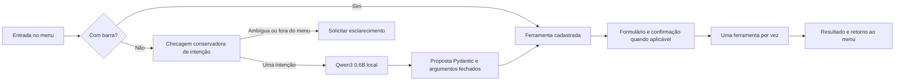

# Shell interativo: validação e limites

Implementação de 28/10/2026, Python 3.12. Execução: `uv run bem-estar`.
O shell é uma bancada de desenvolvimento com dados sintéticos.

## Arquitetura



O roteador não recebe o relato do formulário, o banco ou arquivos de configuração. Processos
filhos recebem variáveis essenciais do sistema e configuração do extrator, sem tokens herdados.
A extração usa a CLI existente em processo Python isolado, preservando o contrato clínico e
os códigos anteriores. Testes e avaliação também usam módulos fixos, nunca comandos do modelo.

Não há gravação de preferências ou conversa. Apenas a extração confirmada escreve no SQLite;
avaliações confirmadas gravam resultados/checkpoints em `results/`, que permanece ignorado.
Recusar ou interromper não desfaz um resultado já confirmado e gravado antes da interrupção.
Não se deve usar o histórico/scrollback do terminal como armazenamento de dados reais.

## Verificações automatizadas

- Propostas inválidas, ferramenta inexistente, argumentos extras e comandos arbitrários.
- Confirmação de dados sintéticos, confirmação de execução, recusa e reentrada para edição.
- Menu `/`, descrições, setas, Tab, Enter, Esc, Ctrl+C e EOF pelo PipeInput do prompt_toolkit.
- Formulários sem autocomplete: `/sair` dentro do relato continua texto literal.
- Unicode, CRLF, caminhos com espaços, arquivo ausente e histórico sem criar banco.
- SQLite somente leitura com paginação; regressão das CLIs e da avaliação do extrator.
- Interrupção/timeout do processo de testes sem escrita posterior por processo cancelado.
- Processos de avaliação com argumentos fixos e checkpoints reaproveitados pelo runner existente.
- Build com shell, dataset do roteador e datasets do extrator incluídos no wheel.

O workflow executa `uv sync --locked --python 3.12`, Ruff, pytest, smoke de entrada nativa e
build em Ubuntu, macOS e Windows. Todos os passos Windows usam `shell: cmd`. O smoke usa
Win32PipeInput no Windows e dados/modelos simulados, sem Ollama ou serviços externos.
Isso testa execução real no CMD do runner; não comprova a renderização em todo console físico.

## Modelo real, separado do CI

```text
uv run bem-estar-route-evaluate
```

O conjunto `evaluation/router_cases.jsonl` contém 24 pedidos inventados: 10 claros, 4 ambíguos,
4 compostos e 6 maliciosos. Os arquivos brutos ficam em `results/router-evaluation.json`, sem
copiar pedidos ao relatório. O campo `caminho` distingue decisão conservadora e chamada ao modelo.

No M1 local, Qwen3 0.6B inicialmente acertou 10/24 ferramentas (41,7%) quando usado sozinho:
os 10 pedidos claros. Nenhuma falha operacional, mas os 14 casos de recusa foram roteados
incorretamente. Isso motivou a checagem conservadora e a validação de compatibilidade da proposta.
Com essa checagem, o fluxo completo acertou 24/24 no mesmo conjunto de desenvolvimento:
10 chamadas ao modelo e 14 esclarecimentos antes do modelo. Esse resultado mede o sistema
híbrido, **não o modelo isolado**. A latência observada das chamadas ficou aproximadamente
entre 0,3 e 1,9 segundos; depende do carregamento, hardware e outros processos.

O conjunto foi usado durante desenvolvimento, não é holdout nem estimativa de generalização.
Palavras e paráfrases não reconhecidas podem exigir reformulação. As expressões conservadoras
não são um detector geral de ataques: a lista fechada, validação e confirmação continuam
obrigatórias. Um JSON válido também pode propor a ferramenta errada; o usuário deve conferir.
Não há evidência clínica produzida por esta avaliação.

Digest do roteador testado: `7df6b6e09427a769808717c0a93cadc4ae99ed4eb8bf5ca557c90846becea435`.

Demonstração local real: pedido “ver status do ambiente” → proposta `status` → confirmação →
consulta ao Ollama e ao banco → retorno ao prompt. O formulário `/extrair` também foi executado
com Qwen3 4B: resultado validado e salvo em SQLite local ignorado pelo Git (latência de cerca
de 8,4 s). Essa amostra demonstra integração, não qualidade clínica. O teste ocorreu em PTY
macOS automatizado, sem inspeção visual em Terminal.app.

## Verificação manual ainda necessária

A matriz de CI não substitui uma sessão com teclado físico em cada emulador. Conferir
visualmente menu, scrollback, colagem multilinha, cores/fonte e Ctrl+C durante inferência em:
Terminal.app macOS, um terminal Linux e CMD nativo/Windows Terminal. Não declarar esses testes
manuais concluídos só porque PipeInput e processos passaram no runner.
